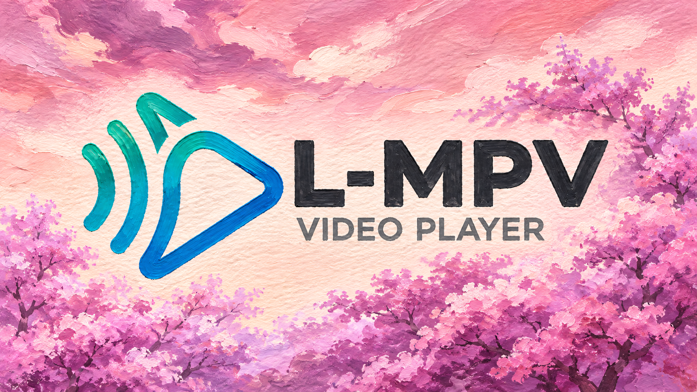
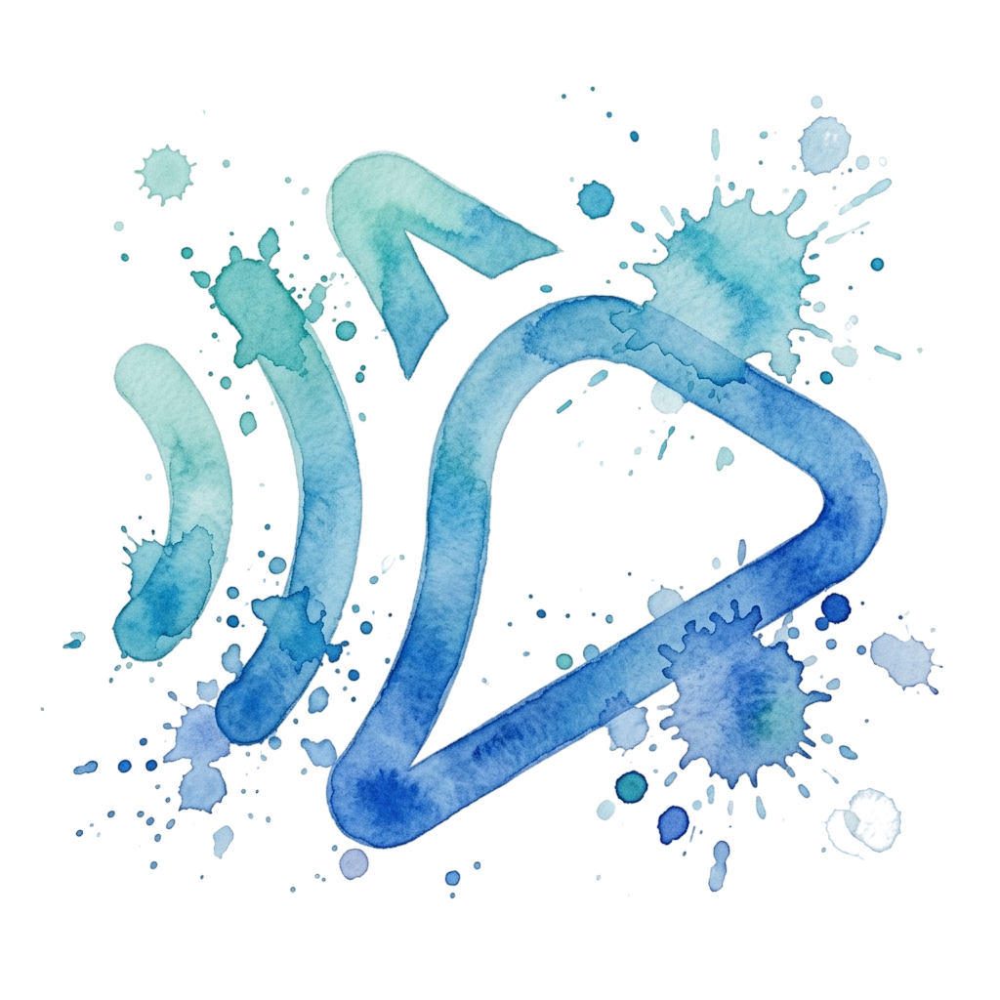
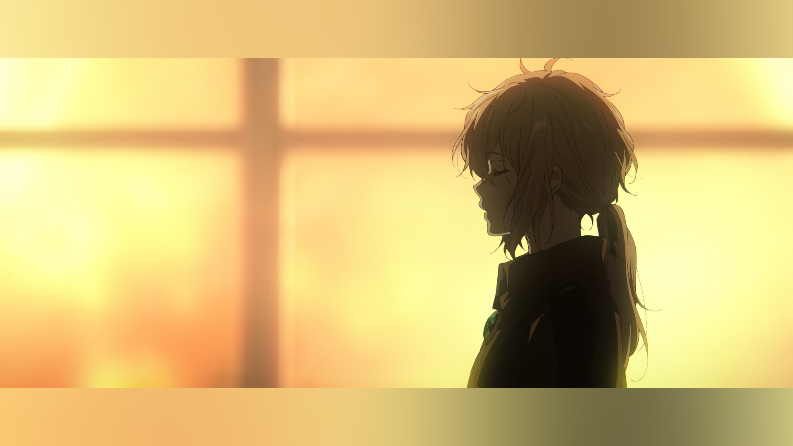
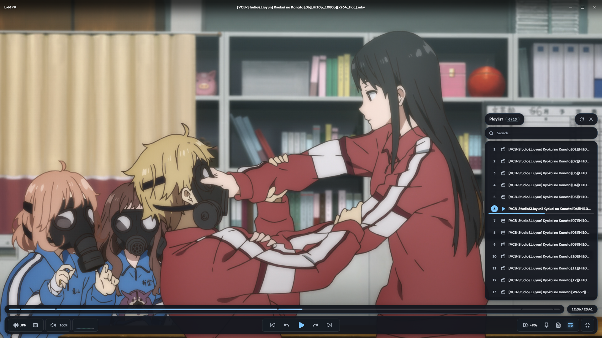
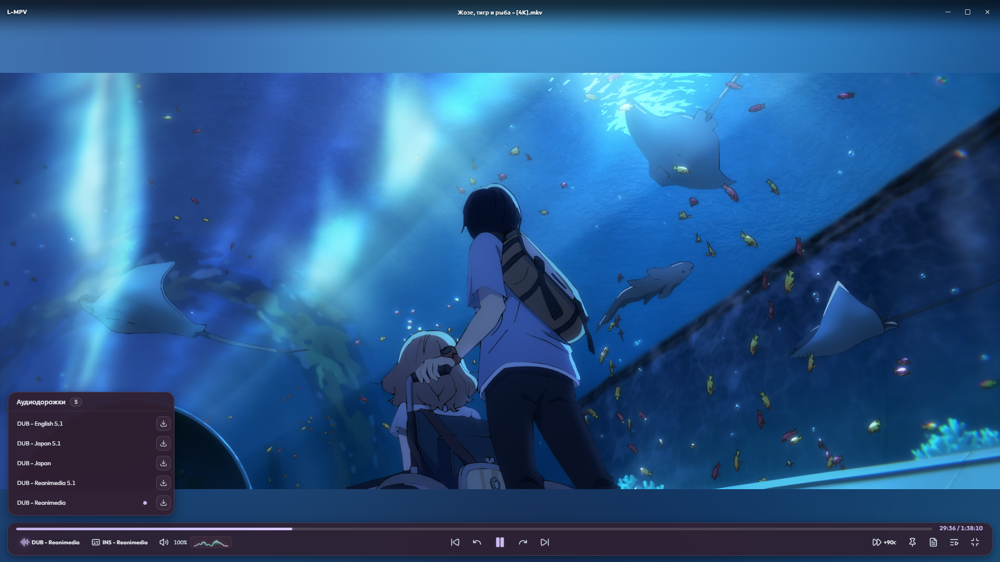
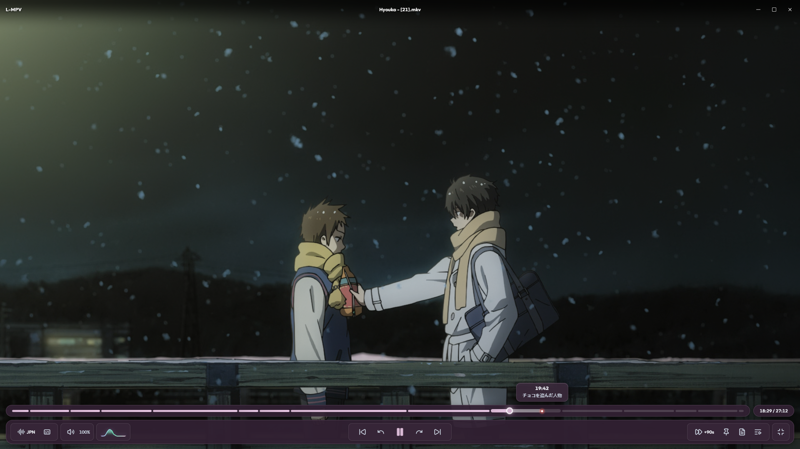
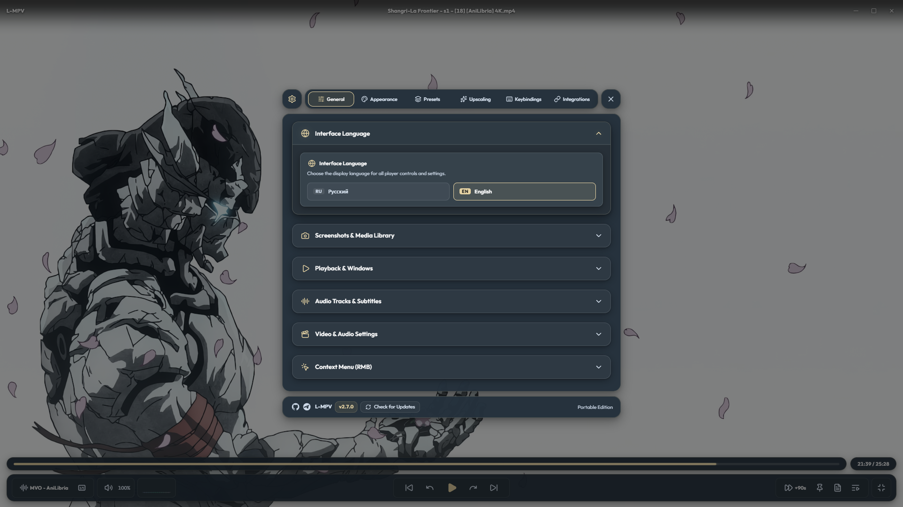
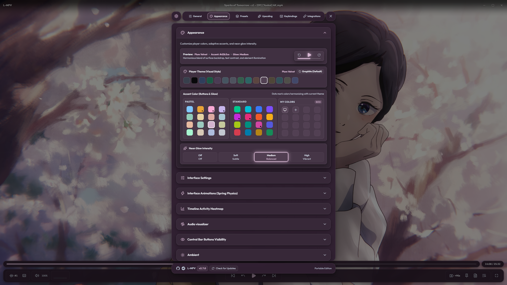
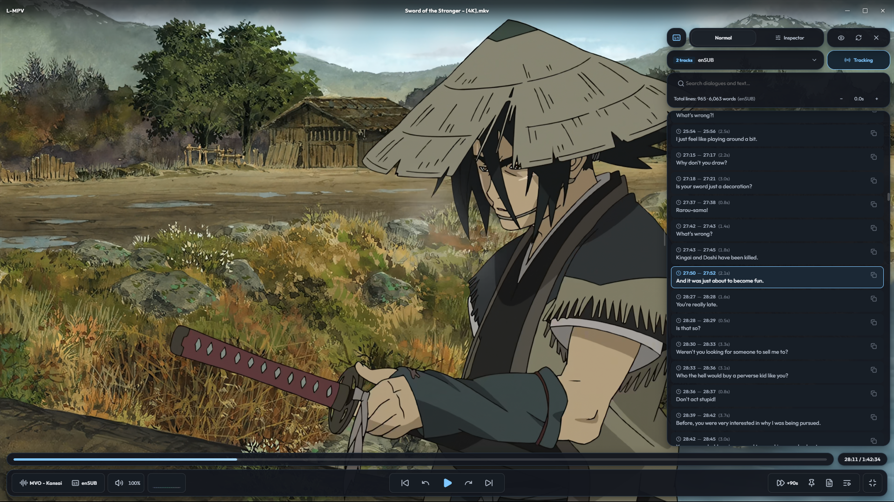
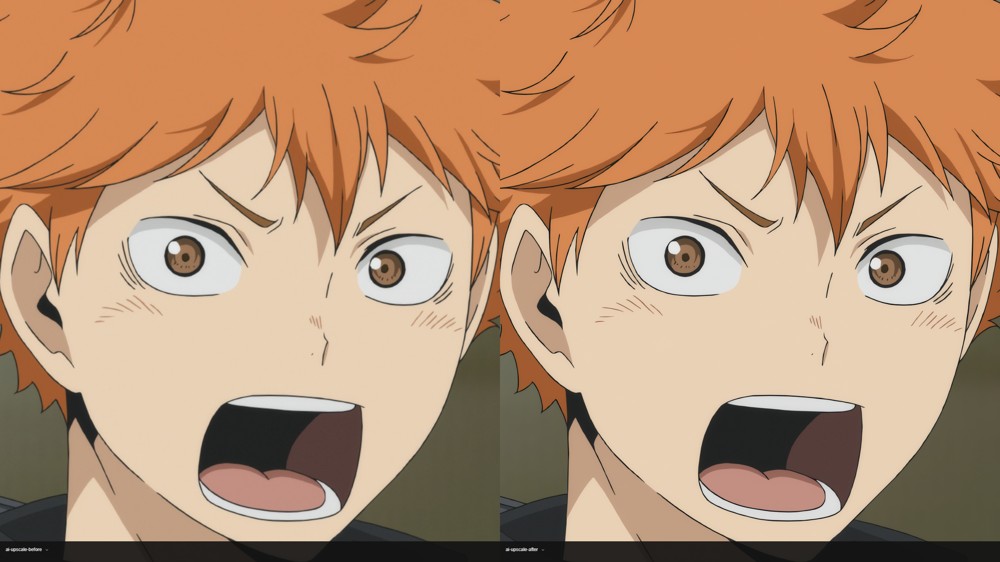

<p align="center">
  
</p>

<h1 align="center">  L-MPV — Modern & Portable Media Player</h1>

<p align="center">
  <b>A customizable media player for Windows.</b><br>
  Built on <b>Tauri v2</b>, <b>React 19</b>, <b>Direct3D 11</b>, and the native <b>libmpv</b> engine (C-FFI) with <b>Real-Time 4K AI Upscaling</b> support.
</p>

<p align="center">
  
  <a href="https://github.com/Menely/L-MPV/releases"></a>
  <a href="https://t.me/+_ngzHkrUNZs5YzQ6"></a>
  
  
  
  
  
  
  
  <a href="./LICENSE"></a>
</p>

<p align="center">
  <b>English</b> | <a href="README.ru.md">Русский</a>
</p>

---

## 🌟 About the Project

 **[L-MPV](https://t.me/+_ngzHkrUNZs5YzQ6)** is a modern desktop media player for Windows that brings together the playback capabilities of the native **MPV** video engine (`vo=gpu-next`, Direct3D 11, HDR tone-mapping, WASAPI, sinc resampling) and hardware-accelerated **Real-Time 4K AI Upscaling** (ONNX inference via DirectML and TensorRT) with a customizable **Glassmorphic** interface crafted in **React 19** and **TypeScript**.

L-MPV keeps its settings, cache, screenshots, ONNX models and native libraries in the application folder. WebView2 Runtime is required; AI components are downloaded separately. File associations and Explorer integration are optional.

<p align="center">
  
</p>

---

## 💖 Acknowledgements

The creation and ongoing evolution of **L-MPV** have been made possible thanks to open-source projects and their contributors:

- **[LANKETT](https://github.com/LANKETT)** — Thank you to the designer for creating the signature app icon and visual brand identity!
  - GitHub: **[@LANKETT](https://github.com/LANKETT)**
  - Telegram Channel: **[LANKETT WORK](https://t.me/lankett_work)**
- **[mpv](https://mpv.io/)** ([GitHub](https://github.com/mpv-player/mpv)) — For the flexible and high-performance native media engine.
- **[mpv-AnimeJaNai](https://github.com/the-database/mpv-AnimeJaNai)** & **[the-database](https://github.com/the-database)** — For the `vf_animejanai` video filter and real-time neural 4K upscaling implementation.
- **[Tauri](https://tauri.app/)** ([GitHub](https://github.com/tauri-apps/tauri)) — For the lightweight and performant framework powered by Rust and modern web technologies.
- **[dnd-kit](https://dndkit.com/)** ([GitHub](https://github.com/clauderic/dnd-kit)) — For the flexible and reliable Drag & Drop toolkit for React.

---

## 📸 Interface Screenshots

<table width="100%">
  <tr>
    <td width="50%" align="center">
      <b>🌌 Hardware Letterbox Illumination</b><br>
      <sub>Shader-based video edge blurring (Blur)</sub><br><br>
      <a href="./assets/ambient-light-demo.png"></a>
    </td>
    <td width="50%" align="center">
      <b>📑 Slide-out Playlist Drawer</b><br>
      <sub>Automatic directory scanning, filtering, and live search</sub><br><br>
      <a href="./assets/playlist-drawer.png"></a>
    </td>
  </tr>
  <tr>
    <td width="50%" align="center">
      <b>🎧 Track Management & 1-Click Export</b><br>
      <sub>Audio/subtitle switching and lossless extraction</sub><br><br>
      <a href="./assets/audio-window.png"></a>
    </td>
    <td width="50%" align="center">
      <b>🔖 Interactive Chapter Navigation</b><br>
      <sub>Chapter list with timestamps and active section highlight</sub><br><br>
      <a href="./assets/interface-chapter-player.png"></a>
    </td>
  </tr>
  <tr>
    <td width="50%" align="center">
      <b>⚙️ Settings Hub</b><br>
      <sub>Language selection, hotkeys, audio & subtitle controls, and context menu</sub><br><br>
      <a href="./assets/settings-general-player.png"></a>
    </td>
    <td width="50%" align="center">
      <b>🎨 Customization Suite</b><br>
      <sub>Accent color themes, 10 audio visualizer palettes</sub><br><br>
      <a href="./assets/settings-customization-player.png"></a>
    </td>
  </tr>
  <tr>
    <td width="50%" align="center">
      <b>💬 Interactive Subtitle Browser & Inspector</b><br>
      <sub>Full-text search, live speech tracking, and ASS inspector</sub><br><br>
      <a href="./assets/subtitled-window-player.png"></a>
    </td>
    <td width="50%" align="center">
      <b>⚡ Real-Time 4K AI Upscaling (Before & After)</b><br>
      <sub>Hardware-accelerated edge and texture reconstruction in real time</sub><br><br>
      <a href="./assets/ai-upscale.png"></a>
    </td>
  </tr>
</table>

---

## ✨ Key Features

<details>
<summary><b>🚀 Real-Time 4K AI Upscaling (Neural Anime & Video Upscaling)</b></summary>

<p align="center">
  
</p>

- **Native In-Stream Video Inference:** Deep integration of the `vf_animejanai` filter powered by the updated `mpv-AnimeJaNai 3.10.0` stack (`aji` v0.17.1 bridge, NVIDIA TensorRT 11.4.0.106, and DirectML DirectX 12), outputting real-time hardware-accelerated 4K Ultra HD frames.
- **Two Operational Modes:** A simple **"Off"** and **"AI Upscaling"** toggle in Settings (`F2`) — you decide when to engage neural enhancement.
- **Dual Inference Backends:**
  - **DirectML:** DirectX 12 inference for compatible AMD, Intel and NVIDIA GPUs. Model support and speed depend on the hardware.
  - **TensorRT:** Inference for supported NVIDIA GPUs, including architectures from `sm75` to Blackwell `sm120`.
- **Component Downloader ("Download Engine"):**
  - Identifies the GPU and selects matching libraries when you click Download or Update engine.
  - Live progress display (percentages, downloaded MBs), clean extraction status, and persistent 100% completion notice for 3 seconds.
  - Non-blocking background extraction via `spawn_blocking` in the background and no intrusive console popups.
- **TensorRT 1080p Precompilation (.engine):**
  - After a libmpv/runtime package change, old or unverified caches are flagged for rebuilding. Update engine and Rebuild actions require your click; libraries and stale caches are not updated automatically. ONNX models are retained. Loaded DLLs require restarting before replacement.
  - Background optimization of ONNX models for 1080p -> 4K upscaling with multi-stage phase tracking (ONNX parsing, CUDA tactics profiling, graph optimization, engine serialization).
  - Compiled with `trtexec.exe` using a 1080p input profile.
  - Precompilation can reduce startup delays for the matching model and input profile. Models can be recompiled from settings.
- **FP16 Conversion and Model Compatibility:**
  - FP32-to-FP16 conversion before compilation requires the bundled converter or Python with `onnx` and `onnxconverter-common`.
  - Model compatibility, output quality and performance depend on the model and inference backend.
- **Universal ONNX Model Library (`models/onnx/`):**
  - Add compatible AnimeJaNai `.onnx` models; arbitrary ONNX architectures are not supported.
  - **"Open Models Folder"** button to open the folder in Windows Explorer.
  - Toggle to hide or reveal model names (privacy dot masking).
  - Interactive drag-and-drop model reordering (`@dnd-kit/sortable`) via grab handles, automatically persisted in `config/models_order.json`.
  - Model keyboard and mouse bindings are edited in the Hotkeys tab; model cards do not contain binding controls.
- **On-the-Fly Neural Network Switching via Hotkeys (up to 9 models):**
  - `Ctrl+J` — Informative OSD overlay displaying upscale status and statistics (active backend, selected model, slot index, video resolution -> 4K);
  - **Favorite upscaling model:** Mark one model with a star and toggle it with `U`. The selection is saved with the portable settings and follows the model filename when the list is reordered. If no favorite is selected or its file is missing, the player shows a message.
  - `Shift+Backquote` — Disable upscaling (the key below Esc, also marked Ё on Russian layouts);
  - `Shift+1` .. `Shift+9` — Enable Neural Network #1 .. #9 (the first 9 models have hotkey slots);
  - OSD notification showing the actual name of the activated model;
  - Forced frame redrawing on pause when switching models.
  - Updates migrate the previous default shortcuts while preserving custom assignments and disabled actions.

</details>

<details>
<summary><b>🌍 Multilingual Interface (English / Russian)</b></summary>

- **Dual language support out of the box:** The entire interface is localized in English and Russian.
- **Live language switching:** Changing the language in settings takes effect immediately without restarting the player.
- **Automatic language detection:** The player automatically detects and applies your Windows system language on first launch (Russian for Russian-locale systems, English fallback for all others).
- **Bilingual Windows Installer:** The NSIS setup wizard supports language selection (English / Russian) with automated system locale preselection and fully localized dialogs.

</details>

<details>
<summary><b>⚡ Video Rendering (<code>vo=gpu-next</code>) & Adaptive Window Geometry</b></summary>

- **High-Quality Pipeline:** Powered by `vo=gpu-next`, native Direct3D 11 (`gpu-api=d3d11`), hardware decoding (`hwdec=auto-safe`), and perceptual gamut mapping (`gamut-mapping-mode=perceptual`).
- **Image Scaling:** Reference `scale=spline36` and `cscale=spline36` interpolation algorithms delivering image scaling and color interpolation.
- **HDR and tone mapping:** Automatic tone mapping and display color-space hints, with configurable HDR processing options.
- **Dithering & Debanding:** Adaptive spatial-temporal blue-noise dithering (`dither-depth=auto`) matched to your monitor bit-depth, and an optional GPU debanding shader (`deband`) with balanced strength presets to reduce visible gradient bands in anime and web rips.
- **Automatic window sizing:** Adapts window geometry to the video aspect ratio and monitor scaling. Fit mode, fullscreen and size constraints can still leave black bars.
- **Automatic zoom and pan reset:** Resets video zoom and pan when opening a new media file.
- **Startup:** When launched with a file, the player prepares it on pause, sizes and shows the window, then starts playback. An explicitly configured pause is preserved. Startup time depends on the file and system.
- **Native video output:** mpv renders to a Windows HWND beneath the transparent WebView2 interface.
- **YUV file recognition:** `.yuv` files appear in file selection and folder playlists and can use optional Windows associations. Raw-video parameters are not configured automatically.

</details>

<details>
<summary><b>🎵 Native Audio Visualizer (WASAPI Loopback Capture / FFT 1024)</b></summary>

- **Spectral Analysis:** Low-overhead system audio capture via Windows WASAPI Loopback Capture in a dedicated background Rust thread, running a 1024-point Cooley-Tukey Radix-2 FFT with a Hann smoothing window.
- **32 Frequency Bands:** Detailed 46.8 Hz per-bin resolution. Logarithmic band distribution spanning 25 Hz to 19,000 Hz with strictly monotonic grouping (sub-bass, punch, midrange/vocals, presence, brilliant highs).
- **5.1 / 7.1 surround downmix:** Includes the center and LFE channels when preparing audio for the visualizer.
- **Logarithmic display scale:** A -46 to 0 dB display range with frequency compensation. Visual gain compensation also depends on player volume.
- **9 Visualization Styles:** Including `Waveform` (multi-layered waves with dynamic spectral harmonics), `Spectrum` (32-band equalizer), and `Bars` (Apple Music / Spotify style rhythm capsules), among others.
- **Peak markers:** Peak hold and gradual decay show changes in the signal level.
- **Reduced background activity:** Audio capture stops while paused or inactive. The capture thread periodically checks whether it should resume.

</details>

<details>
<summary><b>🌌 Hardware Letterbox Blur (GPU)</b></summary>

- **Letterbox and pillarbox blur:** Fills unused areas around the video with a GPU-blurred background when the video and window aspect ratios differ.
- **2 Operating Modes:**
  - `Off` — Classic black letterbox bars;
  - `Blur` — Real-time hardware shader blur with smooth radius adjustment (5px to 150px);
- **Live preview:** Changes are previewed immediately; saving settings is debounced by 400 ms. The achieved frame rate depends on the hardware and video.
- **Quick Access:** Toggle on the fly via hotkey `B` (`Off → Blur → Off`), context menu (Right-Click), or the Settings panel.

</details>

<details>
<summary><b>🎧 Audio output and volume boost</b></summary>

- Windows WASAPI output with a configured 0.2-second audio buffer.
- Volume adjustment up to 150% and an optional peak limiter. Limiting and gain changes can alter the signal; bit-perfect output is not guaranteed.
- Audio device latency options to reduce missing audio at startup on some devices.
- **Volume indicator:** An optional scale below the screen center or a text OSD in the upper-left corner. Disabled by default; enable it under Video & Audio Settings → Audio Path, then use the OSD checkbox to select its appearance.
- Configured sinc resampling, normalized multichannel downmixing and pitch correction when changing playback speed.

</details>

<details>
<summary><b>🎧 Track Management & 1-Click Export (Track Popover & FFmpeg)</b></summary>

- **Ergonomic Track Popover Menus:** Compact audio and subtitle popover on the bottom control bar; fixed **320px** width prevents layout shifts and size jumps when switching between tracks with short or long titles; displays up to 7 tracks cleanly without scrolling, features smooth vertical scrolling for long lists, and automatically centers on the active stream on open.
- **Middle Truncation & Compact Indicators:**
  - `truncateMiddle` algorithm (35-character threshold) gracefully shortens oversized track names in the middle, keeping key beginning and ending identifiers intact (e.g., `Subtitles [Dubbing...FullHD].ass`), preventing CSS ellipsis right-edge clipping while full names remain accessible via hover tooltip;
  - Sleek vector micro-icon `ExternalLink` with tooltip replaces the bulky `EXT` text badge for loaded external tracks;
  - Expanded track title width limit up to 260–280px in fullscreen mode to show more of each title.
- **Adaptive Style-Matching Design:**
  - In **"Capsule"** style: Popovers feature floating cards: a header card with stream count badge and quick shortcut to Subtitle Search (`Ctrl+F`), a standalone card for quickly disabling subtitles, and a unified track list card;
  - In **"Modern"** and **"Classic"** styles: Elegant cohesive window with frosted glass backdrop;
  - Luminous active stream dots replace heavy checkmarks;
  - 1-click track export directly inside the menu;
  - Opening animations adapted to the selected interface style.
- **Subtitle & Audio Disabling (Mpv Property Alignment):** selecting "Disable Subtitles" reliably dispatches native mpv `sid: "no"` (`aid: "no"` for audio), optimistically clearing active UI tracks and displaying an informative OSD confirmation.
- **Track Titles (MP4 / MOV ↔ MKV):** Cascade metadata lookup (`title` → QuickTime/MP4 `metadata/name` from `udta/name` atom → `metadata/title` → `metadata/handler_name`). Track titles (e.g., "Dubbing", "Original Atmos") display consistently and accurately in MP4 and MOV files just like in MKV.
- **Track button controls:** By default, left-click cycles the track and right-click opens its selection menu. Keyboard shortcuts `A` and `V` cycle audio and subtitle tracks. Mouse bindings can be changed in settings.
- **1-Click Audio & Subtitle Export:** Integrated download buttons within the bottom bar popover and context menu (Right-Click).
- **Stream copy:** Extracts compatible audio and subtitle tracks without re-encoding. The time required depends on the file and storage speed.
- **Multi-Threaded Fallback (`-threads 0`):** Automatic transcoding for incompatible container formats (e.g., `mov_text` subtitle streams convert into `.srt`).
- **Direct Copy for External Files:** duplicates loaded external subtitles without invoking FFmpeg (with robust relative path resolution).
- **Flexible Output Paths:** Save extracted files alongside the video or choose any custom destination via Windows Explorer.
- **Animated Feedback:** Inline spinner inside the menu and a sleek progress status bar on the control panel.

</details>

<details>
<summary><b>💬 Interactive Subtitle Browser & Inspector (Searchable Subtitles Browser)</b></summary>

<p align="center">
  
</p>

- **High-Performance Native Rust Matroska (MKV / WebM) Parser:**
  - Extracts embedded ASS/SSA/SRT subtitle streams in Rust without decoding video frames. Analysis time depends on the file and its index.
  - Two-tier extraction architecture: ultra-fast index lookup via `Cues` table directly addressing subtitle clusters, and streaming seek-forward fallback over heavy video/audio blocks when `Cues` are absent;
  - Full `ContentEncodings` compression support: `zlib` stream decompression for styles headers and subtitle frames via `flate2`, and `Header Stripping` prefix reconstruction;
  - Authentic ASS/SSA document reconstruction preserving styles, coordinates, actors, layers, margins, and override tags, along with standard SRT;
  - Versioned `l_mpv_sub_v4` disk cache for repeat lookups without re-parsing.
- **Full-Text Search:** Real-time searching across the entire subtitle track with match highlighting, match counters, and quick navigation via `Up` / `Down` / `Enter`.
- **Interactive Jump to Timestamp:** Clicking any line immediately seeks playback to the exact dialogue timestamp.
- **"Follow Playback" Mode:** Automatically tracks the active line during playback in real time with smooth, adaptive rAF-driven auto-scrolling.
- **Dual Inspection Modes:**
  - *Standard (Text)*: Clean, formatted dialogue text free of formatting tags, showing start timestamp, duration, and character/actor name.
  - *Technical (ASS Inspector)*: In-depth parsing of Advanced SubStation Alpha tags (`[Ht]` HTML preview, `[Ae]` Raw ASS), complete style badges (style name, actor, font family, font size, HEX/BGR color, MarginV/Layer, coordinates, and override tags).
- **Fine Subtitle Delay Tuning:** Micro-adjust subtitle timing offsets in 50/100 ms increments directly from the search bar.
- **Quick Track Picker:** Switch between embedded and external tracks, load new `.srt`/`.ass` files, or disable subtitles in a single click.
- **Window geometry:** Resize the subtitle panel width, move it horizontally by its header and save the layout. Width also adapts to the inspection mode.
- **Adjustable Opacity (Glass / Solid):** Toggle between a translucent Glassmorphic backdrop and a solid high-contrast dark theme for optimal readability over vibrant scenes.
- **Modular Island Architecture & Ergonomic Hitboxes:**
  - Organized into 4 distinct floating surface islands ("Header", "Search & Timing", "Transcript List", "Inspector");
  - Enlarged click hitboxes (28px minimum) for match navigation arrows (`∧`, `∨`), search reset (`X`), and timing delay adjusters (`−`, `+`);
  - Harmonized border-radius styling for the "Standard / Inspector" mode switcher.
- **Subtitle virtualization:** Renders a window of subtitle rows to reduce the number of DOM elements in long tracks.
- **Speech Tokenizer & Tempo Metrics (Intl.Segmenter):** Text segmentation with native support for spaceless CJK languages (Japanese, Chinese), automated ISO 639 to BCP-47 locale normalization, real-time speech rate analysis (WPM — words per minute, CPS — characters per second), and color-coded speech tempo badges in the ASS inspector (relaxed, brisk, rapid).
- **Subtitle and Sign Rendering:** Rendering of stylized ASS/SSA subtitles, karaoke animations, and on-screen signs:
  - *Video-frame placement*: Subtitle margin settings keep rendering aligned with the video frame.
  - *Author styling*: `sub-ass-override=no` is the default; UI avoidance temporarily enables positioning without forcing replacement fonts or colors. Explicit ASS coordinates (`\pos`/`\move`) are preserved and may overlap the controls;
  - *UI avoidance*: ordinary text subtitles move above the visible controls using the selected style (Modern, Classic, Capsule), UI scale and window size; the previous position is restored when controls hide;
  - *Subpixel Precision & Typography (`sub-ass-hinting=none`, `sub-ass-shaper=harfbuzz`, `embeddedfonts=yes`)*: Unlocks HarfBuzz OpenType shaping, loads embedded MKV fonts, and disables FreeType hinting for subtitle rendering;
  - *Aspect Protection (`stretch-image-subs-to-screen=no`)*: Prevents PGS and VobSub bitmap subtitles from stretching during aspect ratio adjustments.

</details>

<details>
<summary><b>🎨 Interface, themes and custom fonts</b></summary>

- **Translucent Panels:**
  - **Interface Opacity (10..100%):** Precise opacity control for control bars, dialogs, and popovers while preserving text contrast and legibility.
  - **Borders and shadows:** Panel borders and shadows distinguish interface surfaces.
  - **Transparent panels:** The interface overlays native mpv output. CSS backdrop blur does not provide video-aware blur of that separate native layer.
- **15 UI Themes:** *Dark Graphite*, *Deep OLED*, *Night Cobalt*, *Dark Emerald*, *Black Orchid*, *Northern Mist*, *Discord Gray*, *Forest Sage*, *Mint Jade*, *Terracotta*, *Twilight Iris*, *Plum Velvet*, *Dark Bronze*, *Ink Ocean*, *Warm Titanium* with matching surface and text colors and customizable accents.
- **Settings controls:** Options share theme-aware highlights and corner styles. Selected options use an accent tint; hovering adds feedback without changing their size.
- **Unified Elevation Surfaces System:**
  - *Level 1 (`.glass-panel`)*: Main floating bars, dropdown menus, and modal dialogs.
  - *Level 2 (`.glass-section`)*: Grouping sections and functional settings containers.
  - *Level 3 (`.glass-tile`)*: Interactive option cards and model tiles with accent selection and hover feedback.
- **Self-Contained Font Ecosystem & Custom Fonts (UI Font):**
  - **Local fonts:** Bundled fonts load without requests to Google Fonts.
  - **5 Built-in Font Families:** *Inter*, *Outfit*, *Plus Jakarta Sans*, *Manrope*, *JetBrains Mono*, plus the Windows *System Default* font.
  - **Custom fonts:** Add `.ttf`, `.otf`, `.woff` or `.woff2` files to the `fonts/` folder next to `l-mpv.exe`.
  - **"Open Fonts Folder" Shortcut:** The folder icon button in the Fonts header opens the directory in Windows Explorer, and the available font list refreshes automatically upon regaining window focus.
  - Switch fonts under “Appearance”; the choice is saved and synchronized between windows.
- **Interactive Color Scheme Section:** Live authentic preview simulating player palette combinations, text contrast, and luminous element highlights.
- **Adaptive Neon Glow (Glow Intensity):** 4 illumination intensity tiers (*Off*, *Soft*, *Medium*, *Cyber Intense*) with vector `drop-shadow` diffusion and timeline backlighting.
- **Modular Color Picker Redesign & Precision Controls:**
  - Modular implementation across all 3 interface styles (*Modern*, *Classic*, and floating island *Capsule*);
  - Canvas spectral wheel with antialiasing and interactive hue ring accent;
  - Linear lightness gradient slider with exact percentage readout;
  - Quick-pick preset strip (10 curated shades) and dual comparison swatch (Current vs Original with 1-click revert);
  - Monospace numeric inputs with 1-click clipboard copy for both HEX and RGB values;
  - Persistent user palette (up to 15 custom colors) with seamless cross-tab synchronization.
- **Mathematical Control Bar Rhythm & Optical Centering:**
  - Strict 40px center-to-center grid rhythm and 22px visual gap across audio tracks, subtitles, and volume buttons;
  - Micro-optical compensation for circular Play/Pause button (`transform: translateX(1px)`) aligning the triangle centroid;
  - Standardized transport button scale (`size=18` for Repeat and Shuffle) and relaxed token spacing (`gap: var(--space-2)`) for Skip Opening;
  - Enhanced nested card opacity differentiation for Capsule mode (`--capsule-island-fill`);
  - First-line alignment for settings checkboxes and options with unified `SettingsIcon` slots.
- **Multi-Position Time Display (6 Layout Options):**
  - Choose your ideal timestamp layout in Settings (`F2`) or the Right-Click menu:
    - *Left of Timeline* — Classic position before the seek bar.
    - *Right of Timeline* — Standard placement after the seek bar.
    - *Right of Volume Slider* — Grouped in the left toolbar next to the audio visualizer.
    - *Right Toolbar Cluster* — Placed in the right button group before utility icons (expands timeline to full width).
    - *Centered Over Timeline* — A separate time badge above the seek bar, styled for Modern, Classic or Capsule.
    - *Window Titlebar* — Interactive time badge inside the top window header to the left of window controls; leaves the bottom control bar uncluttered.
  - Selecting any off-timeline position automatically expands the seek bar to span the full bar width (`.timeline-row--full`).
- **Playback Speed Control & Popover (v2.7.0):**
  - *Context-Aware Visibility*: The speed button dynamically surfaces in the right control group whenever playback speed differs from 1.0x (or can be permanently pinned via Settings).
  - *1-Click Interaction*:
    - **Left Click**: Rapidly cycles playback speeds (0.25x -> 0.5x -> 0.75x -> 1.0x -> 1.25x -> 1.5x -> 1.75x -> 2.0x);
    - **Right Click**: Opens the compact speed selection popover menu.
  - *Adaptive Style-Matching Architecture*:
    - In **"Capsule"** style: Displays as a standalone floating island card, with floating header islands and monolithic list card;
    - In **"Modern"** & **"Classic"** styles: Unified monolithic button and seamless frosted glass menu window.
  - *Luminous Radio-Dots*: Selected speed is indicated by an elegant neon dot matching the audio and subtitle track popover design language.
  - *Positioning & HiDPI Scaling*: Popover floats precisely centered above the speed button with mathematical zoom scaling normalization on 2K/4K and Fullscreen displays.
- **4 Interactive Time Formats with 1-Click Toggle:**
  - Supports: *Elapsed / Total*, *Elapsed / Remaining*, *Remaining Only*, and *Estimated End Time* (adjusted for playback speed).
  - Click directly on the timestamp anywhere in the UI to cycle through formats with an OSD confirmation.
- **Three Distinct Player Styles:**
  - **Capsule**: Modular interface built from independent floating cards:
    - *Independent Functional Islands*: Dedicated cards for streams (audio + subtitles), volume slider, playback controls, utilities, and fullscreen toggle;
    - *Floating Timeline & Time Card*: Seekbar and time badge float independently with soft backlighting; clicking the time card cycles time formats;
    - *Centered Playback Controls*: Play/pause and seek buttons stay strictly locked to the center of the window regardless of track label lengths;
    - *Multi-Tier Adaptive Layout*: Flexible island stations with overflow guards (`min-width: 0`), volume slider sizing (`flex-shrink: 0`), automatic switching of track buttons to clean 32×32 px icon-only mode when scaling down (`≤ 1080px`), and compact scaling of the toolbar audio visualizer, to fit controls into narrower windows.
  - **Modern**: Elegant floating unified pill with integrated seekbar and comfortable window margins.
  - **Classic**: Familiar full-width edge-docked control panel pinned to the bottom edge.
  - Interactive mini-previews under Settings (`F2` → "Appearance") for 1-click visual switching.
- **Ergonomic "Appearance" Tab Redesign:**
  - Global UI Opacity slider (10–100%) with seamless real-time reactivity across `--ui-opacity` and `--bg-glass` design tokens.
  - Responsive 3-column grid (collapses to 1 column on widths ≤ 480px): Corner Radius (2x2 cards + compact slider) | UI Scaling (2x2 cards + slider + "A" auto-scale toggle) | Typography (6 font options + custom user fonts with folder button).
  - Bottom section: Player Style with visual mini-previews (left) + compact grids for Time Position (3x2) and Time Format (2x2) (right).
- **Floating Quick-Control Pill & Default Button Suite:** Minimalist bottom toolbar with accent lighting and a configurable button set: audio tracks, subtitles, volume, previous/next file, seek backward/forward, play/pause, anime opening skip, always-on-top, screenshot, playlist drawer, and fullscreen.
- **Tabular numbers:** Equal-width digits help keep timestamps, bitrate values and counters aligned as values change.
- **Unified Kinetic Motion Tokens:** Standardized 5-tier duration system (`--t-instant`, `--t-fast`, `--t-base`, `--t-pop`, `--t-drawer`) and 4 curated cubic-bezier curves (`--ease-smooth`, `--ease-decelerate`, `--ease-accelerate`, `--ease-spring-smooth`), shared between CSS and TypeScript runtime.
- **Informative User-Facing Error OSD:** High-contrast coral-amber error notifications (`.frame-osd--error`) with a dedicated global API `showOsd(message, { isError: true })` for in-player diagnostics.
- **Subtle Vector Contour Glow (Vector Drop-Shadow):** Precise light diffusion wrapping vector SVG icons with smooth gradient falloff, avoiding muddy circular halos.
- **Container Query Responsiveness:** Responsive layout rules hiding verbose track labels and scaling down the audio visualizer and secondary controls on narrow windows.
- **Fullscreen Auto-Hide:** Option to immediately conceal all UI elements when moving the cursor near the top edge of the display.
- **Chromium & Web Platform Features:**
  - `scrollbar-gutter: stable` (CSS): Reserves scrollbar space where configured to reduce horizontal layout shifts.
  - Parent selector `:has()` (Chromium 105+): Dynamic styling of cards, toggles, checkboxes, and search containers responding to descendant states without superfluous React state or re-renders;
  - Scroll-Driven Animations (`animation-timeline: scroll()`, Chromium 115+): Fluid adaptive header drop-shadows as content scrolls, executed directly on Chromium's GPU compositor without JavaScript scroll event listeners.

</details>

<details>
<summary><b>⚙️ Settings Interface: Sidebar Panel or Modal Dialog</b></summary>

- **Two Form Factors, One Codebase:** Choose your preferred layout (Sidebar drawer or centered modal dialog) under "Appearance"; your selection is saved and applied immediately without restarting the player.
- **Context Preservation Across Layouts:** Active category, tab, expanded accordions, scroll position, and draft preset name persist when switching between Sidebar and Modal views.
- **UI Scaling:** Panel width is computed from actual window dimensions factoring in `UI Scale`, to account for display scaling.
- **Exclusive Single-Accordion Mode:** Expanding any settings category automatically and smoothly collapses sibling categories, maintaining a clean and focused workspace in both Sidebar and Modal layouts.
- **Adaptive Settings Grids & Clean Visuals:** Blocks dynamically collapse from three columns to single-column layouts on compact windows without label truncation. Accordion headers are free of distracting technical badges, and inner preview cards and color pickers adhere to concentric border radius geometry.
- **Reliable Vertical Scrolling:** Seamless, uninterrupted mousewheel and trackpad scrolling across all player styles (Capsule, Modern, Classic).
- **Video & Audio Settings Section:** Dedicated accordion in the General tab, laid out as four compact tiles in a two-column grid. *Frame Processing* (deinterlacing `no`/`auto`/`yadif`/`yadif2x`, hardware decoding `auto-safe`/`auto-copy`/`no`), *Audio Path* (peak limiter, volume normalization `dynaudnorm`/`loudnorm`, device latency fix), *Artifact Reduction* (debanding with strength presets: Light, Balanced, Strong), and *Data Buffer* (50–1024 MB). The icon lives on the tile only, and every segment block has a reset-to-default button plus a hover tooltip.

</details>

<details>
<summary><b>✨ Interactive Timeline: Neon Pulse Wave & Live Scrubbing</b></summary>

- **Segmented Chapter Hover Adaptation:** when hovering over a video with chapters, only the segment of the chapter under the cursor smoothly expands in height (from 5px to 8px) with vertical centering, while neighboring segments maintain their sleek default thickness. For single-chapter or non-chapter videos, the entire timeline expands uniformly as before.
- **Kinematic Neon Pulse Wave:** Compact glowing neon ring expanding from the click point along the progress track, styled to match the active player accent theme. Automatically suppressed when animations are disabled, so the ring can never linger over the control buttons.
- **Live scrubbing:** Pointer movement updates the preview position while dragging the timeline.
- **Preview and exact seeking:** Dragging uses keyframe preview seeks; releasing the pointer requests an exact seek to the selected position.
- **Release Position Calculation:** The final seek position is computed from a freshly measured track rectangle (invalidated on window resize), so auto window resizing can no longer misplace the playhead.
- **No Stray Focus Ring:** Clicking the timeline no longer leaves a green `:focus-visible` outline floating over the video; keyboard focus indication is preserved via the progress track growing from 5px to 8px.
- **Synchronized & Customizable Seek Step:** Control bar buttons and keyboard arrow keys (`←` / `→`) share a unified seek step (default 10 seconds; customizable between 1–300 seconds in Settings).
- **Seek overlay:** Shows the direction and configured duration with signed text and a directional ruler. Quick repeats in the same direction add up on screen.
- **Reliable Navigation Ergonomics:** Clicking the timeline no longer steals spacebar focus (resuming/pausing video works immediately on first press), and seeking via arrow keys avoids unwanted popup of hidden controls.
- **Centered Floating Time:** The badge matches the selected player style and keeps the full time format without increasing the control bar height.

</details>

<details>
<summary><b>📊 Timeline activity heatmap</b></summary>

- Audio RMS and peak levels in dBFS, or video bitrate with one-second detail.
- Audio is decoded with FFmpeg and analyzed in Rust. Video packets are analyzed without decoding frames, using a Rust reader for supported Matroska/WebM files and FFmpeg as a fallback.
- Six graph styles: bars, spline, blocks, filled relief, stepped contour and dotted relief. Eight palettes: Theme, Thermal, Cyberpunk, Monochrome, Sunset, Aurora, Ocean and Plasma.
- Adjustable height, opacity and placement above the timeline or control bar. Disabled by default; available in settings.
- Hover to see RMS/peak levels or average bitrate for the selected interval. Video bitrate uses a balanced scale and adapts the number of visible columns to the window width.
- Audio and video profiles are cached separately in `data/waveforms/audio/` and `data/waveforms/video_bitrate/`. BLAKE3 keys account for file metadata and track selection. Switching the source cancels outdated analysis.
- Settings include a preview and a cache-clearing button.

</details>

<details>
<summary><b>🔍 Hardware Zoom & Pan & Mouse Wheel Controls</b></summary>

- **Cursor-Centered Zoom:** Cursor-centered zooming via `Ctrl` + Mouse Wheel at up to 60 FPS.
- **Magnetic Snap:** Automatically snaps to native scale (100%) when approaching zero zoom.
- **Reset Zoom:** Return to 100% scale and center position with `0`.
- **Volume wheel control:** The wheel over video without Ctrl adjusts volume in 5% steps, up to 150%, and saves the level. When the indicator is enabled, wheel and keyboard changes display either a scale with 50/100% references or a text OSD.

</details>

<details>
<summary><b>🖥️ Fullscreen & Window Management</b></summary>

- **Fullscreen mode:** Native Windows window management is used for fullscreen playback.
- **Dynamic Z-Order Management (`handle_window_focus`):** When switching tasks (`Alt+Tab`), the player releases Topmost status so other applications open smoothly over it, and restores it immediately upon regaining focus.
- **Always on Top:** Keep the player window over other apps with hotkey `T` or the titlebar pin icon.
- **Application exit:** Closing the main player window saves playback history and exits the application.
- **Video Frame Scaling & Rotation:** Scale the frame in the window three ways — *Stretch to window size* (fills the window ignoring proportions), *Fit inside window* (whole frame visible, letterbox/pillarbox bars), *Fill screen and crop frame* (fills the window, edges cropped) — plus rotation by 0°, 90°, 180°, or 270°. The active mode is read back from mpv and marked in the context menu.
- **Aspect ratio lock:** Native Windows resizing keeps the selected aspect ratio when dragging window edges and corners. The ratio follows the video and defaults to 16:9 when idle.

</details>

<details>
<summary><b>📋 Clipboard Integration & Clean Screenshots</b></summary>

- **Frame to clipboard (`Ctrl+C`):** Copies the current video frame without the interface or OSD. The current implementation uses an intermediate JPEG file in the local `data/` folder.
- **PNG screenshots:** Save a video frame with `S` or the camera button. The output depends on the source and mpv screenshot settings.
- **Custom Directory:** Set a custom screenshots directory in Settings or reset to the local `screenshots/` folder.

</details>

<details>
<summary><b>📑 Playlist & File Navigation</b></summary>

- **Startup and buffering:** Playback starts without waiting for the entire buffer to fill. Read-ahead helps absorb brief storage slowdowns; if data runs out, the player waits for more and resumes. Background scanning and full heatmap analysis are deferred during file opening and yield to video reads during seeking or low-buffer conditions. Startup speed depends on the file and storage device.
- **Auto-Playlist with Natural Sort:** Opening a file automatically populates the playlist with all sibling media in the directory, ordered by natural human numerical sorting.
- **Slide-out Playlist Drawer (`L` / `P`):** Search, file filtering, active track highlighting, and one-click playback switching.
- **Adaptive Style-Matching Design:**
  - In **"Capsule"** style: The playlist drawer is separated into floating cards: a header badge with file count, action buttons, a seamless search bar, and an independent track list container;
  - In **"Modern"** and **"Classic"** styles: Features a cohesive frosted glass panel.
- **Playlist scrolling:** Search and playback indicators are displayed within a scrollable file list.
- **Elegant Active Media Marker:** A circular accent badge with subtle neon backlighting marks the currently playing file instead of heavy bounding boxes, ensuring text readability.
- **Drag & Drop:** Drop local media files into the player window.
- **Loop Modes & Shuffle:** Loop current file, loop entire playlist, or play in random order. The toolbar button and the *Repeat Mode* submenu share a single `set_repeat_mode` command that always sets both loop properties together; the submenu marks the active mode immediately and confirms the change with an OSD toast.
- **Watch Progress Bar (Netflix / YouTube Style):** Elegant bottom accent line under every playlist card reflecting saved playback progress (`get_watch_history_batch`). Fully watched episodes (ending reached) are marked with a dedicated `completed` flag, displaying a crisp green `CheckCircle2` badge and a completed progress line, with live progress tracking of the actively playing media.
- **Resilient Compact Geometry & Non-Compressing Items:** Playlist items strictly preserve vertical layout (`flex-shrink: 0; min-height: 38px`), providing smooth native vertical scrolling without vertical crushing or element collisions even in compact player windows.
- **Chapter Navigation:** Interactive chapters modal with timestamps and jump-to-chapter shortcuts.
- **Resume playback:** Saves the last playback position for up to 300 files in `config/history.json` and restores it when a file is reopened.
- **Windows Taskbar Progress:** Displays playback progress bars directly over the player's icon in the Windows taskbar.

</details>

<details>
<summary><b>💻 System Components, Diagnostics & Windows Integration</b></summary>

- **Native Runtime Diagnostics Dashboard:** Compact card-based overview of L-MPV Core (version, architecture, portable mode), `libmpv` (mpv version and `vf_animejanai` filter status), `FFmpeg` utility, and `MediaInfo` C-API library.
- **Neural Inference Monitoring (AnimeJaNai / aji):** Accurately surfaces installed runtimes (`TensorRT 11`, `DirectML`, `aji v0.17.1`), along with ONNX model and compiled `.engine` counters, avoiding false "Not installed" noise.
- **Hardware Acceleration (GPU):** Displays detected graphics hardware, dedicated video memory (VRAM), and compute microarchitecture (`sm120`, `sm89`, `sm86`, etc.).
- **Windows File Associations:** One-click registration for video and audio formats in the Windows Registry, safe unlinking, and shortcut to Windows Default Apps settings.
- **Explorer Context Menu:** Integrates “L-MPV MediaInfo” into the Windows Explorer right-click context menu for instant media analysis without launching playback.
- **Support Report Generation:** “Copy Report” creates a clean, structured diagnostic report including paths, versions, and hardware specs ready for GitHub Issues.
- **Real-Time Shell Log:** Dedicated color-coded terminal log tracking Windows integration events and errors.

</details>

<details>
<summary><b>⚙️ Hybrid Input Customization System</b></summary>

- **Full Hotkey Rebinding:** Configure keyboard shortcuts with modifiers (`Ctrl`, `Shift`, `Alt`) and mouse inputs (`MouseLeft`, `MouseRight`, `MouseMiddle`, `MouseLeftDoubleClick`).
- **Granular Actions:** Separate binds for cycling tracks via click vs. opening their respective selection popovers.
- **Per-Action Reset:** Individual "Reset to Default" button next to every action entry.
- **File Associations:** One-click registration in Windows Registry and shortcut to Windows "Default Apps" settings.

</details>

<details>
<summary><b>📊 Media Container Property Inspector (MediaInfo.dll C-API)</b></summary>

- **Native In-Memory Inspection:** Direct C-FFI binding to `mediainfo.dll` via `libloading` for extraction of video, audio, and subtitle streams without external command-line shells.
- **Independent Desktop Window (655×685 px):** The MediaInfo window moves freely across monitors beyond the main player; launches over the player (`Shift+F10`) with an Always-on-Top pin button (`alwaysOnTop`).
- **Recent report cache:** reopening the same unchanged file keeps its completed report on screen. Analysis runs again if the file changes or its report is no longer in the current process cache.
- **Standalone inspection ("Open with L-MPV MediaInfo"):** View file metadata from the Windows Explorer context menu without showing the main window or starting playback.
- **Style & Color Theme Harmonization:** MediaInfo fully adapts to the selected player style (Capsule, Modern, Classic) and automatically inherits the active color theme, even when opened directly from Windows Explorer. In Capsule mode, elements are organized into floating cards with balanced symmetry.
- **Interactive Stream Filter Tabs (Quick Filter):** Filter tracks (*"All"*, *"General"*, *"Video"*, *"Audio"*, *"Subtitles"*, *"Chapters"*) with informative stream count badges and 6px rounded pills matching the design system.
- **Collapsible Stream Accordions:** Collapse or expand individual streams or all at once ("Expand/Collapse All"), with auto-expansion during `Ctrl+F` search.
- **Native Drag-and-Drop:** Drop any media file straight into the open MediaInfo window with a translucent overlay (`FileUp`) for analysis.
- **Compact overlay (`I`):** Three tabs — Summary, Rendering and Tracks — selected by clicking or pressing `1` / `2` / `3`. Rendering shows process/system CPU and RAM, GPU and VRAM information, decoder, color, display refresh rate and A/V sync. Metric availability depends on the system and file; GPU utilization is not measured. The GPU shown is the adapter with the most dedicated memory and may differ from the one used for playback; VRAM usage is for the L-MPV process, not the whole system. Tracks lets you select audio and subtitles, disable the active track by clicking it again, and jump to chapters. The Summary video bitrate graph is smoothed, may fall back to metadata and includes illustrative fluctuations; it is not a raw packet measurement.
- **Productivity Features:** Property search with highlighting (`Ctrl+F`), export to `.txt`, copy to clipboard, and bilingual interface (EN/RU). Action buttons feature clean minimalist vector icons without redundant borders or text.

</details>

<details>
<summary><b>📁 Modular Presets System & Configuration Files</b></summary>

- **Five built-in styles:** Classic L-MPV (graphite / sky blue), Twilight Iris (indigo / pink), Midnight Cinema (OLED / amber), Quiet Titanium (titanium / silver) and Forest Jade (forest sage / mint). Each sets the theme, accent, toolbar style, font, corner radius, opacity and effects. The heatmap is disabled in all five.
- **Individual Preset Files (`config/presets/<name>.json`):** Every user preset is stored as an independent JSON file in the portable directory, preventing configuration collisions. Easily share, copy, and back up presets via Explorer.
- **Native Export & Import:** Windows Explorer system dialogs (`save` / `open`) to export presets anywhere on your drive or import shared community styles.
- **Quick Explorer Access:** The "Open Folder" button opens `config/presets/` in Windows Explorer with one click.
- **Live Auto-Synchronization:** Preset lists refresh whenever the player regains focus (e.g., after modifying `.json` files manually) or via the refresh button.

</details>

<details>
<summary><b>🖱️ Customizable Context Menu (Right-Click) & Drag-and-Drop Editor</b></summary>

- **Adaptive Style-Matching Design:**
  - In **"Capsule"** style: The main context menu forms sleek floating card islands matching the control bar and playlist aesthetic;
  - In **"Modern"** and **"Classic"** styles: The menu and submenus feature a classic cohesive frosted glass window.
- **Minimalist Radio-Dot Markers:** Active options and toggles across all menu styles feature clean accent dot indicators instead of cumbersome checkmarks and bulky outlines.
- **Menu text:** Menu appearance follows the selected font and interface style.
- **Scrollbar-Free Fluid Scrolling:** Long submenus hide the visible scrollbar while preserving mouse wheel navigation, featuring an ergonomic 10px spacing from the main menu (`SUBMENU_GAP`) and click-outside dismissal that keeps submenus open while toggling settings.
- **Control labels:** Buttons use accessible labels; some controls also show browser tooltips.
- **Interactive Drag-and-Drop Editor:** Visual layout customizer under Settings (`F2` -> "General" -> "Context Menu") powered by `@dnd-kit`, supporting dragging via grab handles or the entire card.
- **Context menu actions:** Audio and subtitle tracks, chapters, playback speed, frame fitting, rotation, letterbox blur, MediaInfo and appearance presets.
- **Dynamic Submenus:**
  - *"Style Presets"*: Browse user presets and pre-packaged styles with active indicators.
  - *"AI Upscaling"*: Quick toggle and model selector scanning `models/onnx/`.
  - *"Control Bar Buttons"*: Individual visibility controls for toolbar buttons, including seeking, playback speed and opening skip.
- **Reactive UI Opacity:** The context menu and submenus strictly inherit the global `--bg-glass` token and `--ui-opacity` setting, smoothly adapting their translucency to match the player's interface opacity slider.
- **Right-Click Toggle:** Right-clicking while the context menu is open cleanly closes it without awkward reposition flashes or redundant reopening.
- **Menu Dividers (`divider`):** Insert clean separator lines anywhere to organize your menu items.
- **Portable Storage (`config/context_menu.json`):** Custom menu layouts are stored locally in the player directory. A one-click "Reset" button restores default factory ordering at any time.

</details>

<details>
<summary><b>🛡️ Configuration storage and background tasks</b></summary>

- Configurable process priority and a Windows multimedia scheduling profile for video rendering. These settings cannot guarantee the absence of dropped frames.
- Settings, history, presets, context menu layouts and subtitle cache use temporary files and atomic replacement to reduce the risk of incomplete writes.
- Settings and context menu layout writes create rotating backups, keeping up to 10 versions per file. Backups are not enabled for every file type.
- FFmpeg tasks use process ownership and cancellation. External utilities have time limits: GPU queries (4 seconds), archive extraction (120 seconds) and TensorRT builds (15 minutes).
- TensorRT compilation is limited to one model at a time.

</details>

<details>
<summary><b>🔄 Update Integrity Verification & Seamless Rollback (BLAKE3 & Checksums)</b></summary>

- **Cryptographic Integrity Verification (BLAKE3):**
  - Automatically verifies hashes of downloaded binaries and libraries (`l-mpv.exe`, `libmpv-2.dll`, `mediainfo.dll`) on the fly, rejecting corrupted or partially downloaded assets before installation.
- **User-Facing `checksums.json` Manifest:**
  - Validated manifests are copied directly into the user's portable player directory upon update, as well as pre-packaged inside `L-MPV-v*-portable.zip`.
- **Built-in Legacy Hashes for Rollback (v2.0.0 – v2.5.6):**
  - BLAKE3 checksums for supported older releases are stored in `updater.rs` and used to verify files during rollback.
- **Renamed Executable Support:**
  - If the user renames the player executable (e.g. `L-MPV.exe`), the updater automatically syncs the binary name before replacing it, ensuring smooth in-place upgrades.

</details>

<details>
<summary><b>🎛️ Audio normalization and night mode</b></summary>

- **Dynamic normalization:** Uses `dynaudnorm` to reduce loudness differences between quiet and loud passages.
- **Night mode:** Uses an RMS compressor (`acompressor`) to reduce loud peaks. Its effect on dialogue depends on the recording level; speech is not detected separately.
- Normalization and the peak limiter can be enabled independently.
- Disabling both clears the player-managed `af` chain. Other audio processing, resampling and device settings may still affect the output.

</details>

---

## 📂 Project Structure

```text
L-MPV/
├── src/                          # React and TypeScript interface
│   ├── components/               # Player, settings, subtitles and dialogs
│   ├── contexts/                 # Shared player state
│   ├── hooks/                    # UI hooks
│   ├── i18n/                     # Russian and English translations
│   ├── styles/                   # CSS styles and themes
│   └── utils/                    # Settings and utilities
├── src-tauri/                    # Rust backend and Tauri configuration
│   ├── src/commands/             # Player commands and media analysis
│   ├── src/upscale/              # AI upscaling and its components
│   ├── src/mpv_manager.rs        # libmpv integration
│   ├── capabilities/             # Application permissions
│   ├── nsis/                     # Windows installer hooks
│   ├── Cargo.toml                # Rust dependencies
│   └── tauri.conf.json           # Windows, resources and build settings
├── assets/                       # Screenshots and artwork
├── scripts/                      # Checks and dependency packaging
├── docs/                         # Project documentation
├── .github/workflows/            # Build and release workflows
├── package.json                  # npm dependencies and commands
└── PROJECT_KNOWLEDGE.md          # Detailed project knowledge base
```

Detailed architecture and file descriptions: [Project knowledge](PROJECT_KNOWLEDGE.md).

---

<details>
<summary><b>⌨️ Default Hotkeys</b></summary>

Every keyboard shortcut and mouse button action can be customized to your preference in **Settings** (*Hotkeys*).

| Category | Action | Default Hotkey |
| :--- | :--- | :--- |
| **4K AI Upscaling** | Disable Upscaling | `Shift + Backquote` (key below Esc) |
| | Toggle the favorite model | `U` |
| | Enable Neural Model #1 .. #9 | `Shift + 1` .. `Shift + 9` (up to 9 models) |
| **Playback** | Play / Pause | `Space` or Left Click on video |
| | Repeat Mode (Loop) | `R` |
| | Shuffle Mode | Bottom bar shuffle button |
| **Seeking** | Seek backward / forward (10 sec, customizable) | `←` / `→` |
| | Seek buttons backward / forward (customizable) | `-10` / `+10` buttons on bottom bar |
| | Frame step backward / forward | `,` / `.` |
| **Audio** | Volume ±5% | `↑` / `↓` or Mouse Wheel over video |
| | Mute / Unmute | `M` |
| | Cycle Audio Track | `A` or left-click the audio button |
| | Audio Track Popover & Export | Right-click the audio button |
| **Subtitles** | Cycle Subtitle Track | `V` or left-click the subtitles button |
| | Subtitle Track Popover & Export | Right-click the subtitles button |
| | Interactive Subtitle Browser & Search | `Ctrl + F` |
| **Playback Speed** | Decrease / Increase Speed (±0.25x) | `[` / `]` |
| | Reset Speed to Normal (1.0x) | `Backspace` |
| **Interface & Window** | Toggle Fullscreen | `F`, `F11` or Double Left Click |
| | Always on Top | `T` |
| | Open Settings | `F2` |
| | Chapters Navigation | `C` |
| | Toggle Audio Visualizer | `W` |
| | Cycle Visualizer Style | `Shift + W` (9 styles) |
| | Rotate Video 90° | `Alt + R` |
| | Zoom & Pan Video | `Ctrl` + Mouse Wheel |
| | Reset Zoom to 100% | `0` |
| | Toggle Blur | `B` (cycles: Off → Blur → Off) |
| | Copy Current Frame to Clipboard | `Ctrl + C` |
| | Save Lossless Screenshot (PNG) | `S` |
| | Show Compact Video Info | `I` (bitrate with live Sparkline graph, color space, true source bit depth) — closes only via `X`, `Escape` or `I` |
| | Inspect MediaInfo Properties | `Shift + F10` |
| | Open Context Menu | Right Click on video |
| **Playlist & Files** | Toggle Playlist Drawer | `L` / `P` |
| | Previous / Next File | `PageUp` / `PageDown` |
| | Open File Dialog | `Ctrl + O` or `O` |

</details>

---

## 🚀 Building and running

These instructions target **Windows 10/11 x64** and PowerShell. Run all commands after cloning from the repository root. To use the player without building it, download a release from the [releases page](https://github.com/Menely/L-MPV/releases).

### Prerequisites

- **Git** to clone the repository.
- **Node.js 22.12+** with npm. Node.js 20 is also supported starting from 20.19.
- **Rust** installed through [rustup](https://rustup.rs/), using the stable `stable-x86_64-pc-windows-msvc` toolchain.
- **Microsoft C++ Build Tools** with the “Desktop development with C++” workload, x64 MSVC tools and a Windows SDK.
- **Microsoft Edge WebView2 Runtime** to display the interface.

Installation links are available in the [Tauri Windows prerequisites](https://v2.tauri.app/start/prerequisites/#windows). Reopen PowerShell after installing the tools.

### 1. Clone and install dependencies

```powershell
git clone https://github.com/Menely/L-MPV.git
Set-Location L-MPV
rustup toolchain install stable-x86_64-pc-windows-msvc
rustup override set stable-x86_64-pc-windows-msvc
npm ci
```

### 2. Native libraries

The files `libmpv-2.dll`, `ffmpeg.exe` and `mediainfo.dll` are not stored in Git. Download the package from the `deps-v1` release, also used by the project's automated build:

```powershell
New-Item -ItemType Directory -Force -Path src-tauri/binaries | Out-Null
Invoke-WebRequest -Uri "https://github.com/Menely/L-MPV/releases/download/deps-v1/mpv_libs.zip" -OutFile "mpv_libs.zip"
Expand-Archive -LiteralPath "mpv_libs.zip" -DestinationPath "src-tauri/binaries" -Force
Remove-Item -LiteralPath "mpv_libs.zip"

foreach ($name in @("libmpv-2.dll", "ffmpeg.exe", "mediainfo.dll")) {
    $nativeFile = Join-Path "src-tauri/binaries" $name
    if (!(Test-Path -LiteralPath $nativeFile) -or (Get-Item -LiteralPath $nativeFile).Length -eq 0) {
        throw "Missing or empty file: $nativeFile"
    }
}
```

If the download is unavailable, open the [deps-v1 release](https://github.com/Menely/L-MPV/releases/tag/deps-v1), download `mpv_libs.zip` manually and extract the three files directly into `src-tauri/binaries/`.

### 3. Run in development mode

Place the native libraries next to the debug executable so they can be found regardless of the working directory:

```powershell
New-Item -ItemType Directory -Force -Path src-tauri/target/debug | Out-Null
Copy-Item -Path "src-tauri/binaries/*" -Destination "src-tauri/target/debug/" -Force
npm run tauri -- dev
```

This starts Vite and the native Tauri window. The first run compiles Rust and downloads dependencies, which may take several minutes. Running `npm run dev` alone starts only the web interface; Rust/libmpv playback is unavailable in a regular browser.

AI components are optional for normal playback. To use upscaling, download an engine in the player settings and add a compatible ONNX model to `models/onnx/` next to the running `l-mpv.exe`. Performance depends on the GPU and model.

### Build and run the release version

```powershell
npm run build:exe
if ($LASTEXITCODE -ne 0) { throw "Build failed" }
Copy-Item -Path "src-tauri/binaries/*" -Destination "src-tauri/target/release/" -Force
& "./src-tauri/target/release/l-mpv.exe"
```

The executable is located at `src-tauri/target/release/l-mpv.exe`. Keep the native libraries next to it; settings and working data are created in the same directory. To move the player, copy the executable and the contents of `src-tauri/binaries/` into a separate writable folder.

To create an NSIS installer:

```powershell
npm run build:bundle
```

The installer is written to `src-tauri/target/release/bundle/nsis/`. Tauri may download packaging tools during the first build.

### Pre-release checks

```powershell
npm run build
cargo test --manifest-path src-tauri/Cargo.toml --locked
```

Vite may warn that the main JavaScript file exceeds 500 kB. This warning alone does not indicate a build failure.

---

## ☕ Support the Author / Tips

If you enjoy using **L-MPV** and would like to support ongoing development and feature expansion:

| Currency / Network | Wallet Address |
| :--- | :--- |
| 💵 **USDT (TRC-20)** | `TBXxG4qgXWfTHFAeHy2WkrPE4K82DsGn9d` |
| 🔷 **USDT (ERC-20)** | `0x14c3eac6b0629a7437e50dc5831b53c0d752b85c` |
| ⚡ **Bitcoin (BTC)** | `bc1qvy9wue3g5fnz02m4w33spj2njkq9lgahdnpxmc` |
| 💎 **Gram / TON** | `UQBwphj9gyFSAQ2mGx00Re6bTOSEuXOCj5Nb-g1egGz4_xVf` |

---

## 💬 Community & Support

Join our Telegram channels and community groups: <br>
<table>
  <thead>
    <tr>
      <th align="left">Russian</th>
      <th align="left">English</th>
    </tr>
  </thead>
  <tbody>
    <tr>
      <td>
        <a href="https://t.me/+45xNDoaEpHBjY2Qy">L-MPV (Russia)</a><br>
        <a href="https://t.me/+iiwyl0cV6uszYTZi">L-MPV Community (Russia)</a>
      </td>
      <td>
        <a href="https://t.me/+Mss1qF6c28o1MDgy">L-MPV (English)</a><br>
        <a href="https://t.me/+LAmGOlk5MXw4NDAy">L-MPV Community (English)</a>
      </td>
    </tr>
  </tbody>
</table>

---

## 📄 License

This project is licensed under the **GNU General Public License v3.0 (GPLv3)**. For complete terms and conditions, refer to the [LICENSE](./LICENSE) file.
