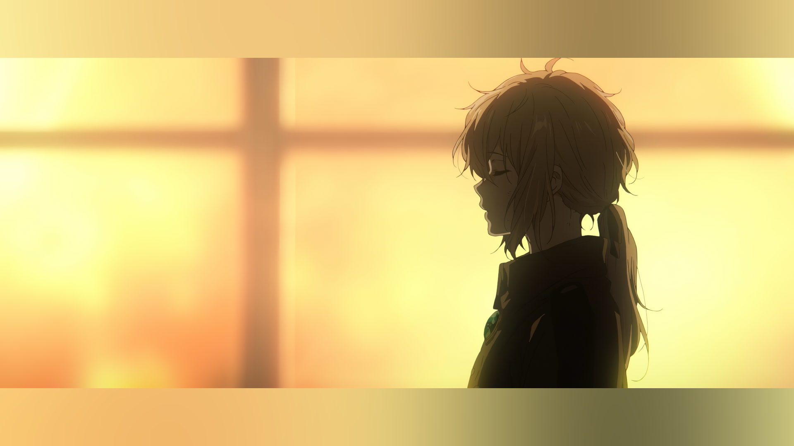
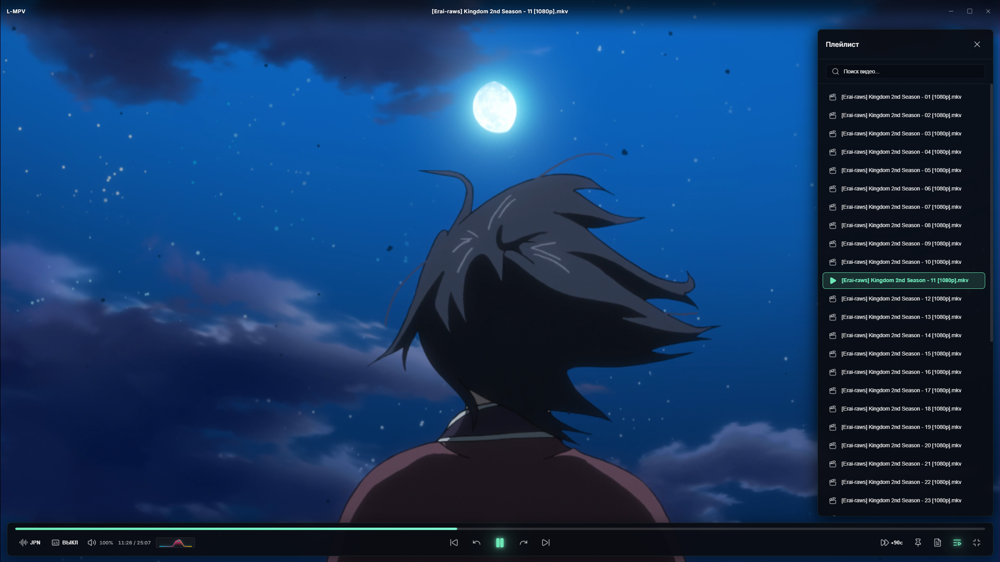
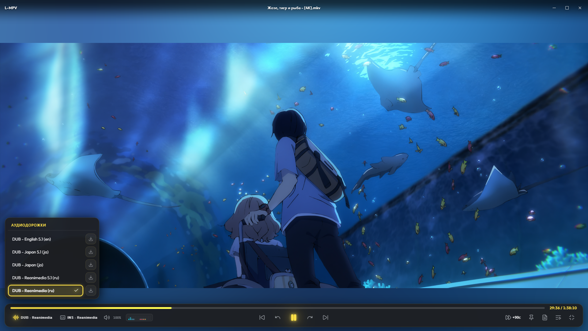
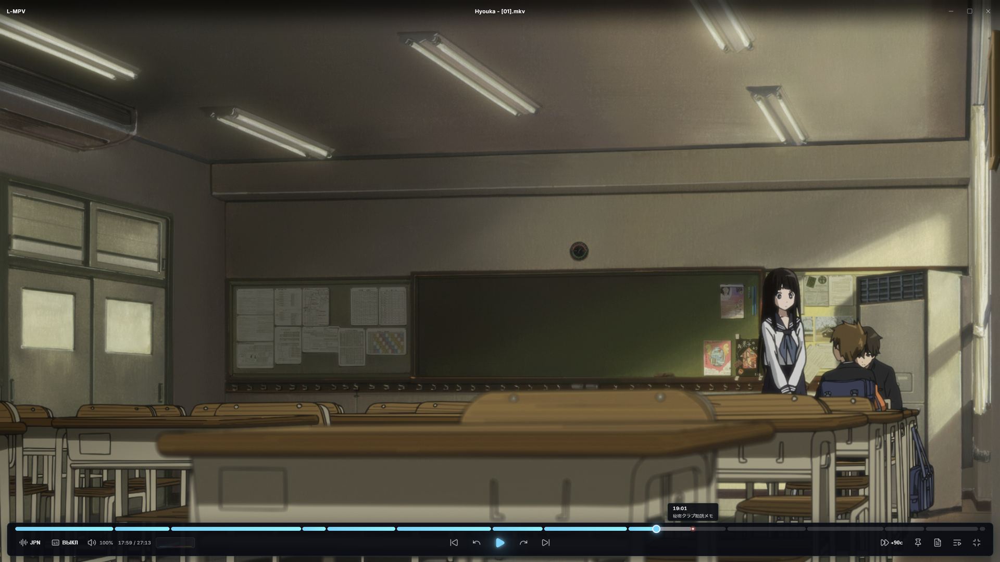
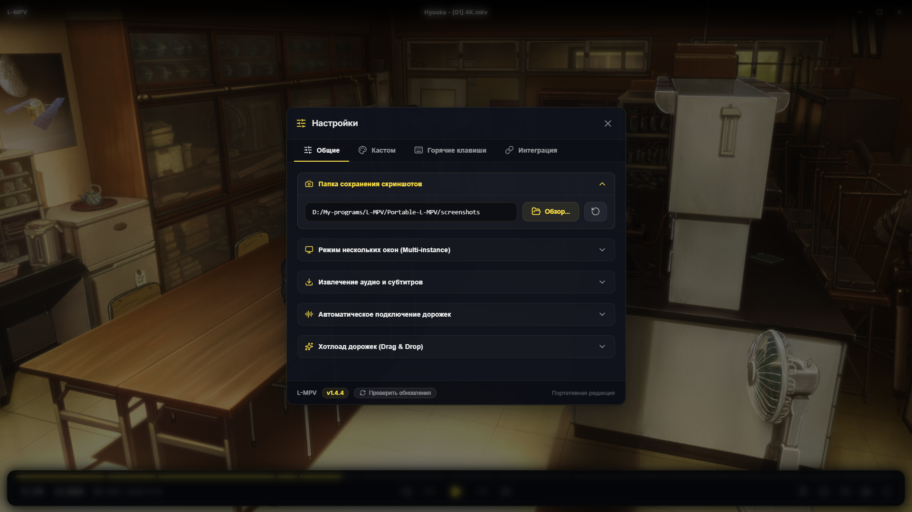
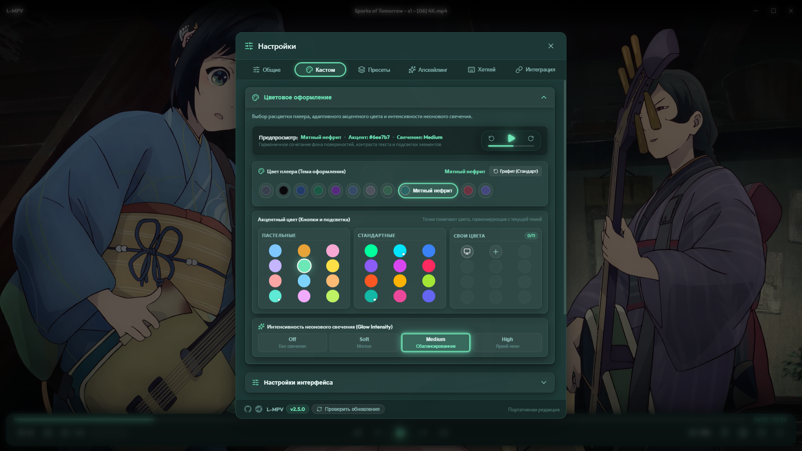
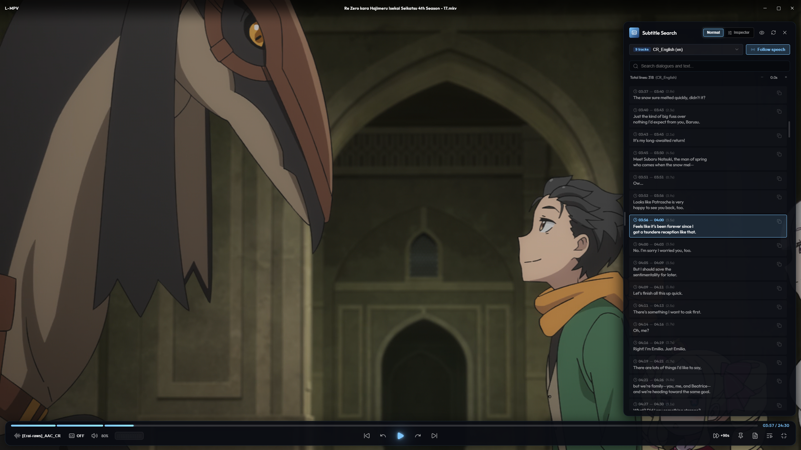
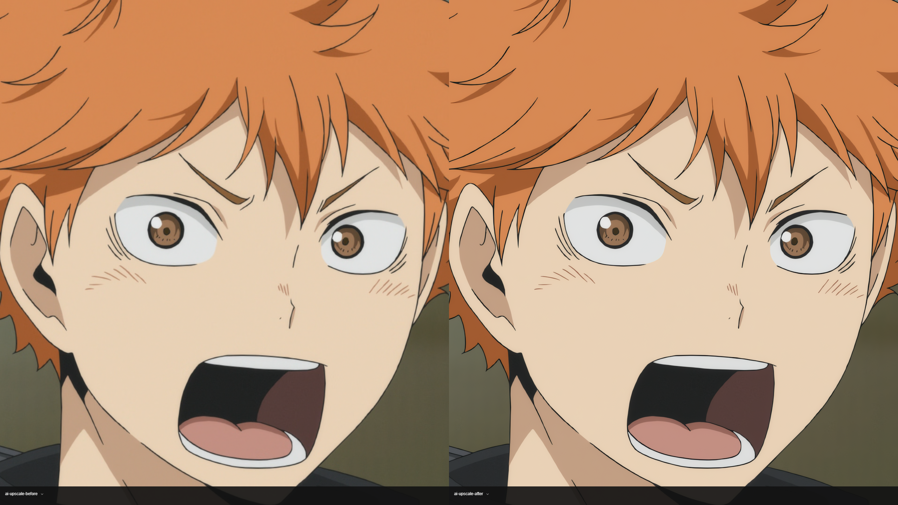

<p align="center">
  
</p>

<h1 align="center">  L-MPV — Modern & Portable Media Player</h1>

<p align="center">
  <b>Высокопроизводительный, эстетичный и портативный медиаплеер нового поколения.</b><br>
  Построен на базе <b>Tauri v2</b>, <b>React 19</b>, <b>Direct3D 11</b> и нативного движка <b>libmpv</b> (C-FFI) с поддержкой <b>Real-Time 4K AI Upscaling</b>.
</p>

<p align="center">
  
  <a href="https://github.com/Menely/L-MPV/releases"></a>
  <a href="https://t.me/+_ngzHkrUNZs5YzQ6"></a>
  
  
  
  
  
  
  
  <a href="./LICENSE"></a>
</p>

<p align="center">
  <a href="README.md">English</a> | <b>Русский</b>
</p>

---

## 🌟 О проекте

 **[L-MPV](https://t.me/+_ngzHkrUNZs5YzQ6)** — это современный настольный медиаплеер для Windows, объединяющий возможности нативного видеодвижка **MPV** (`vo=gpu-next`, Direct3D 11, HDR, WASAPI, sinc-ресемплинг), аппаратный **Real-Time 4K AI Апскейлинг** (ONNX инференс через DirectML и TensorRT) и настраиваемый интерфейс в стиле **Glassmorphism**, созданный на **React 19** и **TypeScript**.

Плеер спроектирован по концепции **True Portable Architecture (Zero-Install)**: он полностью автономен и не создает файлов в системных каталогах пользователя. Все конфигурации, кэш, скриншоты, папка ONNX-моделей (`models/onnx/`) и нативные библиотеки (`libmpv-2.dll`, `ffmpeg.exe`, `mediainfo.dll`) расположены непосредственно в каталоге приложения.

<p align="center">
  
</p>

---

## 💖 Благодарности

Создание и развитие медиаплеера **L-MPV** стало возможным благодаря открытым проектам и их авторам:

- **[LANKETT](https://github.com/LANKETT)** — благодарность дизайнеру за разработку фирменной иконки и визуального логотипа!
  - GitHub: **[@LANKETT](https://github.com/LANKETT)**
  - Telegram-канал: **[LANKETT WORK](https://t.me/lankett_work)**
- **[mpv](https://mpv.io/)** ([GitHub](https://github.com/mpv-player/mpv)) — за производительный и гибкий нативный видеодвижок.
- **[mpv-AnimeJaNai](https://github.com/the-database/mpv-AnimeJaNai)** & **[the-database](https://github.com/the-database)** — за видеофильтр `vf_animejanai` и реализацию нейросетевого 4K-апскейлинга в реальном времени.
- **[Tauri](https://tauri.app/)** ([GitHub](https://github.com/tauri-apps/tauri)) — за легковесный и производительный фреймворк на базе Rust и веб-технологий.
- **[dnd-kit](https://dndkit.com/)** ([GitHub](https://github.com/clauderic/dnd-kit)) — за современный и надежный набор Drag & Drop примитивов для React.

---

## 📸 Скриншоты Интерфейса

<table width="100%">
  <tr>
    <td width="50%" align="center">
      <b>🌌 Аппаратная Подсветка Полос</b><br>
      <sub>Шейдерное размытие краев видео (Ambient)</sub><br><br>
      <a href="./assets/ambient-light-demo.png"></a>
    </td>
    <td width="50%" align="center">
      <b>📑 Выдвижная Панель Плейлиста</b><br>
      <sub>Автоматическое сканирование каталога, фильтрация и живой поиск</sub><br><br>
      <a href="./assets/playlist-drawer.png"></a>
    </td>
  </tr>
  <tr>
    <td width="50%" align="center">
      <b>🎧 Управление Дорожками и Экспорт в 1 Клик</b><br>
      <sub>Быстрая смена аудио/субтитров и скачивание</sub><br><br>
      <a href="./assets/audio-window.png"></a>
    </td>
    <td width="50%" align="center">
      <b>🔖 Интерактивная Навигация по Главам</b><br>
      <sub>Список глав с таймкодами и подсветкой активной части видео</sub><br><br>
      <a href="./assets/interface-chapter-player.png"></a>
    </td>
  </tr>
  <tr>
    <td width="50%" align="center">
      <b>⚙️ Центр Настроек</b><br>
      <sub>Выбор языка, горячих клавиш, управление аудио, сабами и меню</sub><br><br>
      <a href="./assets/settings-general-player.png"></a>
    </td>
    <td width="50%" align="center">
      <b>🎨 Кастомизация</b><br>
      <sub>Акцентные цвета, 10 палитр аудио-визуализатора</sub><br><br>
      <a href="./assets/settings-customization-player.png"></a>
    </td>
  </tr>
  <tr>
    <td width="50%" align="center">
      <b>💬 Интерактивный Поиск и Окно Субтитров</b><br>
      <sub>Полнотекстовый поиск, следование за речью и ASS-инспектор</sub><br><br>
      <a href="./assets/subtitled-window-player.png"></a>
    </td>
    <td width="50%" align="center">
      <b>⚡Real-Time 4K AI Upscaling (До и После)</b><br>
      <sub>Аппаратная реконструкция линий и текстур в реальном времени</sub><br><br>
      <a href="./assets/ai-upscale.png"></a>
    </td>
  </tr>
</table>

---

## ✨ Ключевые Возможности

<details>
<summary><b>🚀 Real-Time 4K AI Upscaling (Нейросетевой Апскейлинг Аниме и Видео)</b></summary>

<p align="center">
  
</p>

- **Нативный инференс в видеопотоке:** интеграция фильтра `vf_animejanai` на базе `the-database/mpv-AnimeJaNai` и моста `aji.dll` с аппаратным выводом кадров в 4K Ultra HD в реальном времени.
- **Два режима работы:** переключатель **«Выкл»** и **«AI Upscaling»** в Настройках (`F2`) — пользователь сам решает, когда задействовать искусственный интеллект.
- **Два движка инференса (Backend):**
  - **DirectML:** универсальный инференс через DirectX 12 для любых видеокарт (AMD Radeon, Intel Arc/Iris, NVIDIA GeForce) с максимальной стабильностью.
  - **TensorRT:** максимальная скорость и частота кадров для видеокарт NVIDIA GeForce RTX (поддержка архитектур от `sm75` до новейшей Blackwell `sm120`).
- **Умный автозагрузчик компонентов («Скачать движок»):**
  - Автоматическое определение установленного GPU и скачивание точного набора библиотек.
  - Потоковая индикация процентов, объема (МБ), аккуратный статус распаковки и фиксация 100% готовности в течение 3 секунд.
  - Неблокирующая фоновая распаковка через `spawn_blocking` без зависаний UI и без всплывающих консольных окон.
- **Предварительная компиляция TensorRT 1080p (.engine):**
  - Фоновая оптимизация ONNX моделей под разрешение 1080p -> 4K с многоступенчатым отслеживанием фаз (разбор ONNX, тактики CUDA, оптимизация графа, сериализация).
  - Компиляция через нативный `aji_harness.exe` с точным соответствием динамических осей `dyn-HW` и оптимизационных параметров.
  - Устранение задержек при первом включении видео и поддержка перекомпиляции в один клик.
- **Автоматическая FP16-нормализация и поддержка моделей всех поколений (V1, V2, V3):**
  - Встроенный алгоритм аппаратной валидации и автоконвертации типов ONNX: модели в формате FP32 автоматически приводятся к стандарту IEEE Float16 перед компиляцией.
  - Полное устранение артефактов «радужного шума» и расхождения памяти шейдера: высокая четкость и чистота картинки как на компактных сетях V2, так и на тяжелых моделях V1 и HD V3 / V3Sharp1.
- **Универсальная библиотека ONNX (`models/onnx/`):**
  - Возможность использования любых сторонних моделей формата `.onnx`.
  - Кнопка **«Папка моделей»** для быстрого перехода в Проводник Windows.
  - Переключатель скрытия/отображения названий моделей (маскировка точками).
  - Интерактивное перемещение порядка моделей мышкой (`@dnd-kit/sortable`) за ручку захвата с сохранением в `config/models_order.json`.
  - Унифицированные компактные элементы управления в карточке модели единой высоты (24px) и парящие тени на фоне карточек.
  - Персональное назначение горячих клавиш и кнопок мыши в едином стиле вкладки хоткеев с отменой по Esc и клику вне.
- **Переключение нейросетей на лету по горячим клавишам (до 9 моделей):**
  - `Ctrl+J` — Информационный OSD-оверлей статуса и статистики апскейлинга (активный движок, выбранная модель, слот, разрешение видео -> 4K);
  - `Shift+1` — Выключить апскейлинг;
  - `Shift+2` .. `Shift+0` — Включить Нейросеть #1 .. #9 (поддержка до 9 моделей в библиотеке);
  - Мгновенное OSD-уведомление с отображением реального названия активированной модели;
  - Принудительная перерисовка кадра на паузе при смене модели.

</details>

<details>
<summary><b>🌍 Мультиязычный Интерфейс (Русский / English)</b></summary>

- **Два языка из коробки:** интерфейс полностью переведен на русский и английский языки.
- **Мгновенное переключение:** смена языка в настройках не требует перезапуска плеера, интерфейс переводится на лету.
- **Умное автоопределение:** плеер автоматически подхватывает системный язык вашей Windows при первом запуске (русский для русскоязычных систем, английский по умолчанию для всех остальных).
- **Двуязычный установщик Windows:** мастер установки NSIS поддерживает выбор языка (Русский / English) с автоматическим определением локали системы и полной локализацией диалогов.

</details>

<details>
<summary><b>⚡ Рендеринг Нового Поколения (<code>vo=gpu-next</code>) и Автоподгонка Окна</b></summary>

- **Высококачественный пайплайн:** рендерер `vo=gpu-next`, нативный Direct3D 11 (`gpu-api=d3d11`), аппаратное декодирование `hwdec=auto-safe` и перцептуальный gamut mapping (`gamut-mapping-mode=perceptual`).
- **Прецизионное масштабирование:** алгоритмы интерполяции `scale=spline36` и `cscale=spline36` для сохранения четкости деталей и плавности цветовых переходов.
- **Интеллектуальный HDR и тонемаппинг:** автоматическая передача метаданных в дисплей (`target-colorspace-hint=yes`), динамический расчет пиков яркости (`hdr-compute-peak=yes`), адаптивный сплайн сжатия динамического диапазона под капотом и точная контрастность теней (`hdr-contrast-recovery=0.0`) для сохранения оригинального авторского замысла.
- **Прецизионный дизеринг и устранение бандинга:** адаптивный пространственно-временной дизеринг с синим шумом (`dither-depth=auto`), согласованный с матрицей дисплея, и опциональный GPU-шейдер дебандинга (`deband`) со сбалансированными пресетами силы для устранения ступенчатых градиентов в аниме и пережатых веб-рипах.
- **Исключение Letterboxing (Zero Black Bars):** автоматический расчет физических чётных пикселей с точным соблюдением Display Aspect Ratio (DAR) видеопотока на базе масштабного коэффициента монитора. Окно центрируется на экране через нативный вызов `appWindow.center()` без черных полос сверху и снизу.
- **Автоматический сброс зума и панорамирования:** гарантированное обнуление параметров `video-zoom` и `video-pan` при открытии каждого нового медиафайла.
- **Zero-Flicker жизненный цикл и мгновенный запуск (< 1-2 с):** окно создается в скрытом режиме, мгновенно считывает геометрию из демуксера контейнера, рассчитывает истинный Display Aspect Ratio, центрируется и отображается (`window.show()`) без задержек и мерцания.
- **Прямой вывод в окно:** видеопоток отрисовывается в нативный Win32 HWND через C-FFI с нулевой задержкой под полностью прозрачным DOM-слоем WebView2 (`transparent: true`).

</details>

<details>
<summary><b>🎵 Нативный Аудио-Визуалайзер (WASAPI Loopback Capture / FFT 1024)</b></summary>

- **Студийный спектральный анализ:** нативный захват системного звука через Windows WASAPI Loopback Capture в фоновом Rust-потоке с вычислением 1024-точечного БПФ (Cooley-Tukey Radix-2 FFT) со сглаживающим окном Ханна.
- **32 студийные частотные полосы:** детальное частотное разрешение 46.8 Гц на бин. Логарифмическое распределение от 25 Гц до 19 000 Гц со строгой монотонностью полос (суб-бас, панч, вокал, презенс, кристальный верх).
- **Сведение 5.1 / 7.1 Surround для кино:** интеллектуальное подмешивание низкочастотного канала сабвуфера (LFE) и центрального канала голоса — любые взрывы, стрельба и спецэффекты вызывают мощную динамическую реакцию!
- **Логарифмическая шкала в децибелах (dBFS):** динамический диапазон от -46 dB до 0 dB с частотной компенсацией спада розового шума (+0.75 dB/полоса) и отвязкой от уровня громкости плеера.
- **9 стилей визуализации:** такие как `Waveform` (многослойная волна с динамическими спектральными гармониками), `Spectrum` (32-полосный эквалайзер) и `Bars` (ритм-капсулы Apple Music / Spotify style) и так далее.
- **Студийная баллистика и физика пиков (Peak Hold & Drop):** мгновенная атака за 1 кадр и плавное опадание светящихся пиковых маркеров с ускорением свободного падения.
- **Нулевая нагрузка на процессор (0.0% CPU):** при паузе, сворачивании, отключении или в IDLE-режиме (когда элементы управления скрываются) поток захвата уходит в глубокий сон без обращения к WASAPI.

</details>

<details>
<summary><b>🌌 Аппаратная Подсветка Полос (Ambient Light / GPU Blur)</b></summary>

- **Устранение черных полос:** при несовпадении пропорций видео и монитора (21:9 на 16:9, 4:3, нестандартные форматы) края видеокадра аппаратно проецируются и размываются в областях letterbox и pillarbox на базе шейдеров `libplacebo` без нагрузки на процессор.
- **3 режима работы:**
  - `Off` — классические черные полосы;
  - `Blur` — аппаратное шейдерное размытие кадра в реальном времени с плавной регулировкой радиуса (от 10 до 150 px);
  - `Color` — мягкая заливка акцентным цветом плеера (включая системный цвет Windows Accent) или кастомным оттенком HEX.
- **Производительность 60 FPS:** мгновенный GPU-предпросмотр (`apply_ambient_preview`) без блокирующего дискового ввода-вывода с дебаунсом сохранения на диск (400 мс).
- **Быстрое управление:** переключение по горячей клавише `B` (`Off → Blur → Color → Off`), в контекстном меню (ПКМ) и в Настройках.

</details>

<details>
<summary><b>🎧 Студийный Аудиофильский Звук и Усиление до 150% (Audiophile Profile)</b></summary>

- **Низколатентный вывод:** нативный драйвер Windows WASAPI (`ao=wasapi`) с оптимизированным буфером 0.2 с.
- **Пиковый лимитер звука (Zero Clipping):** прозрачный лимитер `af=lavfi=[alimiter=limit=0.98]` для мягкого сжатия пиков без хрипов и перегруза при громкости 101–150%. На 100% громкости звук прозрачен (бит-в-бит).
- **Устранение задержки аудиоустройств:** связка `audio-stream-silence=yes` и `audio-wait-open=0.25` исключает проглатывание первых долей секунды звука на засыпающих внешних ЦАП и Bluetooth-колонках без лагов перемотки (`audio-buffer=0.2`).
- **Софтверный буст громкости (до 150%):** возможность усиления тихих аудиодорожек до 150% без искажений и клиппинга (`volume-max=150.0`).
- **Студийный 32-точечный sinc-ресемплинг:** фильтр `audio-resample-filter-size=32`, 16 384 фазы сдвига (`audio-resample-phase-shift=14`) и линейная интерполяция между отсчетами (`audio-resample-linear=yes`).
- **Нормализованный даунмикс:** автоматическое безопасное сведение многоканального аудио 5.1/7.1 в стерео (`audio-normalize-downmix=yes`) с аппаратной защитой от перегрузок и клиппинга.
- **Коррекция тона:** сохранение естественной высоты тона звука при изменении скорости (`audio-pitch-correction=yes`, scaletempo2).

</details>

<details>
<summary><b>🎧 Управление Дорожками и Экспорт в 1 Клик (Track Popover & FFmpeg)</b></summary>

- **Эргономичное меню выбора дорожек:** всплывающее меню аудио и субтитров на нижней панели плеера с ограничением высоты ровно под 7 дорожек, плавным вертикальным скроллом без лишних полос прокрутки (`scrollbar-width: none`) и автоскроллом к активному потоку при открытии.
- **Модульный островной дизайн в стиле «Капсула»:**
  - Парящая независимая шапка с бейджем количества дорожек и кнопкой быстрого перехода к полнотекстовому поиску субтитров (`Ctrl+F`);
  - Функция **«Выключить субтитры»** вынесена в отдельную самостоятельную парящую карточку-островок над списком дорожек;
  - Монолитный общий стеклянный островок списка дорожек без визуального шума и летающих отдельных микро-плашек;
  - Встроенная аккуратная кнопка прямого скачивания через FFmpeg и светящаяся неоновая точка активной дорожки справа;
  - Концентрические скругления элементов по формуле $R_{\text{inner}} = \max(0, R_{\text{outer}} - d)$;
  - Автоматический возврат фокуса клавиатуры на кнопки открытия при закрытии всплывающего окна дорожек.
- **Безотказное отключение субтитров и звука (Mpv Property Alignment):** при клике на «Выключить субтитры» в MPV гарантированно отправляется нативная команда отключения `sid: "no"` (для аудио `aid: "no"`), оптимистично сбрасывая состояние в интерфейсе и отображая OSD-уведомление `«Субтитры: Выкл»`.
- **Полный паритет названий дорожек (MP4 / MOV ↔ MKV):** каскадный опрос свойств (`title` → `metadata/name` из атома `udta/name` QuickTime/MP4 → `metadata/title` → `metadata/handler_name`). Названия дорожек (например, «Дубляж», «Original Atmos») теперь отображаются одинаково детально и понятно как в контейнерах MKV, так и в MP4/MOV файлах.
- **Удобное управление дорожками:** клик ЛКМ по иконкам аудио и субтитров циклически переключает активные потоки, а клик ПКМ открывает аккуратное всплывающее меню со списком доступных дорожек и кнопками экспорта.
- **Экспорт звука и субтитров в 1 клик:** встроенные кнопки скачивания в меню аудиодорожек и субтитров на нижней панели и в контекстном меню (ПКМ).
- **Direct Stream Copy (`-c copy`):** мгновенное извлечение без перекодирования и без малейшей потери исходного качества за считанные секунды.
- **Умный многопоточный фоллбек (`-threads 0`):** автоматическая конвертация несовместимых кодеков (например, субтитры `mov_text` автоматически конвертируются в формат `.srt`).
- **Прямое копирование внешних файлов:** мгновенное копирование уже подключенных внешних субтитров без обращения к FFmpeg.
- **Гибкие пути сохранения:** возможность автоматического сохранения рядом с видеофайлом либо через системный проводник.
- **Анимированная индикация:** спиннер в меню и статусная строка прогресса на панели управления.

</details>

<details>
<summary><b>💬 Интерактивный Поиск и Окно Субтитров (Searchable Subtitles Browser)</b></summary>

<p align="center">
  
</p>

- **Мгновенный полнотекстовый поиск:** живой поиск по всей дорожке субтитров с моментальной подсветкой совпадений, счетчиком найденных реплик и быстрой навигацией клавишами `Вверх` / `Вниз` / `Enter`.
- **Интерактивная навигация и переход:** клик по любой строке диалога мгновенно перематывает воспроизведение на точный таймкод фразы.
- **Режим «Следить за речью» (Follow Playback):** автоматическое отслеживание произносимой реплики во время воспроизведения в реальном времени с адаптивным плавным автоскроллом (rAF-цикл).
- **Два режима отображения:**
  - *Обычный (Текст)*: чистый отформатированный текст диалогов без мусора разметки, таймкод начала, длительность и имя персонажа/актёра.
  - *Технический (ASS-инспектор)*: профессиональный разбор разметки ASS (`[Ht]` HTML-превью, `[Ae]` Raw ASS), подробные бейджи стилей (название стиля, актёр, шрифт, размер, цвет HEX/BGR, слой MarginV/Layer, координаты и теги эффектов).
- **Тонкая регулировка задержки (Sub Delay):** точная подстройка смещения тайминга субтитров с шагом 50/100 мс прямо из строки поиска.
- **Быстрый селектор дорожек (Track Picker):** переключение между встроенными и внешними дорожками, подключение новых файлов `.srt`/`.ass` и отключение субтитров в 1 клик.
- **Свободная геометрия и позиционирование:** изменение ширины окна перетаскиванием границ (Resize), горизонтальное перемещение окна (Drag & Drop за шапку), автоподстройка ширины под режим и сохранение геометрии.
- **Настройка непрозрачности (Glass / Solid):** выбор между полупрозрачным Glassmorphism стилем и контрастным плотным фоном для комфортного чтения поверх ярких сцен.
- **Модульная островная архитектура и эргономичные хитбоксы:**
  - Окно организовано в 4 чистых независимых островка («Шапка», «Поиск с задержкой», «Список реплик», «Инспектор»);
  - Укрупненные области нажатия (хитбоксы 28px) для микро-кнопок навигации между совпадениями (`∧`, `∨`), сброса (`X`) и задержки (`−`, `+`);
  - Гармоничные скругления переключателя режимов «Обычный / Инспектор» без визуальной угловатости.
- **Высокопроизводительная DOM-виртуализация:** моментальная плавная прокрутка тысяч строк субтитров без лагов и с минимальной нагрузкой на процессор.
- **Умный токенайзер речи и метрики темпа (Intl.Segmenter):** высокоточная сегментация текста с нативной поддержкой CJK-языков без пробелов (японский, китайский), автоматическая нормализация локалей ISO 639 в BCP-47, расчет скорости речи в реальном времени (WPM — слов в минуту, CPS — символов в секунду) и цветовые индикаторы темпа речи в ASS-инспекторе (спокойный, быстрый, сверхбыстрый).

</details>

<details>
<summary><b>🎨 Премиальный Glassmorphic UX/UI, Дизайн-Система и Шрифты</b></summary>

- **Премиальный полупрозрачный дизайн с кристальной чёткостью:**
  - **Прозрачность UI (10..100%):** точная регулировка степени прозрачности панелей управления, окон и меню с сохранением контрастности текста.
  - **Чистые бордеры и объем карточек (архитектура v2.5.3):** монолитные тонкие рамки и естественные тени для карточек и аккордеонов без артефактов и пересветов на полупрозрачных фонах.
  - **Высокая производительность:** отказ от тяжёлых фильтров размытия над видеопотоком снижает нагрузку на GPU и обеспечивает отзывчивость интерфейса при воспроизведении 4K и HDR видео.
- **11 Кинематографичных тем оформления плеера:** *Тёмный графит*, *Discord Gray*, *Глубокий OLED*, *Сапфировая полночь*, *Холодный Норд*, *Лавандовый индиго*, *Тёмный изумруд*, *Лесной шалфей*, *Мятный нефрит*, *Аметист*, *Коралловый закат* с выкатными интерактивными pill-метками и динамической гармонизацией фона, текста, поверхностей и акцентов.
- **Единая Дизайн-Система Поверхностей (Elevation Surfaces):**
  - *Level 1 (`.glass-panel`)*: главные парящие панели, выпадающие меню и модальные окна.
  - *Level 2 (`.glass-section`)*: группирующие секции и функциональные блоки настроек.
  - *Level 3 (`.glass-tile`)*: интерактивные карточки опций и нейросетей с физическим откликом и неоновой окантовкой активного состояния (`.glass-tile--active`).
- **Автономная шрифтовая экосистема и кастомные шрифты (UI Font):**
  - **Полная автономность и резкость DirectWrite:** все шрифты встроены локально, устранены внешние сетевые запросы Google Fonts (FOUT) и паразитные композитные GPU-слои для кристальной четкости DirectWrite ClearType на Full HD мониторах.
  - **5 встроенных гарнитур:** *Inter*, *Outfit*, *Plus Jakarta Sans*, *Manrope*, *JetBrains Mono* + *Системный* шрифт ОС.
  - **Поддержка пользовательских шрифтов:** локальная папка `fonts/` рядом с исполняемым файлом `l-mpv.exe` с автоматической распаковкой при первом запуске/обновлении. Пользователь может добавить любые файлы `.ttf`, `.otf`, `.woff`, `.woff2`.
  - **Кнопка «Открыть папку со шрифтами»:** кнопка с иконкой папки в шапке карточки «Шрифты» открывает каталог в Проводнике Windows, а список доступных шрифтов обновляется мгновенно на лету при возврате фокуса в плеер.
  - Мгновенное переключение во вкладке «Кастом» с сохранением в `localStorage`, `config/settings.json` и синхронизацией между окнами.
- **Интерактивная секция «Цветовое оформление»:** живой аутентичный предпросмотр сочетания расцветки плеера, контрастности текста и подсветки элементов в реальном времени.
- **Адаптивный неоновый глоу (Glow Intensity):** 4 уровня свечения (*Off*, *Soft*, *Medium*, *Cyber Intense*) с вектором рассеивания `drop-shadow` и подсветкой таймлайна.
- **Кастомный Color Picker и палитра 4×4:** модальное окно выбора цвета с кругом спектра HSV/RGB/HEX, слайдером яркости, 16 пастельными и 16 стандартными пресетами, а также персистентной сохранённой палитрой (до 15 своих цветов).
- **Многопозиционная система времени (6 вариантов расположения):**
  - Возможность выбора удобного положения времени в Настройках (`F2`) или в ПКМ-меню:
    - *Слева от таймлайна* — классическое положение перед полосой.
    - *Справа от таймлайна* — стандартное расположение.
    - *Справа от громкости* — в левой группе кнопок тулбара рядом с аудио-визуализатором.
    - *Справа в тулбаре кнопок* — в правом блоке кнопок перед сервисными иконками (таймлайн на 100% ширины).
    - *По центру над таймлайном* — парящая неоновая капсула, центрированная над полосой перемотки (таймлайн на 100% ширины).
    - *В заголовке окна (Titlebar)* — интерактивный бейдж времени в верхней шапке окна слева от кнопок окна; полностью освобождает нижнюю панель управления.
  - При выборе любой позиции вне таймлайна полоса перемотки автоматически раскрывается на 100% ширины панели (`.timeline-row--full`).
- **4 интерактивных формата времени и переключение в 1 клик:**
  - Поддержка форматов: *Прошедшее / Общее*, *Только оставшееся*, *Расчет времени окончания видео* (с учетом скорости `speed`) и *Высокоточный тайминг с миллисекундами*.
  - Интерактивная смена формата по клику непосредственно на время в любой точке интерфейса с OSD-уведомлением.
- **Стиль плеера («Капсула», «Модерн» и «Классический»):**
  - **Капсула**: Модульный интерфейс из независимых парящих островков и отдельной парящей полоски таймлайна:
    - *Независимые функциональные островки*: отдельные карточки для дорожек (аудио + субтитры), регулятора громкости, тулбарного визуализатора (появляется только при активации), транспорта, утилит и кнопки полноэкранного режима;
    - *3-колоночный CSS Grid*: адаптивная сетка `minmax(0, 1fr) auto minmax(0, 1fr)` с зазором `gap: 12px`, полностью исключающая наложение островков друг на друга при узком окне или длинных названиях дорожек и файлов;
    - *Математическая система концентрических скруглений*: строгий расчет радиусов вложенных элементов $R_{\text{inner}} = \max(0, R_{\text{outer}} - d)$ во всех окнах, поповерах, списках плейлиста и контекстных меню;
    - *Бесшовные встроенные скроллбары*: тонкие полупрозрачные ползунки прокрутки в плейлисте и окне субтитров без вылезания за границы и без стрелок;
    - *Точная цветопередача*: калибровка токенов `bgPillRgb` и `bgGlassRgb` для чистого соответствия выбранному цвету темы без паразитного затемнения;
    - *Полноценная `<button>`-карточка времени*: интерактивная карточка времени с поддержкой клавиатурного фокуса, доступности W3C a11y и переключением формата по клику на любую точку карточки;
    - *Жесткая привязка тепловой карты*: контейнер `.timeline-col--capsule`, стабилизирующий геометрию рельефа и всплывающих тултипов.
  - **Модерн**: Единая парящая капсула со встроенным таймлайном и воздушными отступами от краев окна.
  - **Классический**: Монолитная сплошная панель во всю ширину окна у нижнего края без зазоров.
  - Детализированные интерактивные мини-превью плеера `148×64px` в Настройках с неоновой подсветкой активного выбора.
- **Эргономичный редизайн вкладки «Внешний вид»:**
  - Настройка общей прозрачности интерфейса (10–100%) со сквозным обновлением токенов `--ui-opacity` и `--bg-glass`.
  - Адаптивная сетка (3 колонки, при ширине панели ≤ 480px — одна колонка): Скругление углов (карточки 2x2 + компактный ползунок) | Масштабирование UI Scale (карточки 2x2 + ползунок + кнопка «A» авто-масштаба) | Шрифты (список 6 гарнитур + кастомные шрифты пользователя с кнопкой папки).
  - Нижний блок: стиль плеера с мини-превью (слева) + компактные сетки выбора позиций времени (3x2) и формата времени (2x2) (справа).
- **Плавающая панель управления и дефолтный набор кнопок:** минималистичная нижняя «таблетка» с акцентной подсветкой и богатым набором кнопок из коробки: аудиодорожки, субтитры, громкость, предыдущее/следующее видео, перемотка назад/вперёд, пауза/плей, пропуск опенинга, поверх всех окон, скриншот, плейлист и полный экран.
- **Моноширинные цифры и устранение «цифровой дрожи» (Tabular Numbers):** шрифтовое выравнивание моноширинных цифр (`tabular-nums`, `font-feature-settings: "tnum"`) для таймкодов, битрейтов, FPS и счётчиков серий, ликвидирующее скачки и горизонтальное дрожание текста при отсчёте времени.
- **Единая кинетическая система анимаций:** 5 стандартизированных уровней длительностей (`--t-instant`, `--t-fast`, `--t-base`, `--t-pop`, `--t-drawer`) и 4 кривые Безье (`--ease-smooth`, `--ease-decelerate`, `--ease-accelerate`, `--ease-spring-smooth`), полностью синхронизированные между CSS и TypeScript.
- **Информативные визуальные OSD-ошибки:** контрастный кораллово-янтарный стиль уведомлений (`.frame-osd--error`) с глобальным API `showOsd(message, { isError: true })` для моментального информирования о сбоях и неполадках.
- **Мягкое контурное свечение (Vector Drop-Shadow):** аккуратное рассеивание света строго по контуру векторных SVG-иконок с плавным градиентным угасанием без грубых круговых ареолов.
- **Многоуровневая адаптивность (Container Queries):** многоступенчатое умное сжатие и скрытие подписей дорожек, компактное масштабирование аудио-визуализатора и второстепенных кнопок при сужении окна.
- **Умное автоскрытие в Fullscreen:** возможность мгновенного скрытия всего интерфейса при подведении курсора к верхнему краю экрана.
- **Современные стандарты Chromium & Web Platform:**
  - `scrollbar-gutter: stable` (CSS): стабильный резерв пространства под вертикальный скроллбар во всех модальных окнах, списках дорожек и настройках — ликвидация горизонтальных сдвигов и «дёрганья» интерфейса при скролле и фильтрации;
  - Родительский псевдокласс `:has()` (Parent Selector, Chromium 105+): динамическая реактивность карточек, чекбоксов и поисковых строк на состояние вложенных элементов без лишнего React-стейта и ререндеров;
  - Scroll-Driven Animations (`animation-timeline: scroll()`, Chromium 115+): плавная кинематографичная адаптивная тень шапок окон и боковых панелей по мере прокрутки контента силами GPU-композитора Chromium без JavaScript-слушателей скролла.

</details>

<details>
<summary><b>⚙️ Экран Настроек: Боковая Панель или Модальное Окно</b></summary>

- **Две формы на одной кодовой базе:** пользователь выбирает стиль настроек (Sidebar-панель или модальное окно) в разделе «Внешний вид»; выбор сохраняется между запусками и применяется мгновенно, без перезапуска плеера.
- **Сохранение контекста при переключении формы:** активная категория, вкладка, раскрытые секции, позиция прокрутки и черновик имени пресета сохраняются между Sidebar и Modal.
- **Эксклюзивный Single-Accordion:** автоматическое сворачивание соседних категорий при раскрытии активной, обеспечивающее чистоту экрана и порядок как в боковой панели, так и в модальном окне.
- **Корректный масштаб интерфейса:** ширина панели рассчитывается от реальной ширины окна с учётом `UI Scale`, поэтому элементы не «разъезжаются» при масштабировании на 2K/4K мониторах.
- **Адаптивные сетки настроек:** блоки перестраиваются из трёх колонок в одну на узких панелях, подписи не переносятся, а вертикальные ползунки не выдавливают соседние блоки.
- **Секция «Настройки видео и звука»:** централизованный аккордеон во вкладке «Общие», собранный на компактных тайлах в две колонки. Четыре карточки: «Обработка кадра» (деинтерлейсинг `no`/`auto`/`yadif`/`yadif2x`, аппаратное декодирование `auto-safe`/`auto-copy`/`no`), «Аудиотракт» (пиковый лимитер, нормализация громкости `dynaudnorm`/`loudnorm`, фикс задержки устройства), «Устранение артефактов» (дебандинг с пресетами силы: Лёгкий, Сбалансированный, Сильный) и «Буфер данных» (50–1024 МБ). Иконка только у карточки, у каждого сегментного блока — кнопка сброса к дефолту и подсказка по наведению.

</details>

<details>
<summary><b>✨ Интерактивный Таймлайн: Neon Pulse Wave и Live Scrubbing</b></summary>

- **Адаптивное увеличение по главам (Segmented Chapter Hover):** при наведении курсора на видео с главами плавно увеличивается по высоте (с 5px до 8px) только та часть шкалы, которая принадлежит активной главе под курсором, в то время как остальные сегменты сохраняют стандартную аккуратную толщину (5px). Для видео без глав сохранено классическое равномерное увеличение всей шкалы целиком.
- **Кинематическая волна Neon Pulse Wave:** компактное кольцо неонового свечения (36px), расходящееся от точки клика по полосе таймлайна с адаптацией под активный акцентный цвет плеера. При отключенных анимациях волна не создаётся вовсе, поэтому кольцо не может «залипнуть» поверх кнопок панели управления.
- **Мгновенный Live Scrubbing без задержек:** оптимизированная обработка событий `pointermove` без троттлинга для плавной перемотки даже на мониторах с частотой 144+ Гц.
- **Высокоточная перемотка без артефактов (Anti-Flicker):** во время перетаскивания используются лёгкие превью-переходы `absolute+keyframes` без декодирования промежуточных кадров, а точный `absolute+exact` выполняется ровно один раз при отпускании ползунка. Устранена перегрузка аппаратного декодера, рваные кадры и рассинхрон интерфейса на слабом железе.
- **Точная геометрия при отпускании:** позиция финального перехода считается по свеже измеренному прямоугольнику шкалы (кэш сбрасывается при ресайзе окна), поэтому автоподгонка окна под пропорции видео больше не сбивает позицию.
- **Никаких лишних рамок фокуса:** клик мышью по таймлайну больше не оставляет зелёную рамку `:focus-visible` поверх видео; индикатор клавиатурного фокуса сохранён через рост полосы прогресса с 5px до 8px.
- **Настраиваемый шаг перемотки и синхронизация:** кнопки панели управления и клавиши-стрелки `←` / `→` работают на единый шаг перемотки (по умолчанию 10 секунд; шаг 1–300 сек задаётся в Настройках).
- **Минималистичный экранный оверлей перемотки (Seek Indicator):** кинематографичная индикация без затемняющих плашек — только крупный текст (`+10 сек »` / `« -10 сек`) и акцентные шевроны с адаптивным отступом от краев окна и контрастными тенями для 100% читаемости на любых сценах.
- **Стабильная эргономика управления:** клик по таймлайну больше не перехватывает фокус клавиши `Space` (воспроизведение продолжается по первому нажатию), а навигация стрелками не вызывает ложного появления скрытого интерфейса.
- **Геометрия времени по центру:** в режиме «По центру над таймлайном» время центрируется абсолютно и больше не раздувает высоту нижней панели управления.

</details>

<details>
<summary><b>📊 Тепловая Карта Таймлайна (Activity Heatmap & Рельеф Медиафайла)</b></summary>

- **Визуализация динамического рельефа потока:** аппаратно-ускоренная Canvas-полоса (`WaveformActivityStrip.tsx`) отображает активность звука или битрейта видео по всей шкале хронометража, позволяя мгновенно ориентироваться в хронометраже и находить диалоговые сцены, тихие паузы или динамичный экшен.
- **Два источника анализа данных:**
  - *Громкость звука (Audio RMS)*: амплитудный профиль звуковой дорожки в децибелах (RMS) через фильтр `astats` утилиты FFmpeg.
  - *Битрейт видео (Video Bitrate)*: распределение плотности видеопотока и размеров пакетов через `ffprobe` в Мбит/с.
- **Три стиля отображения графика:**
  - *Столбики (Bars)*: классический микро-эквалайзер с закругленными капсулами.
  - *Сплайн-рельеф (Smooth Spline)*: мягкая светящаяся линия Безье с деликатным градиентным заполнением под кривой.
  - *Ступенчатые блоки (Digital Hi-Fi)*: цифровая Hi-Fi матрица с четкими уровнями.
- **Четыре цветовые палитры спектра:**
  - *Акцент темы*: градиент на основе активного системного или пользовательского акцента плеера.
  - *Термальная*: спектральный тепловой переход от холодного изумрудного к янтарному и ярко-красному.
  - *Киберпанк*: неоновый переход от глубокого фиолетового к ярко-розовому и бирюзовому.
  - *Монохром*: лаконичная нейтральная серебристая градация.
- **Гибкая геометрия и размещение:**
  - Расположение: *«Над панелью»* (над плавающей панелью управления) или *«Над таймлайном»* (непосредственно над полосой перемотки).
  - Настройка высоты полосы (по умолчанию **34px** для сбалансированного внешнего вида) и общей прозрачности.
  - Опциональный светящийся неоновый гребень волны (Neon Peak Line).
- **Живой бейдж интенсивности в тултипе таймлайна (Live Hover Peak Badge):**
  - При наведении курсора на таймлайн или полосу активности во всплывающем бейдже времени в реальном времени отображается точный пик звука в децибелах (`-14.2 dB`) либо мгновенный битрейт видео (`18.4 Мбит/с`).
- **Высокопроизводительное кэширование SHA-256 на диске:**
  - Профиль активности сохраняется в папку `data/cache/heatmaps/` по SHA-256 хешу (канонический путь + размер файла + источник). При повторном открытии файла график появляется мгновенно за доли миллисекунды без повторных запусков FFmpeg.
  - Защита `TaskGuard` исключает дублирующие параллельные задачи анализа.
- **Компактная секция настроек (`HeatmapSettingsSection.tsx`):**
  - Аккордеонная секция в «Общих настройках» с интерактивным живым предпросмотром выбранного стиля, палитры и источника, а также кнопкой быстрой очистки кэша.

</details>

<details>
<summary><b>🔍 Аппаратный Zoom & Pan и Колесо Мыши</b></summary>

- **Плавное масштабирование кадра:** центрированный зум относительно курсора по комбинации `Ctrl` + Колесо мыши с частотой до 60 FPS.
- **Магнитная привязка:** автоматическое прилипание к исходному масштабу (100%) при приближении к нулевому зуму.
- **Мгновенный сброс:** возврат к 100% масштабу и центрированию по клавише `Ctrl + 0`.
- **Регулировка громкости:** прокрутка колеса мыши над видео без клавиши `Ctrl` плавно меняет громкость (до 150%) с шагом 5% и сохранением уровня.

</details>

<details>
<summary><b>🖥️ Полноэкранный режим и управление окном</b></summary>

- **Настоящий полноэкранный режим:** гарантированное скрытие панели задач Windows через Win32 флаг `HWND_TOPMOST` и DWM Cloaking без смещения кадра в угол (0, 0).
- **Динамический Z-порядок (`handle_window_focus`):** при переключении на другое приложение (`Alt+Tab`) плеер автоматически снимает статус Topmost, позволяя окнам свободно открываться поверх плеера, и мгновенно восстанавливает его при возврате фокуса.
- **Поверх всех окон:** удержание окна плеера над другими приложениями клавишей `T` или кнопкой-булавкой.
- **Чистый жизненный цикл процесса:** гарантированное моментальное закрытие фонового процесса `L-MPV.exe` в диспетчере задач Windows при выходе из приложения.
- **Масштаб видеокадра и поворот:** три режима вписывания кадра в окно — *Растянуть до размера окна* (заполняет окно без сохранения пропорций), *Вписать в окно* (весь кадр виден, чёрные полосы), *Заполнить экран и обрезать кадр* (заполняет окно, края обрезаются), — и поворот на 0°, 90°, 180°, 270°. Активный режим считывается из mpv и отмечается в контекстном меню.
- **Аппаратное пропорциональное масштабирование (Aspect Ratio Lock):** нативный перехват системного сообщения Win32 `WM_SIZING` через оконную процедуру подкласса (`SetWindowSubclass`). Окно плеера плавно и строго пропорционально масштабируется при растягивании за любой из 4 углов и 4 краев без дерганий, паразитных черных полос и рассинхрона. Пропорции автоматически адаптируются под соотношение сторон кадра (16:9, 21:9, 4:3, 9:16 Shorts/Reels) и возвращаются к эталонному 16:9 при закрытии видео.

</details>

<details>
<summary><b>📋 Буфер Обмена и Чистые Скриншоты</b></summary>

- **Кадр в буфер обмена по `Ctrl + C`:** мгновенный захват текущего кадра без OSD напрямую в буфер обмена Windows через нативную команду `copy_frame_to_clipboard` (без сохранения временных файлов).
- **Чистый скриншот:** сохранение кадра в высоком качестве (PNG) по клавише `S` или иконке камеры с уведомлением в OSD.
- **Пользовательская папка:** выбор папки сохранения в настройках или сброс на локальную папку `screenshots/`.

</details>

<details>
<summary><b>📑 Умный Плейлист и Навигация</b></summary>

- **Автоматический плейлист с Natural Sort:** при открытии файла плеер находит все видео в директории и выстраивает плейлист в естественном порядке нумерации файлов.
- **Выдвижная панель Playlist Drawer (`L` / `P`):** мгновенный поиск, фильтрация, подсветка активного трека и переключение в один клик.
- **Drag & Drop:** поддержка перетаскивания файлов и сетевых URL напрямую в окно плеера.
- **Режимы повтора и Shuffle:** циклическое воспроизведение текущего файла, всего плейлиста или случайный порядок. Кнопка на панели и подменю «Режим повтора» в ПКМ-меню используют одну команду `set_repeat_mode`, которая всегда выставляет оба свойства повтора вместе; подменю сразу отмечает активный режим, смена подтверждается OSD.
- **Индикатор прогресса серий (Watch Progress Bar в стиле Netflix/YouTube):** изящная акцентная полоска снизу каждой карточки серии в плейлисте, отображающая процент просмотра из локальной истории (`get_watch_history_batch`). Полностью просмотренные эпизоды (досмотренные до конца) получают флаг `completed`, помечаются аккуратной зелёной галочкой `CheckCircle2` и заполненной линией со специальным стилем, а также поддерживается живое отслеживание прогресса текущего файла.
- **Защита от сплющивания в компактных окнах:** элементам плейлиста гарантирована фиксированная минимальная высота (`flex-shrink: 0`, `min-height: 38px`), обеспечивающая плавную вертикальную прокрутку со скроллбаром без взаимного наезда и расплющивания строк даже в самых маленьких окнах плеера.
- **Главы (Chapters):** модальное окно навигации по встроенным главам файла с интерактивными таймкодами.
- **Возобновление просмотра (Resume Playback):** надёжное автосохранение последней позиции для **до 300 файлов** в локальной истории `config/history.json`. Бесшовный старт строго с сохранённого таймкода, синхронизация видео и звука без опережения аудио (`hr-seek-framedrop=no`), защита от случайного сброса при быстром закрытии и сохранение актуальной позиции даже при прерывании просмотра раньше предыдущего рекорда.
- **Интеграция с Windows Taskbar:** отображение индикатора прогресса воспроизведения прямо на иконке плеера в панели задач Windows.

</details>

<details>
<summary><b>⚙️ Гибридная Система Кастомизации Управления</b></summary>

- **Полная перепривязка хоткеев:** поддержка комбинаций клавиш с модификаторами (`Ctrl`, `Shift`, `Alt`) и кликов мыши (`MouseLeft`, `MouseRight`, `MouseMiddle`, `MouseLeftDoubleClick`).
- **Раздельные действия:** индивидуальные бинды для смены аудио/субтитров кликом и открытия их меню.
- **Точечный сброс:** персональная кнопка сброса «По умолчанию» рядом с каждым действием.
- **Ассоциации файлов:** регистрация медиафайлов в реестре Windows и быстрый переход в параметры Windows «Приложения по умолчанию».

</details>

<details>
<summary><b>📊 Анализ Свойств Медиаконтейнера (MediaInfo.dll C-API)</b></summary>

- **Нативный анализ без внешних консолей:** прямое C-FFI связывание с `mediainfo.dll` через `libloading` для мгновенного сбора исчерпывающей информации обо всех видео, аудио и субтитрах.
- **Полноценное независимое окно ОС Windows (655×685 px):** окно MediaInfo можно свободно перемещать за пределы плеера на любой монитор; открывается поверх плеера (`Shift+F10`) с возможностью открепления кнопкой-булавкой (Pin / `alwaysOnTop`).
- **Автономный режим просмотра ("Открыть в L-MPV MediaInfo"):** быстрый просмотр технической информации о файле напрямую из контекстного меню Проводника Windows без запуска основного плеера.
- **Островной дизайн в стиле «Капсула»:**
  - Декомпозиция окна на 6 независимых парящих карточек с системным зазором 6px (`mediainfo-modal-capsule.css`);
  - Идеальное двухколоночное выравнивание: карточка кнопок окна и карточка действий тулбара откалиброваны по ширине $160\text{px}$ и высоте $42\text{px}$, кнопка языка $70\text{px}$ ($32\text{px} + 6\text{px} + 32\text{px}$), обеспечивая единую вертикальную границу без ступенек.
- **Цветовая интеграция во всех стилях:** окно MediaInfo автоматически перенимает цветовую гамму активной темы плеера (`--bg-surface`, `--bg-primary`, `--bg-glass`) во всех стилях («Модерн», «Классический», «Капсула»).
- **Холодная гидратация с диска (`hydrateUiSettingsFromDisk()`):** при запуске из Проводника Windows окно мгновенно считывает актуальные настройки темы из `config/settings.json`.
- **Интерактивные чипы-вкладки категорий потоков (Quick Filter):** мгновенная фильтрация дорожек по секциям (*«Все»*, *«Общее»*, *«Видео»*, *«Аудио»*, *«Субтитры»*, *«Главы»*) с информативными бейджами количества потоков и скруглением 6px в едином стиле интерфейса.
- **Сворачиваемые секции (Accordion):** индивидуальное и массовое («Свернуть/Развернуть все») сворачивание секций контейнера с умным автораскрытием секций при поиске по `Ctrl+F`.
- **Нативный Drag-and-Drop:** перетаскивание любых медиафайлов прямо в открытое окно MediaInfo с полупрозрачным оверлеем (`FileUp`) и мгновенным обновлением анализа.
- **Мониторинг битрейта в реальном времени (Bitrate Sparkline):** живой динамический график входящего видео и аудио битрейта, подробные метрики буфера, кэша демуксера и аппаратного декодера.
- **Интерактивный функционал:** мгновенный поиск по свойствам (Ctrl+F) с подсветкой, экспорт в .txt, копирование в буфер обмена и переключение языков (RU/EN). Кнопки действий переведены в минималистичный режим чистых векторных иконок.

</details>

<details>
<summary><b>📁 Модульная Система Пресетов Настроек и Файлов</b></summary>

- **Индивидуальные файлы пресетов (`config/presets/<название>.json`):** каждый созданный пресет сохраняется в собственный независимый JSON-файл в портативной папке, исключая смешивание настроек. Пресетами легко делиться, копировать и бэкапить через проводник.
- **Нативный экспорт и импорт:** системные диалоги Проводника Windows (`save` / `open`) для сохранения файла пресета в любую удобную папку на компьютере или загрузки стороннего стиля.
- **Быстрый переход в проводник:** кнопка «Папка» открывает каталог `config/presets/` в Проводнике Windows в один клик.
- **Автоматическая синхронизация на лету:** список пресетов мгновенно обновляется при возврате фокуса в окно плеера (например, после ручного изменения или добавления `.json` файлов) или по кнопке «Обновить».

</details>

<details>
<summary><b>🖱️ Настраиваемое Контекстное Меню (ПКМ) и Drag-and-Drop Конфигуратор</b></summary>

- **Парящие островные карточки-группы подменю (`.context-menu__group`):** выпадающие подменю теперь динамически делятся на стильные изолированные островные группы карточек без единого тяжелого фонового прямоугольника.
- **Минималистичные круглые индикаторы выбора (`.context-menu__radio-dot`):** активные пункты и радио-переключатели в подменю унифицированы на чистые круглые маркеры-точки без избыточных обводок и галочек, создавая аккуратный и легкий облик.
- **Плавная прокрутка без видимого скроллбара:** в длинных списках подменю полоса прокрутки скрыта, при этом колесо мыши скроллит списки идеально плавно; зазор между главным меню и подменю зафиксирован на удобных 10px (`SUBMENU_GAP`), а клики по переключателям не захлопывают меню.
- **Полная ликвидация назойливых всплывающих подсказок (`title`):** со всех кнопок панели управления, кнопок сворачивания/разворачивания/закрытия окон и кнопок сброса «По умолчанию» удалены браузерные желтые подсказки для максимальной визуальной чистоты.
- **Интерактивный Drag-and-Drop редактор:** визуальный конфигуратор в Настройках (`F2` -> «Основные» -> «Контекстное меню (ПКМ)») на базе движка `@dnd-kit` с поддержкой перетаскивания как за ручку-хват (Grip), так и за всю карточку пункта.
- **22 функциональных действия и подменю:** управление дорожками аудио и субтитров, главами, скоростью, соотношением сторон, поворотом кадра, подсветкой полос, информацией MediaInfo, таймером сна и пресетами оформления.
- **Динамические интеллектуальные подменю:**
  - *«Пресеты настроек»*: выбор сохраненных пресетов пользователя и готовых стилей с отметкой активного выбора.
  - *«AI-Апскейлинг»*: мгновенное включение/выключение и выбор модели нейросети из папки `models/onnx/`.
  - *«Кнопки панели управления»*: 11 индивидуальных переключателей видимости элементов нижней панели (включая кнопки перемотки и пропуск опенинга с настраиваемым временем в секундах).
- **Синхронизация прозрачности с интерфейсом:** фон контекстного меню и выпадающих подменю привязан к общесистемной переменной `--bg-glass` и настройке `--ui-opacity`, плавно изменяя прозрачность синхронно с общим ползунком прозрачности плеера.
- **Интеллектуальное закрытие по повторному ПКМ (Toggle):** повторный клик правой кнопкой мыши при открытом меню чисто закрывает его без паразитного переоткрытия и скачков координат.
- **Вставка разделителей (`divider`):** добавление горизонтальных черт в любое место меню для аккуратной группировки.
- **Портативное хранение (`config/context_menu.json`):** все изменения раскладки сохраняются локально в папке плеера. Кнопка «Сброс» позволяет в один клик вернуть эталонный заводской вид.

</details>

<details>
<summary><b>🛡️ Архитектурная Надежность: Атомарная Запись, Защита от Микрофризов и Контроль Процессов</b></summary>

- **Приоритизация потоков и устранение микрофризов (Windows MMCSS):**
  - Опция `vo-mmcss-profile=Playback` регистрирует поток рендеринга видео в мультимедийном планировщике Windows (MMCSS), гарантируя стабильное выделение процессорных квантов и ликвидируя дропы кадров при фоновых нагрузках ОС (антивирус, браузер, индексация).
  - Повышенный приоритет процесса плеера (`priority=abovenormal`).
- **Двухфазная атомарная запись (`write_atomic`):**
  - Полная защита конфигурационных файлов от обнуления и порчи при сбоях питания, BSOD или принудительном закрытии: данные сохраняются во временный `.tmp`-файл, синхронизируются на накопитель через `File::sync_all()` и замещают оригинал системным вызовом WinAPI `MoveFileExW` (`MOVEFILE_REPLACE_EXISTING | MOVEFILE_WRITE_THROUGH`).
  - Охвачены: настройки (`settings.json`), история просмотров (`history.json`), пресеты (`presets/*.json`), контекстное меню (`context_menu.json`) и кэш субтитров.
- **Автоматическая ротация резервных копий (`prune_backups`):**
  - Перед перезаписью файла его предыдущая версия сохраняется в `config/backups/<имя_файла>.<timestamp_ms>.bak`. Плеер автоматически сохраняет до **10 последних версий** каждого файла, удаляя устаревшие копии.
- **Владение подпроцессами и строгие таймауты (Subprocess Ownership):**
  - Защита от процессов-зомби: вызовы FFmpeg используют `kill_on_drop(true)` — при закрытии окна плеер немедленно завершает дочерние процессы.
  - Таймауты на системные утилиты: `nvidia-smi` (4 сек), распаковка `tar.exe` (120 сек), сборка TensorRT (15 мин).
  - Защита от исчерпания видеопамяти: атомарный страж `COMPILATION_ACTIVE` блокирует параллельный запуск компиляций нескольких TensorRT-движков.

</details>

<details>
<summary><b>🔄 Система Целостности Обновлений и Откат Версий (BLAKE3 & Checksums)</b></summary>

- **Криптографическая верификация целостности (BLAKE3):**
  - При каждом обновлении или откате плеер проверяет хэши скачиваемых исполняемых файлов и библиотек (`l-mpv.exe`, `libmpv-2.dll`, `mediainfo.dll`) на лету, отсекая повреждённые файлы и обрывы сети.
- **Манифест `checksums.json` на диске пользователя:**
  - Скачанный и проверенный манифест сохраняется в корень папки плеера при обновлении. Любой пользователь может локально подтвердить подлинность файлов плеера (`b3sum --check checksums.json`).
  - Манифест также автоматически упаковывается внутрь архивов `L-MPV-v*-portable.zip`.
- **Встроенная база эталонных хэшей для отката (v2.0.0 – v2.5.6):**
  - Для всех архивных версий контрольные суммы жестко вшиты непосредственно в код `updater.rs`. Это обеспечивает моментальный и безопасный откат на любую старую версию без необходимости модификации старых релизов на GitHub.
- **Синхронизация при переименовании:**
  - Если пользователь переименовал исполняемый файл (например, в `L-MPV.exe` или `плеер.exe`), установщик обновлений автоматически подгоняет имя файла и перезаписывает именно рабочий бинарник.

</details>

<details>
<summary><b>🎛️ Модульный Аудиотракт, Динамическая Нормализация и Ночной Режим Звука</b></summary>

- **Выделенный изолированный модуль `audio_filter.rs`:**
  - Логика сборки и валидации фильтров lavfi полностью вынесена из инфраструктурного `mpv_manager.rs` в независимый модуль.
  - Строгий перечислимый тип `AudioNormalizeMode` (`Off`, `Dynamic`, `Night`) с автоматическим парсингом строк, гарантирующий нулевой риск рассинхронизации настроек с UI.
  - Высокопроизводительный паттерн `AudioFilterChainBuilder`: сборка параметров цепочки скомпилирована в чистый `&'static str` с нулевыми аллокациями в куче (Zero-Heap Allocation).
- **Кинематографический Ночной режим (Night DRC Mode):**
  - Калибровка на базе быстрого RMS-компрессора: `acompressor=threshold=0.25:ratio=3:attack=10:release=450:makeup=1:knee=2:link=maximum:detection=rms`.
  - Порог компрессии `threshold=0.25` (-12 dBFS) и сглаживающее колено `knee=2` расположены строго выше спектра человеческой речи (-27..-18 dBFS). **Диалоги сохраняют 100% оригинальной громкости и естественности (0.0 dB изменений)**.
  - Внезапные громкие взрывы и выстрелы мягко приглушаются ровно на ~5 dB при соотношении 3:1, а время восстановления 450 мс исключает эффект прерывистого «дыхания» (pumping).
- **Динамическая нормализация звука (Dynamic Audio Normalization):**
  - Сбалансированный фильтр `dynaudnorm=framelen=500:gausssize=15:maxgain=3.5:peak=0.90:compress=8:threshold=0.008:overlap=0.5`.
  - Окно Гаусса 7.5 секунд предотвращает модуляцию громкости между отдельными словами и полностью решает проблему провала речи после взрывов — комфортная громкость диалогов восстанавливается за 2–3 секунды.
  - Порог отсечения `threshold=0.008` (-42 dBFS) подтягивает даже тихий шёпот без усиления шума цифровых пауз, а потолок `maxgain=3.5` (+10.9 dB) делает звук разборчивым без искажения звуковой картины.
- **Полная независимость аудиотракта (Матрица 6 состояний):**
  - Режимы нормализации и защита от перегруза звука (True Peak Limiter `alimiter`) отвязаны друг от друга: выключение лимитера больше не блокирует переключение режимов нормализации в меню плеера.
  - При выключении обоих тумблеров цепочка `af` полностью очищается (`af=""`), обеспечивая прямой прозрачный тракт (Bit-Perfect Bypass).

</details>

---

## 🏗️ Стек Технологий

<table>
  <tr>
    <th>Уровень</th>
    <th>Технологический стек</th>
    <th>Назначение</th>
  </tr>
  <tr>
    <td><b>Frontend</b></td>
    <td>React 19, TypeScript 5.8, Vite 7, Lucide Icons, Vanilla CSS</td>
    <td>Сверхбыстрый Glassmorphic интерфейс, дизайн-система на CSS Custom Properties, микроанимации</td>
  </tr>
  <tr>
    <td><b>DnD Engine</b></td>
    <td><code>@dnd-kit/core</code>, <code>@dnd-kit/sortable</code></td>
    <td>Интерактивное физическое перетаскивание пунктов меню с кастомными сенсорами без привязки к Pointer Events</td>
  </tr>
  <tr>
    <td><b>Backend & Shell</b></td>
    <td>Rust (2021 edition), Tauri v2, Tokio</td>
    <td>Низкоуровневая интеграция с Win32 API, многопоточный IPC-мост, управление окнами и DWM</td>
  </tr>
  <tr>
    <td><b>Media Engine</b></td>
    <td><code>libmpv-2.dll</code> (сборка <code>the-database/mpv-winbuild</code>) via dynamic FFI (<code>libloading</code>)</td>
    <td>Аппаратный рендеринг <code>vo=gpu-next</code>, Direct3D 11, HDR tone-mapping, demuxing</td>
  </tr>
  <tr>
    <td><b>AI Upscaling</b></td>
    <td><code>vf_animejanai</code> + <code>aji.dll</code> (DirectML / TensorRT) + ONNX</td>
    <td>Аппаратный апскейлинг видео в реальном времени до 4K на любых GPU</td>
  </tr>
  <tr>
    <td><b>MediaInfo Engine</b></td>
    <td><code>mediainfo.dll</code> via dynamic C-FFI</td>
    <td>Извлечение исчерпывающего технического отчёта о видеоконтейнере и потоках данных</td>
  </tr>
  <tr>
    <td><b>Audio Engine</b></td>
    <td>Windows WASAPI, 32-tap Sinc Resampler, Scaletempo2</td>
    <td>Студийный 32-точечный ресемплинг, безопасный даунмикс 5.1/7.1 в стерео, pitch correction</td>
  </tr>
  <tr>
    <td><b>Track Extraction</b></td>
    <td>Встроенный FFmpeg (<code>ffmpeg.exe</code>)</td>
    <td>Прямой экспорт потоков аудио/субтитров (<code>-c copy</code>) и интеллектуальный fallback-транскодинг</td>
  </tr>
  <tr>
    <td><b>Платформа</b></td>
    <td>Windows 10 / 11 x64</td>
    <td>Аппаратное ускорение DXVA2/D3D11VA, Windows Explorer Context Menu API, Taskbar API</td>
  </tr>
</table>

---

## 📂 Структура Проекта

```text
L-MPV/
├── assets/                               # Статические изображения и баннеры
├── src/                                  # Фронтенд (React 19 + TypeScript)
│   ├── assets/                           # Локальные шрифты (Inter, JetBrainsMono, Manrope, Outfit, PlusJakartaSans)
│   ├── components/                       # Компоненты интерфейса (feature-папки с barrel index.ts)
│   │   ├── player/                       # Оболочка плеера: Titlebar, PlayerControls, Timeline,
│   │   │                                # TimeDisplay, ContextMenu (contextMenuBuilder, contextMenuGrouping),
│   │   │                                # heatmap/ (WaveformActivityStrip, waveformDrawer, waveformPalette),
│   │   │                                # PlaylistDrawer, AudioVisualizer, SeekIndicator
│   │   ├── modals/                       # Окна: SettingsModal, MediaInfoModal (инфо-оверлей со Sparkline битрейта, цветом и реальной разрядностью исходника),
│   │   │                                # StandaloneMediaInfoWindow (655x685), ChaptersModal, UpdateModal, ColorPickerModal;
│   │   │                                # модуль mediainfo/ (MediaInfoTabsBar, MediaInfoSectionList, useMediaInfoDragDrop)
│   │   ├── common/                       # Переиспользуемое: MarkdownRenderer
│   │   ├── settings/                     # Экран настроек: SettingsPanel (Sidebar-форма) + вкладки и секции
│   │   │   ├── SettingsPanel.tsx          # Sidebar-форма: адаптивная геометрия, scroll-spy, ленивый mount вкладок
│   │   │   ├── tabs/                      # Вкладки настроек:
│   │   │   │   ├── GeneralSettingsTab.tsx    # Основные (скриншоты, воспроизведение и окна, аудиодорожки и субтитры — в т.ч. названия дорожек на панели, меню ПКМ)
│   │   │   │   ├── AppearanceSettingsTab.tsx # Эргономичный дизайн: темы, прозрачность, скругление, масштаб, шрифты, стиль панели, 6 позиций времени, 4 формата
│   │   │   │   ├── HotkeysSettingsTab.tsx    # Управление горячими клавишами и биндами
│   │   │   │   ├── IntegrationSettingsTab.tsx # Системная интеграция и ассоциации файлов в Windows
│   │   │   │   └── ContextMenuSettingsTab.tsx # Визуальный Drag-and-Drop редактор контекстного меню (@dnd-kit)
│   │   │   ├── sections/                  # Секции настроек:
│   │   │   │   ├── PresetsSection.tsx        # Секция управления пресетами («Мои пресеты» и «Готовые стили») с унифицированными кнопками
│   │   │   │   ├── UpscalingSettingsSection.tsx # Управление 4K AI апскейлингом (DirectML / TensorRT, библиотека ONNX моделей, порядок моделей мышкой, хоткеи)
│   │   │   │   ├── VisualizerSettingsSection.tsx # Настройки аудио-визуалайзера (режимы, стили, баллистика)
│   │   │   │   └── HeatmapSettingsSection.tsx # Настройки тепловой карты (стили, источники данных, палитры, кэш)
│   │   │   ├── components/                # Переиспользуемые компоненты настроек:
│   │   │   │   ├── AccordionSection.tsx      # Переиспользуемая collapsible-секция настроек
│   │   │   │   ├── SettingBlocks.tsx         # Базовые блоки и EmptyState настроек
│   │   │   │   ├── ColorSchemeSection.tsx    # Секция цветового оформления с живым предпросмотром
│   │   │   │   ├── ControlButtonsPreviewCard.tsx # Живое превью кнопок панели управления
│   │   │   │   ├── VisualizerPreviewCard.tsx # Интерактивная карточка предпросмотра аудио-визуализатора (Canvas + FFT-ритм)
│   │   │   │   ├── ContextMenuEntryCard.tsx  # Карточка пункта DnD-редактора меню
│   │   │   │   ├── OptionTile.tsx           # Переиспользуемые тайлы настроек: OptionCard, OptionBlock (сетка сегментов + сброс), OptionToggleRow
│   │   │   │   └── optionCardStyles.ts       # Общие стили карточек опций
│   │   │   ├── appearance/                # Примитивы вкладки «Внешний вид»:
│   │   │   │   └── ambientPrimitives.tsx     # VerticalSlider, AmbientTuneRow, getAmbientPreviewColor (вынесены из AppearanceSettingsTab)
│   │   │   └── lib/                       # Инфраструктура настроек:
│   │   │       ├── settingsViewSession.ts     # Общее состояние обеих форм (секция, вкладка, скролл, draft пресета)
│   │   │       ├── settingsTabPreload.ts     # Кэш «холодных» данных тяжёлых вкладок (пресеты, upscale-статус)
│   │   │       ├── useSettingsTabTransition.ts # Анимация переходов между вкладками
│   │   │       └── visualizerConstants.ts    # Константы визуалайзера
│   │   ├── upscale/                      # Модульные подкомпоненты апскейлинга:
│   │   │   ├── types.ts                  # Модели данных и событий прогресса
│   │   │   ├── GpuHardwareCard.tsx       # Информационная карточка обнаруженного GPU (VRAM, архитектура, рекомендации)
│   │   │   ├── BackendSelector.tsx       # Селектор DirectML / TensorRT, скачивание движков, удаление, индикация прогресса
│   │   │   ├── ModelListItem.tsx         # Карточка модели нейросети с Drag-and-Drop мышкой (@dnd-kit/sortable), высотой 24px и React.memo
│   │   │   ├── ModelTensorRtAction.tsx   # Статус 1080p готов, микро-прогрессбар компиляции, кнопки сборки/перекомпиляции 24px (React.memo)
│   │   │   └── ModelHotkeyButton.tsx     # Компактная кнопка назначения хоткея активации модели в едином стиле хоткеев (React.memo)
│   │   ├── subtitles/                    # Окно субтитров: SubtitlesSearchModal, токенайзер речи subtitleTokenizer
│   │   │                                # (Intl.Segmenter, WPM/CPS), строки, шапка, поиск, бейджи, TrackPicker,
│   │   │                                # hooks/ (useSubtitlesAnalysis, useModalGeometry, useActiveLineIndex,
│   │   │                                # useFollowPlayback, useSearchNavigation, usePersistentState)
│   │   ├── contexts/                         # Реактивные контексты состояния
│   │   │   └── PlayerStateContext.tsx        # Трёхуровневый контекст: PlayerStateContext + LiveStateContext + PlayerProgressContext
│   │   ├── i18n/                             # Локализация (RU/EN)
│   │   │   ├── LanguageContext.tsx           # Провайдер языка и хук useTranslation
│   │   │   ├── types.ts                      # Типы словарей
│   │   │   ├── index.ts                      # Реэкспорт и helpers (getDict, getEffectiveLocale, saveLocale)
│   │   │   └── locales/                      # Словари ru.ts / en.ts
│   │   ├── styles/                           # Модульная система стилей (18 модулей Vanilla CSS)
│   │   ├── fonts.css                     # Локальные @font-face встроенных гарнитур
│   │   ├── variables.css                 # CSS-переменные, шкалы типографики/отступов/z-index, параметры свечения
│   │   ├── components.css                # Дизайн-система (.glass-panel, .glass-section, .glass-tile, .btn, .badge)
│   │   ├── base.css                      # Глобальный сброс, IDLE-режим, OSD
│   │   ├── titlebar.css                  # Шапка окна и бейдж времени
│   │   ├── video-area.css                # Видеообласть
│   │   ├── controls.css                  # Панель управления, таймлайн, парящий бейдж времени, регулятор громкости
│   │   ├── visualizer.css                # Стили аудио-визуализатора (над таймлайном и тулбар)
│   │   ├── presets.css                   # Стили менеджера пресетов
│   │   ├── context-menu.css              # ПКМ-меню
│   │   ├── modals.css                    # Модальные окна (Настройки с эргономичными сетками, MediaInfo, Chapters, редактор меню)
│   │   ├── mediainfo-modal.css           # Агрегатор и базовые стили автономного и модального окна MediaInfo
│   │   ├── mediainfo-modal/              # Модульные стили окна MediaInfo:
│   │   │   └── mediainfo-modal-capsule.css # Островная архитектура стиля «Капсула» (6 парящих карточек, сетка 160px, калибровка кнопок)
│   │   ├── side-panel.css                # Панель глав
│   │   ├── track-popover.css             # Меню дорожек
│   │   ├── overlays.css                  # Overlay-элементы (Drag&Drop, Playlist Drawer и др.)
│   │   ├── settings-panel.css            # Sidebar-форма настроек: адаптивные отступы, привязка к панели управления, сдвиг контента шапки
│   │   ├── responsive.css                # Адаптивность и медиа-запросы
│   │   └── utilities.css                 # Общие утилитарные классы; подключается ПОСЛЕДНИМ, чтобы побеждать при равной специфичности
│   ├── utils/                            # Вспомогательные утилиты
│   │   ├── contextMenuRegistry.ts        # Типизированный реестр 22 доступных элементов меню
│   │   ├── contextMenuLayout.ts          # Сохранение и синхронизация раскладки меню (config/context_menu.json)
│   │   ├── timePositionUtils.ts          # 6 вариантов расположения времени (таймлайн, тулбар, парящий бейдж, Titlebar)
│   │   ├── timeFormatUtils.ts            # 4 формата отображения времени (прошедшее/общее, оставшееся, расчет окончания, миллисекунды)
│   │   ├── controlBarStyleUtils.ts       # Стили нижней панели управления («Парящий остров» и «Пристыкованная плашка»)
│   │   ├── seekUtils.ts                  # Управление настраиваемым шагом перемотки и событиями индикатора SeekIndicator
│   │   ├── uiThemeUtils.ts               # Управление скруглением углов, масштабом (UI Scale), прозрачностью (--ui-opacity/--bg-glass) и шрифтами (UI Font)
│   │   ├── uiSettingsSync.ts             # Синхронизация системных CSS-переменных, палитр и стилей оформления с DOM
│   │   ├── colorUtils.ts                 # Цветовые темы, генерация градиентов и HSL/RGB преобразования
│   │   ├── hotkeyUtils.ts                # Реестр действий, обработка биндов и локальное сохранение
│   │   ├── mediaInfoParser.ts            # Модуль парсинга и русского перевода свойств MediaInfo
│   │   ├── presetsUtils.ts               # Управление, импорт и экспорт пользовательских пресетов
│   │   ├── recentFilesUtils.ts           # Управление списком недавних файлов и синхронизация с локальной историей
│   │   └── timeUtils.ts                  # Высокоточное форматирование временных меток
│   ├── hooks/                            # Локальные хуки
│   │   ├── useOsd.ts                     # Централизованный хук экранных уведомлений (OSD)
│   │   └── useOverlayDismiss.ts          # Универсальный хук закрытия оверлеев и модальных окон (Esc, клик вне, скролл)
│   ├── App.tsx                           # Главный контейнер (IDLE, Hotkeys, Zoom/Pan, Drag&Drop, модалки; использует useOsd); SettingsModal и SettingsPanel подключены статически
│   ├── index.css                         # Единый импорт модулей стилей
│   └── main.tsx                          # Точка входа React (импортирует index.css и settings-panel.css)
├── src-tauri/                            # Бэкенд (Rust + Tauri v2)
│   ├── src/
│   │   ├── main.rs                       # Точка входа приложения
│   │   ├── lib.rs                        # Инициализация Tauri, HWND-привязка, изоляция WebView2, реестр IPC-команд
│   │   ├── commands/                     # Модульные IPC #[tauri::command] обработчики:
│   │   │   ├── mod.rs                    # Реэкспорт всех подмодулей IPC-команд
│   │   │   ├── dir_scan.rs               # Однократный листинг каталога + счётчик поколений фоновых задач открытия
│   │   │   ├── types.rs                  # Общие DTO и структуры данных для обмена с фронтендом
│   │   │   ├── playback.rs               # Управление воспроизведением, навигацией, громкостью, скоростью, скриншотами
│   │   │   ├── tracks.rs                 # Управление аудио/видео дорожками, субтитрами и экспорт через FFmpeg
│   │   │   ├── subtitles.rs              # Поиск, парсинг ASS/SRT/VTT субтитров, временные метки и стили
│   │   │   ├── system.rs                 # Системная интеграция, оконный менеджмент, диалоги выбора файлов, ассоциации
│   │   │   ├── config.rs                 # Загрузка и атомарное сохранение настроек AppSettings (config/settings.json)
│   │   │   ├── presets.rs                # Сохранение, загрузка, экспорт и импорт пресетов конфигурации
│   │   │   ├── playlist.rs               # Управление плейлистом, навигация по файлам в папке, Natural Sort
│   │   │   ├── history.rs                # Персистентная история воспроизведения и позиций файлов (config/history.json, флаг completed)
│   │   │   └── heatmap/                  # Модульная генерация и кэширование тепловых карт активности медиафайла:
│   │   │       ├── mod.rs                # Фасад, регистрация IPC-команд тепловой карты
│   │   │       ├── types.rs              # MediaHeatmapProfile, HeatmapSource, HeatmapPoint
│   │   │       ├── cache.rs              # Атомарный дисковый кэш SHA-256 в data/cache/heatmaps/
│   │   │       ├── manager.rs            # Менеджер асинхронных задач с TaskGuard от дублирования
│   │   │       ├── audio.rs              # Извлечение RMS-громкости звука через FFmpeg astats
│   │   │       └── video_bitrate.rs      # Анализ плотности видеокадров и битрейта через FFprobe
│   │   ├── upscale/                      # Модульная подсистема 4K AI апскейлинга:
│   │   │   ├── mod.rs                    # Фасад подсистемы, IPC-команды, unit-тесты
│   │   │   ├── types.rs                  # Модели данных: ModelFileItem, UpscaleSettings, GpuHardwareInfo, Progress
│   │   │   ├── hardware.rs               # Диагностика GPU через Win32 DXGI, определение SM-архитектуры NVIDIA
│   │   │   ├── config.rs                 # Разрешение путей, окружение DLL PATH, сканирование models/onnx/, upscale.conf
│   │   │   ├── downloader.rs             # Асинхронная потоковая загрузка DirectML/TensorRT, распаковка архивов
│   │   │   ├── engine_builder.rs         # Сборка движков TensorRT (.engine), автоконвертация FP32 в FP16, aji_harness и trtexec
│   │   │   └── controller.rs             # Управление libmpv фильтром, фоновая компиляция TensorRT .engine, хоткеи
│   │   ├── ambient.rs                    # Контроллер подсветки полос (Blur / Color / Off)
│   │   ├── audio_capture.rs              # Нативный захват звука WASAPI Loopback, быстрый БПФ (FFT Radix-2), 32 полосы
│   │   ├── audio_filter.rs               # Модульная сборка и валидация lavfi аудиофильтров, матрица нормализации и ночного режима
│   │   ├── fonts_bundle.rs               # Автономная распаковка шрифтов, GDI-регистрация, IPC шрифтов
│   │   ├── logging.rs                    # Централизованное логирование: локальное время, ротация до 2 МБ, автоочистка логов TensorRT
│   │   ├── mediainfo.rs                  # FFI-интеграция с mediainfo.dll и управление автономным окном
│   │   ├── mpv_manager.rs                # FFI-обертка libmpv (vo=gpu-next, WASAPI, D3D11, vf_animejanai, sinc-фильтр)
│   │   ├── system_integration.rs         # Интеграция с Проводником Windows (контекстное меню, ассоциации файлов)
│   │   ├── updater.rs                    # Модуль фонового и ручного обновления (BLAKE3 верификация)
│   │   └── window_aspect_ratio.rs        # Аппаратный Aspect Ratio Lock: перехват Win32 WM_SIZING, математика 8 направлений
│   ├── capabilities/default.json         # Манифест разрешений Tauri v2
│   ├── icons/                            # Иконки приложения
│   ├── nsis/                             # Хуки NSIS-инсталлятора
│   ├── build.rs                          # Build-скрипт Tauri
│   ├── Cargo.toml                        # Зависимости бэкенда Rust
│   ├── tauri.conf.json                   # Конфигурация Tauri v2
│   └── binaries/                         # Нативные бинарники для dev-сборки и bundle resources (gitignored):
│       ├── libmpv-2.dll                  # Медиадвижок MPV (со встроенным vf_animejanai)
│       ├── mediainfo.dll                 # Подробный анализ MediaInfo
│       └── ffmpeg.exe                    # Прямой экспорт дорожек
├── tools/                                # Вспомогательные скрипты
│   └── build_check.bat                   # Быстрый cargo check бэкенда
├── docs/
│   └── archive/old-banners/              # Архив старых баннеров
├── scripts/                              # Python-утилиты (convert_fp16.py — конвертация ONNX в FP16)
├── models/                               # Каталог нейросетей
│   └── onnx/                             # Универсальная папка для размещения ONNX-моделей
├── inference/                            # Папка библиотек инференса (aji.dll, DirectML, TensorRT)
└── Portable-L-MPV/                       # Автономный портативный дистрибутив
    ├── L-MPV.exe                         # Главный исполняемый файл
    ├── libmpv-2.dll                      # Нативная библиотека медиадвижка MPV (со встроенным vf_animejanai)
    ├── mediainfo.dll                     # Нативная библиотека подробного анализа MediaInfo
    ├── ffmpeg.exe                        # Встроенный модуль для прямого экспорта дорожек
    ├── models/onnx/                      # Папка для пользовательских ONNX-моделей
    ├── inference/                        # Библиотеки инференса
    ├── config/                           # Локальные конфигурации (settings.json, context_menu.json, presets/...)
    ├── data/                             # Рабочие данные (data/webview/ — профиль WebView2, data/thumbs/ — кэш обложек)
    ├── logs/                             # Локальные логи (mpv.log, crash.log)
    └── screenshots/                      # Каталог сохранения снимков экрана по умолчанию
```

---

## ⌨️ Горячие Клавиши (Default Hotkeys)

Все сочетания клавиш и кнопок мыши можно настроить под себя в окне **Настроек** (*Горячие клавиши*).

| Категория | Действие | Горячие клавиши по умолчанию |
| :--- | :--- | :--- |
| **Апскейлинг 4K** | Выключить апскейлинг | `Shift + 1` |
| | Включить Нейросеть #1 .. #9 | `Shift + 2` .. `Shift + 0` (до 9 моделей) |
| **Воспроизведение** | Воспроизведение / Пауза | `Space` или Клик ЛКМ по видео |
| | Режим повтора (Loop) | `R` |
| | Случайный порядок (Shuffle) | Кнопка на панели управления |
| **Перемотка** | Перемотка назад / вперед (10 сек, настраиваемо) | `←` / `→` |
| | Кнопки перемотки назад / вперед (настраиваемо) | Кнопки `-10` / `+10` на панели управления |
| | Покадровый шаг назад / вперед | `,` (`Б`) / `.` (`Ю`) |
| **Звук** | Громкость ±5% | `↑` / `↓` или Колесо мыши над видео |
| | Включить / выключить звук (Mute) | `M` |
| | Смена аудиодорожки | `A` или Клик ЛКМ по кнопке Audio |
| | Меню аудиодорожек и скачивание | Клик ПКМ по кнопке Audio |
| **Субтитры** | Смена дорожки субтитров | `V` или Клик ЛКМ по кнопке Subtitles |
| | Меню субтитров и скачивание | Клик ПКМ по кнопке Subtitles |
| | Интерактивное окно и поиск по субтитрам | `Ctrl + F` |
| **Скорость** | Замедлить / Ускорить (±0.25x) | `[` / `]` |
| | Сброс скорости к нормальной (1.0x) | `Backspace` |
| **Интерфейс и Окно** | Полноэкранный режим (Fullscreen) | `F`, `F11` или Двойной клик ЛКМ |
| | Поверх всех окон | `T` |
| | Настройки плеера | `F2` |
| | Главы видео (Chapters) | `C` |
| | Аудио-визуалайзер (Вкл/Выкл) | `W` |
| | Сменить стиль визуализатора | `Shift + W` (3 стиля) |
| | Поворот видео на 90° | `Alt + R` |
| | Масштабирование видео (Zoom & Pan) | `Ctrl` + Колесо мыши |
| | Сброс масштаба к 100% | `0` |
| | Подсветка полос (Ambient Light) | `B` (циклически: Off → Blur → Color) |
| | Копировать кадр в буфер обмена | `Ctrl + C` |
| | Сохранить кадр (Скриншот PNG) | `S` |
| | Информация о видео (Компактная) | `I` (битрейт со Sparkline-графиком, цветовое пространство, реальная разрядность исходника) — закрывается только `X`, `Escape` или `I` |
| | Свойства MediaInfo (MPC) | `Shift + F10` |
| | Открыть контекстное меню | Клик ПКМ по видео |
| **Плейлист и Файлы** | Боковая панель плейлиста | `L` / `P` |
| | Предыдущий / следующий файл | `PageUp` / `PageDown` |
| | Открыть файл | `Ctrl + O` или `O` |

---

## ⚡ IPC-Архитектура (Rust ↔ React)

Связь интерфейса React с движком MPV, подсистемой апскейлинга и системными модулями осуществляется через **137 нативных IPC-команд**, гарантирующую мгновенный отклик и отсутствие задержек:

- **Апскейлинг и AI Модели (11 команд):** `get_upscale_status`, `get_system_gpu_info`, `scan_onnx_models`, `open_models_folder`, `open_inference_folder`, `apply_upscale_settings`, `download_inference_engine`, `delete_inference_engine`, `switch_upscale_network_hotkey`, `precompile_model_engine_1080p`, `save_models_order`.
- **Воспроизведение и Плейлист (20 команд):** `open_file`, `toggle_pause`, `set_pause`, `seek`, `seek_absolute`, `seek_preview`, `frame_step`, `frame_back_step`, `playlist_prev`, `playlist_next`, `get_playlist`, `play_playlist_item`, `reload_folder_playlist`, `set_loop_file`, `set_loop_playlist`, `set_repeat_mode`, `get_repeat_mode`, `toggle_shuffle`, `get_play_next_on_end`, `set_play_next_on_end`.
- **Громкость и Скорость (2 команды):** `set_volume`, `set_speed`.
- **Настройки Видео и Звука (12 команд):** `get_video_audio_settings`, `set_hdr_tone_mapping_setting`, `set_hdr_contrast_recovery_setting`, `set_dither_depth_setting`, `set_deband_setting`, `set_deband_preset_setting`, `set_audio_limiter_setting`, `set_audio_latency_fix_setting`, `set_deinterlace_mode_setting`, `set_hwdec_mode_setting`, `set_audio_normalize_setting`, `set_demuxer_cache_setting`.
- **Дорожки, Субтитры и FFmpeg (18 команд):** `get_tracks`, `set_audio_track`, `set_subtitle_track`, `disable_subtitles`, `set_sub_delay`, `get_sub_delay`, `load_subtitle_file`, `load_audio_file`, `set_video_track`, `extract_track`, `get_auto_load_tracks`, `set_auto_load_tracks`, `get_auto_select_external_audio`, `set_auto_select_external_audio`, `load_external_tracks_for_file`, `get_subtitles_avoid_ui`, `set_subtitles_avoid_ui_setting`, `update_subtitles_avoid_ui`.
- **Вид, Зумирование и Окно (10 команд):** `set_frame_mode`, `get_frame_mode`, `set_rotation`, `set_video_zoom_and_pan`, `get_video_zoom`, `get_video_dimensions`, `toggle_fullscreen`, `set_window_aspect_ratio`, `reset_window_aspect_ratio`, `get_window_aspect_ratio`.
- **Анализ MediaInfo (5 команд):** `get_detailed_media_info`, `is_standalone_mode`, `get_standalone_mediainfo_path`, `open_mediainfo_window`, `toggle_mediainfo_window`.
- **Скриншоты и Буфер Обмена (4 команды):** `take_screenshot`, `copy_frame_to_clipboard`, `get_screenshot_dir`, `set_screenshot_dir`.
- **Главы (2 команды):** `get_chapters`, `seek_chapter`.
- **Метаданные и Позиция (13 команд):** `get_position`, `get_duration`, `get_frame_number`, `get_frame_count`, `get_fps`, `get_media_info`, `get_playback_state`, `get_last_position`, `get_watch_history_batch`, `save_position`, `save_current_position`, `get_app_version`, `get_active_subtitle_lines`, `analyze_subtitle_track`.
- **Интеграция с Windows (9 команд):** `register_file_associations`, `unregister_file_associations`, `open_default_apps_settings`, `register_explorer_context_menu`, `unregister_explorer_context_menu`, `is_explorer_context_menu_registered`, `get_windows_accent_color`, `get_multi_instance`, `set_multi_instance`.
- **Подсветка Полос / Ambient Light (5 команд):** `get_ambient_settings`, `get_ambient_palette`, `apply_ambient_preview`, `set_ambient_settings`, `toggle_ambient_mode`.
- **Пресеты настроек и Файлы (8 команд):** `get_settings_presets`, `save_settings_presets`, `save_single_preset`, `delete_preset_file`, `rename_preset_file`, `open_presets_folder`, `write_text_file`, `read_text_file`.
- **Аудио-визуалайзер (2 команды):** `get_audio_spectrum`, `set_visualizer_active`.
- **Тепловая карта таймлайна (3 команды):** `get_media_heatmap_data`, `cancel_media_heatmap_analysis`, `clear_waveform_cache`.
- **Раскладка ПКМ-меню (2 команды):** `get_context_menu_layout`, `save_context_menu_layout`.
- **UI-настройки (2 команды):** `get_ui_settings`, `save_ui_settings`.
- **Шрифтовая экосистема (3 команды):** `open_fonts_folder`, `get_custom_fonts`, `load_font_data`.
- **Прогресс на панели задач (1 команда):** `update_taskbar_progress`.
- **Автообновление (5 команд):** `check_launch_and_update`, `check_for_updates`, `get_available_releases`, `download_and_install_update`, `postpone_update`.

---

## 🚀 Сборка и Запуск

### Требования к окружению
- **Node.js** v20+ и менеджер пакетов **npm**
- **Rust** (toolchain `stable-x86_64-pc-windows-msvc`)
- Нативные бинарники в папке `src-tauri/binaries/` (gitignored, скачать вручную):
  - `libmpv-2.dll` из релиза `the-database/mpv-winbuild` (с фильтром `vf_animejanai`)
  - `ffmpeg.exe` для прямого экспорта дорожек и `mediainfo.dll` для детального анализа

### Режим разработки (Development)
```bash
# 1. Установка зависимостей фронтенда
npm install

# 2. Запуск Vite + Tauri в режиме горячей перезагрузки (Live Reload)
npm run tauri dev
```

### Сборка Исполняемого Файла (Production Build)
```bash
# Быстрая сборка только автономного файла .exe с встроенным фронтендом (без инсталлятора):
npm run build:exe
# (или: npm run tauri build -- --no-bundle)

# Полная сборка с созданием Windows-инсталлятора (NSIS):
npm run build:bundle
# (или: npm run tauri build)
```

Готовый бинарный файл создается по пути `src-tauri/target/release/l-mpv.exe`.

### Проверки Перед Релизом
```bash
# Типизация и production-сборка фронтенда
npx tsc --noEmit --pretty false
npm run build

# Юнит-тесты бэкенда
cargo test --manifest-path src-tauri/Cargo.toml --locked
```

> Экран настроек подключён статически ради мгновенного открытия, поэтому Vite может предупреждать о размере основного чанка (порог 500 kB) — это ожидаемо.

### Формирование Портативной Версии
Для развертывания в папку `Portable-L-MPV/` (exe + нативные библиотеки из `src-tauri/binaries/`):
```powershell
Copy-Item -Path "src-tauri/target/release/l-mpv.exe" -Destination "Portable-L-MPV/L-MPV.exe" -Force
Copy-Item -Path "src-tauri/binaries/libmpv-2.dll", "src-tauri/binaries/ffmpeg.exe", "src-tauri/binaries/mediainfo.dll" -Destination "Portable-L-MPV/" -Force
```

---

## ☕ Поддержать автора / На чай

Если вам нравится медиаплеер **L-MPV** и вы хотите поддержать дальнейшую разработку и развитие проекта:

| Валюта / Сеть | Адрес кошелька |
| :--- | :--- |
| 💵 **USDT (TRC-20)** | `TBXxG4qgXWfTHFAeHy2WkrPE4K82DsGn9d` |
| 🔷 **USDT (ERC-20)** | `0x14c3eac6b0629a7437e50dc5831b53c0d752b85c` |
| ⚡ **Bitcoin (BTC)** | `bc1qvy9wue3g5fnz02m4w33spj2njkq9lgahdnpxmc` |
| 💎 **Gram / TON** | `UQBwphj9gyFSAQ2mGx00Re6bTOSEuXOCj5Nb-g1egGz4_xVf` |

---

## 💬 Сообщество и Связь

Присоединяйтесь к нашему комьюнити и телеграм каналу: <br>
<table>
  <thead>
    <tr>
      <th align="left">Russian</th>
      <th align="left">English</th>
    </tr>
  </thead>
  <tbody>
    <tr>
      <td>
        <a href="https://t.me/+45xNDoaEpHBjY2Qy">L-MPV (Russia)</a><br>
        <a href="https://t.me/+iiwyl0cV6uszYTZi">L-MPV Community (Russia)</a>
      </td>
      <td>
        <a href="https://t.me/+Mss1qF6c28o1MDgy">L-MPV (English)</a><br>
        <a href="https://t.me/+LAmGOlk5MXw4NDAy">L-MPV Community (English)</a>
      </td>
    </tr>
  </tbody>
</table>

---

## 📄 Лицензия

Проект распространяется под свободной лицензией **GNU General Public License v3.0 (GPLv3)**. Подробная информация доступна в файле [LICENSE](./LICENSE).
