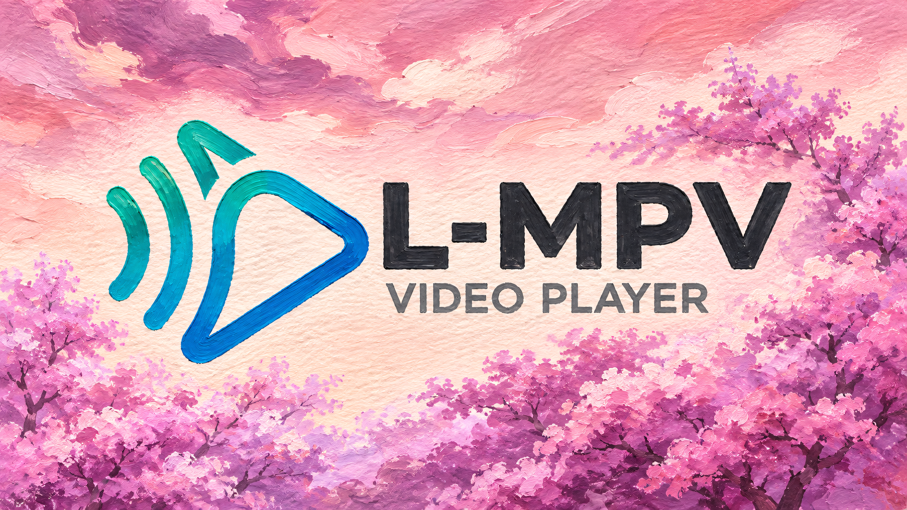
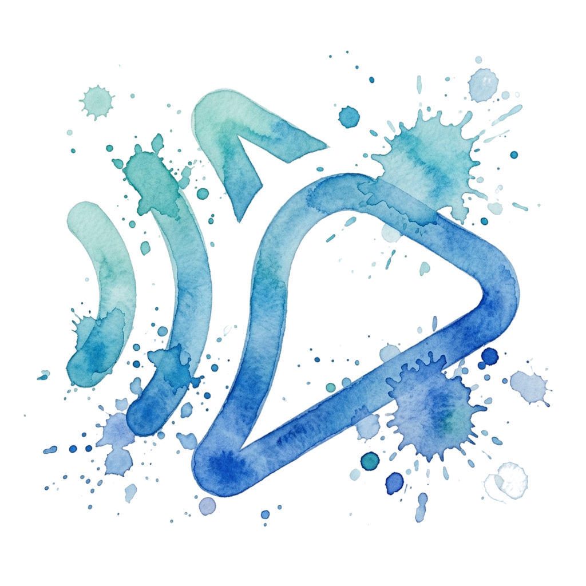
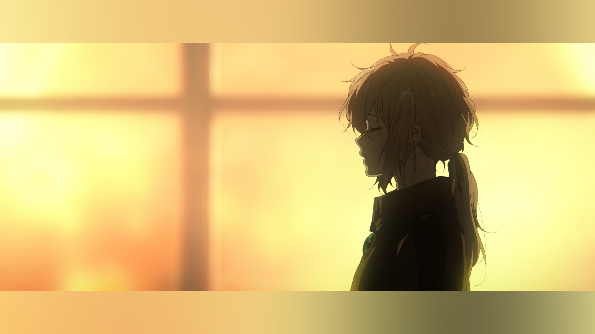
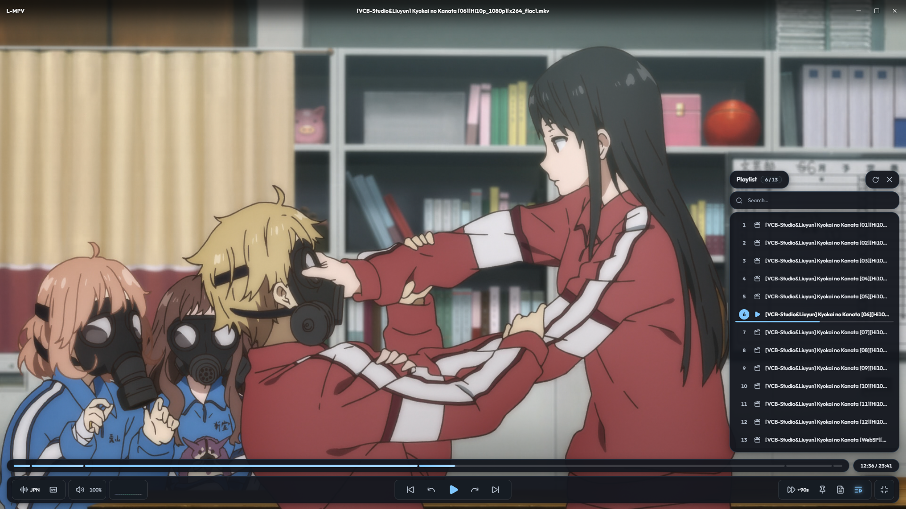
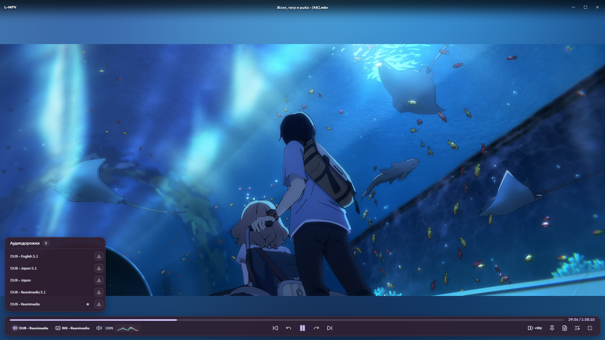
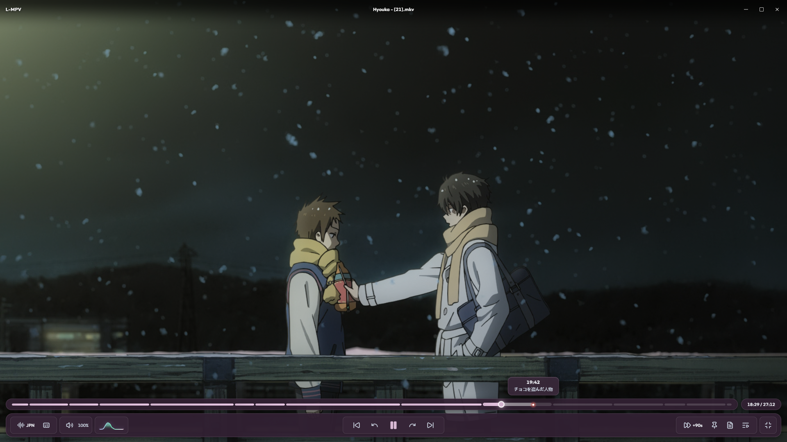
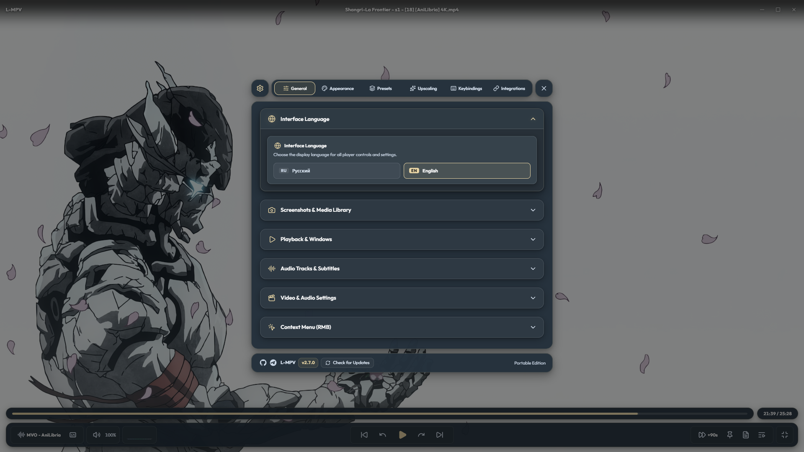
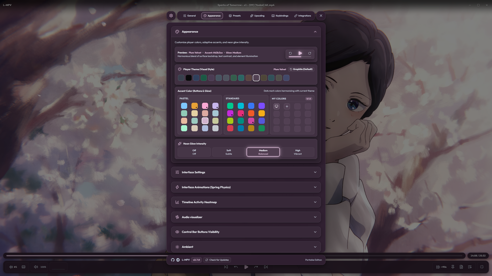
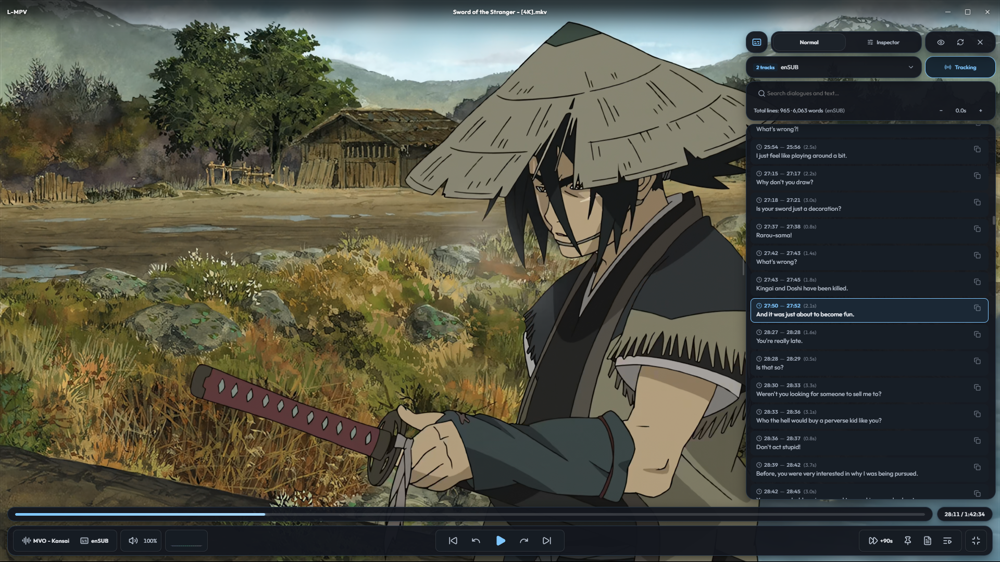
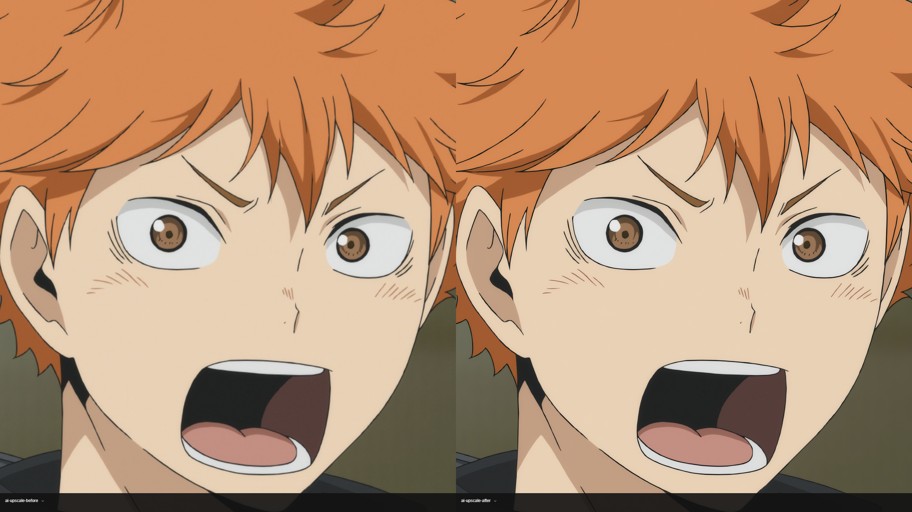

<p align="center">
  
</p>

<h1 align="center">  L-MPV — Modern & Portable Media Player</h1>

<p align="center">
  <b>Настраиваемый медиаплеер для Windows.</b><br>
  Построен на базе <b>Tauri v2</b>, <b>React 19</b>, <b>Direct3D 11</b> и нативного движка <b>libmpv</b> (C-FFI) с поддержкой <b>Real-Time 4K AI Upscaling</b>.
</p>

<p align="center">
  
  <a href="https://github.com/Menely/L-MPV/releases"></a>
  <a href="https://t.me/+_ngzHkrUNZs5YzQ6"></a>
  
  
  
  
  
  
  
  <a href="./LICENSE"></a>
</p>

<p align="center">
  <a href="README.md">English</a> | <b>Русский</b>
</p>

---

## 🌟 О проекте

 **[L-MPV](https://t.me/+_ngzHkrUNZs5YzQ6)** — это современный настольный медиаплеер для Windows, объединяющий возможности нативного видеодвижка **MPV** (`vo=gpu-next`, Direct3D 11, HDR, WASAPI, sinc-ресемплинг), аппаратный **Real-Time 4K AI Апскейлинг** (ONNX инференс через DirectML и TensorRT) и настраиваемый интерфейс в стиле **Glassmorphism**, созданный на **React 19** и **TypeScript**.

L-MPV хранит настройки, кэш, скриншоты, ONNX-модели и нативные библиотеки в папке приложения. Для работы нужен WebView2 Runtime; AI-компоненты загружаются отдельно. Ассоциации файлов и интеграция с Проводником включаются по желанию пользователя.

<p align="center">
  
</p>

---

## 💖 Благодарности

Создание и развитие медиаплеера **L-MPV** стало возможным благодаря открытым проектам и их авторам:

- **[LANKETT](https://github.com/LANKETT)** — благодарность дизайнеру за разработку фирменной иконки и визуального логотипа!
  - GitHub: **[@LANKETT](https://github.com/LANKETT)**
  - Telegram-канал: **[LANKETT WORK](https://t.me/lankett_work)**
- **[mpv](https://mpv.io/)** ([GitHub](https://github.com/mpv-player/mpv)) — за производительный и гибкий нативный видеодвижок.
- **[mpv-AnimeJaNai](https://github.com/the-database/mpv-AnimeJaNai)** & **[the-database](https://github.com/the-database)** — за видеофильтр `vf_animejanai` и реализацию нейросетевого 4K-апскейлинга в реальном времени.
- **[Tauri](https://tauri.app/)** ([GitHub](https://github.com/tauri-apps/tauri)) — за легковесный и производительный фреймворк на базе Rust и веб-технологий.
- **[dnd-kit](https://dndkit.com/)** ([GitHub](https://github.com/clauderic/dnd-kit)) — за современный и надежный набор Drag & Drop примитивов для React.
- **[frame-player](https://github.com/risenxxx/frame-player)** — за подход к предпросмотру кадров на таймлайне, адаптированный здесь через независимый worker предпросмотра.
- **[thumbfast](https://github.com/iiiGerardoiii/thumbfast)** — за подход к генерации миниатюр по запросу, на котором основан приватный декодер предпросмотра libmpv.

---

## 📸 Скриншоты Интерфейса

<table width="100%">
  <tr>
    <td width="50%" align="center">
      <b>🌌 Аппаратная Подсветка Полос</b><br>
      <sub>Шейдерное размытие краев видео (Ambient)</sub><br><br>
      <a href="./assets/ambient-light-demo.png"></a>
    </td>
    <td width="50%" align="center">
      <b>📑 Выдвижная Панель Плейлиста</b><br>
      <sub>Автоматическое сканирование каталога, фильтрация и живой поиск</sub><br><br>
      <a href="./assets/playlist-drawer.png"></a>
    </td>
  </tr>
  <tr>
    <td width="50%" align="center">
      <b>🎧 Управление Дорожками и Экспорт в 1 Клик</b><br>
      <sub>Быстрая смена аудио/субтитров и скачивание</sub><br><br>
      <a href="./assets/audio-window.png"></a>
    </td>
    <td width="50%" align="center">
      <b>🔖 Интерактивная Навигация по Главам</b><br>
      <sub>Список глав с таймкодами и подсветкой активной части видео</sub><br><br>
      <a href="./assets/interface-chapter-player.png"></a>
    </td>
  </tr>
  <tr>
    <td width="50%" align="center">
      <b>⚙️ Центр Настроек</b><br>
      <sub>Выбор языка, горячих клавиш, управление аудио, сабами и меню</sub><br><br>
      <a href="./assets/settings-general-player.png"></a>
    </td>
    <td width="50%" align="center">
      <b>🎨 Кастомизация</b><br>
      <sub>Акцентные цвета, 10 палитр аудио-визуализатора</sub><br><br>
      <a href="./assets/settings-customization-player.png"></a>
    </td>
  </tr>
  <tr>
    <td width="50%" align="center">
      <b>💬 Интерактивный Поиск и Окно Субтитров</b><br>
      <sub>Полнотекстовый поиск, следование за речью и ASS-инспектор</sub><br><br>
      <a href="./assets/subtitled-window-player.png"></a>
    </td>
    <td width="50%" align="center">
      <b>⚡Real-Time 4K AI Upscaling (До и После)</b><br>
      <sub>Аппаратная реконструкция линий и текстур в реальном времени</sub><br><br>
      <a href="./assets/ai-upscale.png"></a>
    </td>
  </tr>
</table>

---

## ✨ Ключевые Возможности

<details>
<summary><b>🚀 Real-Time 4K AI Upscaling (Нейросетевой Апскейлинг Аниме и Видео)</b></summary>

<p align="center">
  
</p>

- **Нативный инференс в видеопотоке:** интеграция фильтра `vf_animejanai` на базе актуального стека `mpv-AnimeJaNai 3.10.0` (мост `aji` v0.25.0, NVIDIA TensorRT 11.4.0.106 и DirectML DirectX 12) с аппаратным выводом кадров в 4K Ultra HD в реальном времени.
- **Два режима работы:** переключатель **«Выкл»** и **«AI Upscaling»** в Настройках (`F2`) — пользователь сам решает, когда задействовать искусственный интеллект.
- **Два движка инференса (Backend):**
  - **DirectML:** инференс через DirectX 12 на совместимых видеокартах AMD, Intel и NVIDIA. Поддержка моделей и скорость зависят от оборудования.
  - **TensorRT:** инференс на поддерживаемых видеокартах NVIDIA, включая архитектуры от `sm75` до Blackwell `sm120`.
- **Загрузка компонентов («Скачать движок»):**
  - Определение GPU и выбор соответствующих библиотек после нажатия «Скачать движок» или «Обновить движок».
  - Потоковая индикация процентов, объёма (МБ), аккуратный статус распаковки и фиксация 100% готовности в течение 3 секунд.
  - Неблокирующая фоновая распаковка через `spawn_blocking` без зависаний UI и без всплывающих консольных окон.
- **Предварительная компиляция TensorRT 1080p (.engine):**
  - Старые или неподтверждённые кэши помечаются для пересборки. Подтверждённые engines могут сохраняться после обновления libmpv/aji, если модель, GPU и ядро TensorRT остаются совместимыми. Валидные профили разных разрешений могут сосуществовать; готовность 1080p показывается отдельно. Действия «Обновить движок» и «Пересобрать» выполняются по нажатию пользователя, ONNX-модели сохраняются. Загруженные DLL требуют перезапуска перед заменой.
  - Ошибка загрузки или распаковки сохраняет установленный рантайм и его паспорт проверки. Новый комплект проверяется до замены установленных компонентов.
  - Фоновая оптимизация ONNX моделей под разрешение 1080p -> 4K с многоступенчатым отслеживанием фаз (разбор ONNX, тактики CUDA, оптимизация графа, сериализация).
  - Компиляция через `trtexec.exe` с профилем входного изображения 1080p.
  - Предварительная компиляция может сократить задержку запуска для соответствующей модели и профиля. Повторная сборка доступна в настройках.
- **Преобразование FP16 и совместимость моделей:**
  - Для преобразования FP32 в FP16 перед компиляцией нужен конвертер из пакета компонентов либо Python с модулями `onnx` и `onnxconverter-common`.
  - Совместимость, качество изображения и производительность зависят от модели и движка инференса.
- **Универсальная библиотека ONNX (`models/onnx/`):**
  - Поддерживаются совместимые с AnimeJaNai модели `.onnx`; произвольная архитектура ONNX не гарантирует совместимость.
  - Кнопка **«Папка моделей»** для быстрого перехода в Проводник Windows.
  - Переключатель скрытия/отображения названий моделей (маскировка точками).
  - Интерактивное перемещение порядка моделей мышкой (`@dnd-kit/sortable`) за ручку захвата с сохранением в `config/models_order.json`.
  - Сочетания клавиш и действия мыши для моделей меняются во вкладке «Горячие клавиши»; в карточках моделей кнопок назначения нет.
- **Переключение нейросетей на лету по горячим клавишам (до 9 моделей):**
  - `Ctrl+J` — Информационный OSD-оверлей статуса и статистики апскейлинга (активный движок, выбранная модель, слот, разрешение видео -> 4K);
  - **Избранная модель апскейлинга:** отметьте одну модель звёздочкой и включайте или выключайте её клавишей `U`. Выбор сохраняется вместе с переносимыми настройками и привязан к имени файла, поэтому сохраняется при перестановке моделей. Если избранная модель не выбрана или её файл отсутствует, плеер показывает сообщение.
  - `Shift+Backquote` — выключить апскейлинг (клавиша под Esc, Ё в русской раскладке);
  - `Shift+1` .. `Shift+9` — Включить Нейросеть #1 .. #9 (горячие клавиши доступны для первых 9 моделей);
  - OSD-уведомление с отображением реального названия активированной модели;
  - Принудительная перерисовка кадра на паузе при смене модели.
  - При обновлении прежние стандартные сочетания заменяются новыми; пользовательские назначения и отключённые действия сохраняются.

</details>

<details>
<summary><b>🌍 Мультиязычный Интерфейс (Русский / English)</b></summary>

- **Два языка из коробки:** интерфейс переведён на русский и английский языки.
- **Переключение языка:** смена языка в настройках не требует перезапуска плеера, интерфейс переводится на лету.
- **Автоопределение языка:** плеер автоматически подхватывает системный язык вашей Windows при первом запуске (русский для русскоязычных систем, английский по умолчанию для всех остальных).
- **Двуязычный установщик Windows:** мастер установки NSIS поддерживает выбор языка (Русский / English) с автоматическим определением локали системы и полной локализацией диалогов.

</details>

<details>
<summary><b>⚡ Рендеринг видео (<code>vo=gpu-next</code>) и Автоподгонка Окна</b></summary>

- **Высококачественный пайплайн:** рендерер `vo=gpu-next`, нативный Direct3D 11 (`gpu-api=d3d11`), аппаратное декодирование `hwdec=auto-safe` и перцептуальный gamut mapping (`gamut-mapping-mode=perceptual`).
- **Масштабирование изображения:** алгоритмы интерполяции `scale=spline36` и `cscale=spline36` для сохранения чёткости деталей и плавности цветовых переходов.
- **HDR и тонемаппинг:** автоматический тонемаппинг и передача подсказок о цветовом пространстве дисплея; параметры обработки HDR доступны в настройках.
- **Дизеринг и уменьшение бандинга:** адаптивный пространственно-временной дизеринг с синим шумом (`dither-depth=auto`), согласованный с матрицей дисплея, и опциональный GPU-шейдер дебандинга (`deband`) со сбалансированными пресетами силы для устранения ступенчатых градиентов в аниме и пережатых веб-рипах.
- **Автоподгонка окна:** размер окна учитывает пропорции видео и масштаб монитора. В режиме вписывания, полном экране и при ограничениях размера могут оставаться чёрные полосы.
- **Автоматический сброс масштаба и смещения:** при открытии нового медиафайла сбрасываются параметры масштаба и положения кадра.
- **Запуск с файлом:** плеер подготавливает файл на паузе, подгоняет и показывает окно, затем начинает воспроизведение. Явно заданная пауза сохраняется. Время запуска зависит от файла и системы.
- **Нативный вывод видео:** mpv выводит видео в Windows HWND под прозрачным интерфейсом WebView2.
- **Распознавание файлов YUV:** `.yuv` включены в выбор файлов, плейлист из папки и необязательные ассоциации Windows. Параметры raw-видео автоматически не задаются.

</details>

<details>
<summary><b>🎵 Нативный Аудио-Визуалайзер (WASAPI Loopback Capture / FFT 1024)</b></summary>

- **Спектральный анализ:** нативный захват системного звука через Windows WASAPI Loopback Capture в фоновом Rust-потоке с вычислением 1024-точечного БПФ (Cooley-Tukey Radix-2 FFT) со сглаживающим окном Ханна.
- **32 частотные полосы:** детальное частотное разрешение 46.8 Гц на бин. Логарифмическое распределение от 25 Гц до 19 000 Гц со строгой монотонностью полос (суб-бас, панч, вокал, презенс, высокие частоты).
- **Сведение 5.1 / 7.1 Surround:** при подготовке звука для визуализатора учитываются центральный канал и канал LFE.
- **Логарифмическая шкала:** диапазон отображения от -46 до 0 dB с частотной компенсацией. Дополнительная компенсация визуального усиления зависит от громкости плеера.
- **9 стилей визуализации:** такие как `Waveform` (многослойная волна с динамическими спектральными гармониками), `Spectrum` (32-полосный эквалайзер) и `Bars` (ритм-капсулы Apple Music / Spotify style) и так далее.
- **Индикаторы пиков:** удержание и постепенное снижение маркеров показывают изменения уровня сигнала.
- **Снижение фоновой активности:** на паузе и при неактивном интерфейсе захват звука останавливается. Поток периодически проверяет, нужно ли возобновить работу.

</details>

<details>
<summary><b>🌌 Аппаратная Подсветка Полос (Ambient Light / GPU Blur)</b></summary>

- **Размытие полос:** при несовпадении пропорций видео и окна свободные области вокруг кадра заполняются размытым на GPU фоном.
- **2 режима работы:**
  - `Off` — классические черные полосы;
  - `Blur` — аппаратное шейдерное размытие кадра в реальном времени с плавной регулировкой радиуса (от 5 до 150 px); устаревший тяжелый режим `Color` удален в v2.7.0 для упрощения доступных режимов.
- **Предпросмотр:** изменения применяются сразу, сохранение настроек выполняется с задержкой 400 мс. Частота кадров зависит от оборудования и видео.
- **Быстрое управление:** переключение по горячей клавише `B` (`Off → Blur → Off`), в контекстном меню (ПКМ) и в Настройках.

</details>

<details>
<summary><b>🎧 Вывод звука и усиление громкости</b></summary>

- Вывод через Windows WASAPI с настроенным аудиобуфером 0,2 секунды.
- Громкость до 150% и опциональный пиковый лимитер. Ограничение пиков и изменение усиления могут менять сигнал; побитовая точность вывода не гарантируется.
- Настройки задержки аудиоустройства для уменьшения потери начала звука на некоторых устройствах.
- Настроенный sinc-ресемплинг, нормализованное сведение многоканального звука и коррекция тона при изменении скорости.

- **Индикатор громкости:** необязательная шкала ниже центра экрана или текстовый OSD слева сверху. По умолчанию выключен; включается в «Настройки видео и звука» → «Аудиотракт», вид переключается чекбоксом OSD.

</details>

<details>
<summary><b>🎧 Управление Дорожками и Экспорт в 1 Клик (Track Popover & FFmpeg)</b></summary>

- **Эргономичное всплывающее меню выбора дорожек:** аккуратное меню аудио и субтитров прямо на нижней панели плеера; фиксированная ширина **320px** снижает изменения ширины меню при переключении дорожек с разной длиной названий; компактно отображает до 7 дорожек без прокрутки, с плавным скроллом для длинных списков и автоматической прокруткой к активному потоку при открытии.
- **Сокращение названий и компактные индикаторы:**
  - Алгоритм `truncateMiddle` (порог 35 символов) аккуратно сокращает слишком длинные названия дорожек посередине, сохраняя информативное начало и конец (например, `Субтитры [Дубляж...FullHD].ass`), предотвращая срез правого края CSS-эллипсисом, а полное имя доступно во всплывающей подсказке;
  - Компактная векторная микро-иконка `ExternalLink` с тултипом вместо громоздкой текстовой плашки `EXT` для подключенных внешних дорожек;
  - В полноэкранном режиме лимит ширины названий расширен до 260–280px.
- **Адаптивный дизайн под выбранный стиль плеера:**
  - В стиле **«Капсула»** меню представлено парящими карточками: отдельная шапка со счётчиком дорожек и кнопкой быстрого перехода к поиску субтитров (`Ctrl+F`), независимая карточка для быстрого отключения субтитров и аккуратный список дорожек;
  - В стилях **«Модерн»** и **«Классический»** — элегантное цельное окно с эффектом матового полупрозрачного стекла;
  - Светящаяся неоновая точка у активной дорожки вместо громоздких галочек;
  - Встроенная кнопка экспорта дорожки в 1 клик прямо из всплывающего меню;
  - Анимации открытия с учётом выбранного стиля интерфейса.
- **Отключение субтитров и звука (Mpv Property Alignment):** при клике на «Выключить субтитры» в MPV отправляется нативная команда отключения `sid: "no"` (для аудио `aid: "no"`), оптимистично сбрасывая состояние в интерфейсе и отображая OSD-уведомление `«Субтитры: Выкл»`.
- **Названия дорожек (MP4 / MOV ↔ MKV):** каскадный опрос свойств (`title` → `metadata/name` из атома `udta/name` QuickTime/MP4 → `metadata/title` → `metadata/handler_name`). Названия дорожек (например, «Дубляж», «Original Atmos») теперь отображаются одинаково детально и понятно как в контейнерах MKV, так и в MP4/MOV файлах.
- **Управление дорожками:** по умолчанию ЛКМ переключает дорожку, а ПКМ открывает меню выбора. Клавиши `A` и `V` переключают аудиодорожки и субтитры. Действия кнопок мыши можно изменить в настройках.
- **Экспорт звука и субтитров в 1 клик:** встроенные кнопки скачивания в меню аудиодорожек и субтитров на нижней панели и в контекстном меню (ПКМ).
- **Direct Stream Copy (`-c copy`):** извлечение без перекодирования и без малейшей потери исходного качества за считанные секунды.
- **Многопоточное преобразование (`-threads 0`):** автоматическая конвертация несовместимых кодеков (например, субтитры `mov_text` автоматически конвертируются в формат `.srt`).
- **Прямое копирование внешних файлов:** копирование уже подключенных внешних субтитров без обращения к FFmpeg (с корректным разрешением относительных путей).
- **Гибкие пути сохранения:** возможность автоматического сохранения рядом с видеофайлом либо через системный проводник.
- **Анимированная индикация:** спиннер в меню и статусная строка прогресса на панели управления.

</details>

<details>
<summary><b>💬 Интерактивный Поиск и Окно Субтитров (Searchable Subtitles Browser)</b></summary>

<p align="center">
  
</p>

- **Встроенный высокоскоростной Rust-парсер Matroska (MKV / WebM):**
  - Извлечение встроенных ASS/SSA/SRT-субтитров в Rust без декодирования видеокадров. Время анализа зависит от файла и его индекса.
  - Двухуровневая архитектура извлечения: быстрое индексное чтение по таблице `Cues` с прямым доступом к кластерам субтитров и потоковый скан со скачками (`seek_forward`) через видео/аудио блоки при отсутствии индекса;
  - Поддержка сжатия `ContentEncodings`: декомпрессия `zlib` заголовков стилей и пакетов реплик, а также восстановление удаленных заголовков `Header Stripping`;
  - Полноценная реконструкция структуры документов ASS/SSA с сохранением стилей, координат, актёрских меток, слоев и эффектов;
  - Версионированный дисковый кэш `l_mpv_sub_v4` для повторного открытия без повторного разбора.
- **Полнотекстовый поиск:** живой поиск по всей дорожке субтитров с подсветкой совпадений, счетчиком найденных реплик и быстрой навигацией клавишами `Вверх` / `Вниз` / `Enter`.
- **Интерактивная навигация и переход:** клик по любой строке диалога перематывает воспроизведение на точный таймкод фразы.
- **Режим «Следить за речью» (Follow Playback):** выделяет текущую реплику и следует за воспроизведением и перемоткой. Ручная прокрутка приостанавливает слежение до повторного включения. Поиск временно приостанавливает слежение; после очистки запроса оно возобновляется, если режим остался включён.
- **Виртуализированный список реплик:** для длинной дорожки отображается скользящее окно строк, а поиск охватывает всю дорожку. При смене окна сохраняется согласованность выделения и автопрокрутки.
- **Два режима отображения:**
  - *Обычный (Текст)*: чистый отформатированный текст диалогов без мусора разметки, таймкод начала, длительность и имя персонажа/актёра.
  - *Технический (ASS-инспектор)*: профессиональный разбор разметки ASS (`[Ht]` HTML-превью, `[Ae]` Raw ASS), подробные бейджи стилей (название стиля, актёр, шрифт, размер, цвет HEX/BGR, слой MarginV/Layer, координаты и теги эффектов).
- **Тонкая регулировка задержки (Sub Delay):** подстройка тайминга из строки поиска с шагом 100 мс или 500 мс при удержании Shift.
- **Быстрый селектор дорожек (Track Picker):** переключение между встроенными и внешними дорожками, подключение новых файлов `.srt`/`.ass` и отключение субтитров в 1 клик.
- **Свободная геометрия и позиционирование:** изменение ширины окна перетаскиванием границ (Resize), горизонтальное перемещение окна (Drag & Drop за шапку), автоподстройка ширины под режим и сохранение геометрии.
- **Настройка непрозрачности (Glass / Solid):** выбор между полупрозрачным Glassmorphism стилем и контрастным плотным фоном для комфортного чтения поверх ярких сцен.
- **Модульная островная архитектура и эргономичные хитбоксы:**
  - Окно организовано в 4 чистых независимых островка («Шапка», «Поиск с задержкой», «Список реплик», «Инспектор»);
  - Укрупненные области нажатия (хитбоксы 28px) для микро-кнопок навигации между совпадениями (`∧`, `∨`), сброса (`X`) и задержки (`−`, `+`);
  - Гармоничные скругления переключателя режимов «Обычный / Инспектор» без визуальной угловатости.
- **Виртуализация субтитров:** отображение скользящего окна видимых строк дорожки (активируется при более чем 50 репликах), что сокращает число одновременно создаваемых DOM-элементов при открытии длинных дорожек.
- **Токенайзер речи и метрики темпа (Intl.Segmenter):** сегментация текста с нативной поддержкой CJK-языков без пробелов (японский, китайский), автоматическая нормализация локалей ISO 639 в BCP-47, расчет скорости речи в реальном времени (WPM — слов в минуту, CPS — символов в секунду) и цветовые индикаторы темпа речи в ASS-инспекторе (спокойный, быстрый, сверхбыстрый).
- **Отрисовка субтитров и экранных надписей:** поддержка стилизованных ASS/SSA-субтитров, караоке-анимаций и экранных надписей:
  - *Размещение в видеокадре (`sub-ass-force-margins=no`, `sub-use-margins=no`)*: настройки полей согласуют размещение субтитров с областью видео;
  - *Сохранение авторского оформления*: по умолчанию используется `sub-ass-override=no`; привязка к интерфейсу временно разрешает изменение позиции без принудительной подмены шрифтов и цветов. Явные координаты ASS (`\pos`/`\move`) сохраняются и могут пересекаться с панелью;
  - *Привязка к интерфейсу*: обычные текстовые субтитры поднимаются над видимой панелью с учётом стиля («Модерн», «Классический», «Капсула»), масштаба и размера окна; при скрытии панели восстанавливается прежнее положение;
  - *Субпиксельная точность и типографика (`sub-ass-hinting=none`, `sub-ass-shaper=harfbuzz`, `embeddedfonts=yes`)*: движок HarfBuzz для полной поддержки лигатур и CJK-символов, распаковка авторских встроенных шрифтов MKV и отключение хинтинга для устранения ступенчатого дрожания в динамических анимациях;
  - *Геометрическая защита (`stretch-image-subs-to-screen=no`)*: защита растровых субтитров Blu-ray/DVD (PGS, VobSub) от искажения пропорций.

</details>

<details>
<summary><b>🎨 Интерфейс, темы и пользовательские шрифты</b></summary>

- **Полупрозрачные панели:**
  - **Прозрачность UI (10..100%):** точная регулировка степени прозрачности панелей управления, окон и меню с сохранением контрастности текста.
  - **Рамки и тени:** помогают различать панели и вложенные элементы интерфейса.
  - **Полупрозрачные панели:** интерфейс расположен поверх нативного вывода mpv. CSS-размытие фона не размывает видео в этом отдельном нативном слое.
- **15 тем оформления плеера:** *Тёмный графит*, *Глубокий OLED*, *Ночной кобальт*, *Тёмный изумруд*, *Чёрная орхидея*, *Северный туман*, *Discord Gray*, *Лесной шалфей*, *Мятный нефрит*, *Терракота*, *Сумеречный ирис*, *Сливовый бархат*, *Тёмная бронза*, *Чернильный океан*, *Тёплый титан* с согласованными цветами фона и текста и настраиваемыми акцентами.
- **Элементы настроек:** параметры используют согласованные подсветку и скругления. Выбор обозначается акцентной заливкой, а наведение даёт отклик без изменения размеров элемента.
- **Единая Дизайн-Система Поверхностей (Elevation Surfaces):**
  - *Level 1 (`.glass-panel`)*: главные парящие панели, выпадающие меню и модальные окна.
  - *Level 2 (`.glass-section`)*: группирующие секции и функциональные блоки настроек.
  - *Level 3 (`.glass-tile`)*: интерактивные карточки параметров и моделей с акцентным выделением и откликом при наведении.
- **Автономная шрифтовая экосистема и кастомные шрифты (UI Font):**
  - **Локальные шрифты:** встроенные гарнитуры загружаются без запросов к Google Fonts.
  - **5 встроенных гарнитур:** *Inter*, *Outfit*, *Plus Jakarta Sans*, *Manrope*, *JetBrains Mono* + *Системный* шрифт ОС.
  - **Пользовательские шрифты:** добавьте файлы `.ttf`, `.otf`, `.woff` или `.woff2` в папку `fonts/` рядом с `l-mpv.exe`.
  - **Кнопка «Открыть папку со шрифтами»:** кнопка с иконкой папки в шапке карточки «Шрифты» открывает каталог в Проводнике Windows, а список доступных шрифтов обновляется на лету при возврате фокуса в плеер.
  - Выбор шрифта в разделе «Внешний вид» сохраняется и синхронизируется между окнами.
- **Интерактивная секция «Цветовое оформление»:** живой аутентичный предпросмотр сочетания расцветки плеера, контрастности текста и подсветки элементов в реальном времени.
- **Адаптивный неоновый глоу (Glow Intensity):** 4 уровня свечения (*Off*, *Soft*, *Medium*, *Cyber Intense*) с вектором рассеивания `drop-shadow` и подсветкой таймлайна.
- **Модульный редизайн окна выбора цвета (Color Picker) и точные контролы:**
  - Модульная организация (SRP) с адаптацией под все 3 стиля плеера (*«Модерн»*, *«Классический»* и островная *«Капсула»*);
  - Высокопроизводительный Canvas-спектр с сглаживанием и динамической световой окантовкой в цвет выбора;
  - Градиентный ползунок яркости с процентным индикатором значения;
  - Лента быстрого выбора пресетов (10 оттенков) и сплит-сватч сравнения (Текущий / Исходный со сбросом в 1 клик);
  - Моноширинные поля ввода HEX и каналов RGB с кнопками быстрого копирования в буфер обмена;
  - Сохранённая пользовательская палитра (до 15 своих цветов) с синхронизацией между окнами.
- **Математический ритм панели управления и оптическое центрирование:**
  - Строгий сеточный ритм с шагом центров ровно 40 px и визуальным зазором 22 px между кнопками аудиодорожек, субтитров и громкости;
  - Оптическая компенсация центроида круглой кнопки воспроизведения (`transform: translateX(1px)`);
  - Стандартизация размера иконок повтора и случайного воспроизведения (`size=18`) и гармоничный отступ кнопки пропуска опенинга (`gap: var(--space-2)`);
  - Улучшенная дифференциация прозрачности для вложенных карточек стиля «Капсула» (`--capsule-island-fill`);
  - Выравнивание чекбоксов и заголовков настроек по базовой линии первой строки через унифицированный слот `SettingsIcon`.
- **Многопозиционная система времени (6 вариантов расположения):**
  - Возможность выбора удобного положения времени в Настройках (`F2`) или в ПКМ-меню:
    - *Слева от таймлайна* — классическое положение перед полосой.
    - *Справа от таймлайна* — стандартное расположение.
    - *Справа от громкости* — в левой группе кнопок тулбара рядом с аудио-визуализатором.
    - *Справа в тулбаре кнопок* — в правом блоке кнопок перед сервисными иконками (таймлайн на всю ширину).
    - *По центру над таймлайном* — Отдельный счётчик над полосой перемотки, оформленный под «Модерн», «Классический» или «Капсулу».
    - *В заголовке окна (Titlebar)* — интерактивный бейдж времени в верхней шапке окна слева от кнопок окна; освобождает нижнюю панель управления.
  - При выборе любой позиции вне таймлайна полоса перемотки автоматически раскрывается на всю ширину панели (`.timeline-row--full`).
- **Кнопка и меню скорости воспроизведения (Speed Control, v2.7.0):**
  - *Динамическое отображение*: кнопка автоматически появляется в правой секции управления при скорости видео, отличной от 1.0x (или принудительно закрепляется через Настройки).
  - *Эргономика кликов*:
    - **ЛКМ** — быстрое переключение скоростей по кругу (от 0.25x до 2.0x с шагом 0.25x);
    - **ПКМ** — открытие компактного меню выбора скорости.
  - *Дизайн под все 3 стиля плеера*:
    - В стиле **«Капсула»** кнопка оформлена как отдельная парящая карточка-островок, а меню — в виде воздушных островков шапки и списка;
    - В стилях **«Модерн»** и **«Классический»** — монолитная кнопка и цельное матовое стекло меню.
  - *Неоновые радио-точки выбора*: активное значение выделяется аккуратным светящимся маркером-точкой в едином стиле выбора аудиодорожек и субтитров.
  - *Абсолютная точность геометрии*: окно парит строго над кнопкой скорости (`translateX(-50%)`) с учётом масштабирования UI на 2K/4K экранах и в полноэкранном режиме, без наплыва на таймлайн.
- **4 интерактивных формата времени и переключение в 1 клик:**
  - Поддержка форматов: *Прошедшее / Общее*, *Прошедшее / Оставшееся*, *Только оставшееся* и *Время окончания* (с учётом скорости воспроизведения).
  - Интерактивная смена формата по клику непосредственно на время в любой точке интерфейса с OSD-уведомлением.
- **Три уникальных стиля оформления интерфейса:**
  - **Капсула**: Модульный интерфейс из независимых парящих островков:
    - *Раздельные функциональные карточки*: отдельные островки для дорожек (аудио + субтитры), регулятора громкости, кнопок воспроизведения, утилит и кнопки полного экрана;
    - *Парящий таймлайн и карточка времени*: полоса перемотки и бейдж времени парят независимо друг от друга с мягкой подсветкой; клик по карточке времени переключает формат отображения;
    - *Центрирование кнопок воспроизведения*: кнопки воспроизведения и перемотки располагаются по центру экрана, не смещаясь при изменении ширины соседних кнопок или названий дорожек;
    - *Многоуровневая адаптивность*: гибкие островные станции с защитой от переполнения (`min-width: 0`), фиксированный размер регулятора громкости, автоматический перевод кнопок дорожек в режим аккуратных иконок 32×32 px при сжатии окна (`≤ 1080px`) и динамическое масштабирование тулбарного спектроанализатора, для размещения карточек в узком окне.
  - **Модерн**: Элегантная единая парящая капсула со встроенным таймлайном и воздушными отступами от краёв экрана.
  - **Классический**: Привычная сплошная панель управления во всю ширину окна, пристыкованная к нижней границе без зазоров.
  - Наглядные интерактивные мини-превью стилей в Настройках (`F2` → «Внешний вид») для удобного выбора в один клик.
- **Эргономичный редизайн вкладки «Внешний вид»:**
  - Настройка общей прозрачности интерфейса (10–100%) со сквозным обновлением токенов `--ui-opacity` и `--bg-glass`.
  - Адаптивная сетка (3 колонки, при ширине панели ≤ 480px — одна колонка): Скругление углов (карточки 2x2 + компактный ползунок) | Масштабирование UI Scale (карточки 2x2 + ползунок + кнопка «A» авто-масштаба) | Шрифты (список 6 гарнитур + кастомные шрифты пользователя с кнопкой папки).
  - Нижний блок: стиль плеера с мини-превью (слева) + компактные сетки выбора позиций времени (3x2) и формата времени (2x2) (справа).
- **Плавающая панель управления и дефолтный набор кнопок:** нижняя панель с подсветкой и кнопками управления: аудиодорожки, субтитры, громкость, предыдущее/следующее видео, перемотка назад/вперёд, пауза/плей, пропуск опенинга, поверх всех окон, скриншот, плейлист и полный экран.
- **Табличные цифры:** одинаковая ширина цифр помогает сохранять выравнивание времени, битрейта и счётчиков при обновлении значений.
- **Единая кинетическая система анимаций:** 5 стандартизированных уровней длительностей (`--t-instant`, `--t-fast`, `--t-base`, `--t-pop`, `--t-drawer`) и 4 кривые Безье (`--ease-smooth`, `--ease-decelerate`, `--ease-accelerate`, `--ease-spring-smooth`), согласованные между CSS и TypeScript.
- **Информативные визуальные OSD-ошибки:** контрастный кораллово-янтарный стиль уведомлений (`.frame-osd--error`) с глобальным API `showOsd(message, { isError: true })` для информирования о сбоях и неполадках.
- **Мягкое контурное свечение (Vector Drop-Shadow):** аккуратное рассеивание света строго по контуру векторных SVG-иконок с плавным градиентным угасанием без грубых круговых ареолов.
- **Многоуровневая адаптивность (Container Queries):** многоступенчатое умное сжатие и скрытие подписей дорожек, компактное масштабирование аудио-визуализатора и второстепенных кнопок при сужении окна.
- **Автоскрытие в полноэкранном режиме:** возможность скрытия всего интерфейса при подведении курсора к верхнему краю экрана.
- **Возможности Chromium и веб-платформы:**
  - `scrollbar-gutter: stable` (CSS): резервирует место под полосу прокрутки в соответствующих контейнерах, уменьшая горизонтальные сдвиги;
  - Родительский псевдокласс `:has()` (Parent Selector, Chromium 105+): динамическая реактивность карточек, чекбоксов и поисковых строк на состояние вложенных элементов без лишнего React-стейта и ререндеров;
  - Scroll-Driven Animations (`animation-timeline: scroll()`, Chromium 115+): плавная адаптивная тень шапок окон и боковых панелей по мере прокрутки контента силами GPU-композитора Chromium без JavaScript-слушателей скролла.

</details>

<details>
<summary><b>⚙️ Экран Настроек: Боковая Панель или Модальное Окно</b></summary>

- **Две формы на одной кодовой базе:** пользователь выбирает стиль настроек (Sidebar-панель или модальное окно) в разделе «Внешний вид»; выбор сохраняется между запусками и применяется без перезапуска плеера.
- **Сохранение контекста при переключении формы:** активная категория, вкладка, раскрытые секции, позиция прокрутки и черновик имени пресета сохраняются между Sidebar и Modal.
- **Эксклюзивный Single-Accordion:** автоматическое сворачивание соседних категорий при раскрытии активной, обеспечивающее чистоту экрана и порядок как в боковой панели, так и в модальном окне.
- **Корректный масштаб интерфейса:** ширина панели рассчитывается от реальной ширины окна с учётом `UI Scale`, поэтому элементы не «разъезжаются» при масштабировании на 2K/4K мониторах.
- **Адаптивные сетки настроек:** блоки перестраиваются из трёх колонок в одну на узких панелях, подписи не переносятся, а вертикальные ползунки не выдавливают соседние блоки.
- **Чистое визуальное оформление и гармоничные скругления:** заголовки сворачиваемых списков избавлены от отвлекающих технических бейджей, названия секций лаконичны и переведены на чистый русский язык, а вложенные карточки предпросмотра, цветовые группы и переключатели согласованы по концентрической геометрии скруглений.
- **Плавный вертикальный скролл:** стабильная и отзывчивая область прокрутки колесом мыши и тачпадом во всех стилях интерфейса («Капсула», «Модерн», «Классический»).
- **Секция «Настройки видео и звука»:** централизованный аккордеон во вкладке «Общие», собранный на компактных тайлах в две колонки. Четыре карточки: «Обработка кадра» (деинтерлейсинг `no`/`auto`/`yadif`/`yadif2x`, аппаратное декодирование `auto-safe`/`auto-copy`/`no`), «Аудиотракт» (пиковый лимитер, нормализация громкости `dynaudnorm`/`loudnorm`, фикс задержки устройства), «Устранение артефактов» (дебандинг с пресетами силы: Лёгкий, Сбалансированный, Сильный) и «Буфер данных» (50–1024 МБ). Иконка только у карточки, у каждого сегментного блока — кнопка сброса к дефолту и подсказка по наведению.

</details>

<details>
<summary><b>✨ Интерактивный Таймлайн: Neon Pulse Wave и Live Scrubbing</b></summary>

- **Адаптивное увеличение по главам (Segmented Chapter Hover):** при наведении курсора на видео с главами плавно увеличивается по высоте (с 5px до 8px) только та часть шкалы, которая принадлежит активной главе под курсором, в то время как остальные сегменты сохраняют стандартную аккуратную толщину (5px). Для видео без глав сохранено классическое равномерное увеличение всей шкалы целиком.
- **Кинематическая волна Neon Pulse Wave:** компактное кольцо неонового свечения (36px), расходящееся от точки клика по полосе таймлайна с адаптацией под активный акцентный цвет плеера. При отключенных анимациях волна не создаётся вовсе, поэтому кольцо не может «залипнуть» поверх кнопок панели управления.
- **Перемотка перетаскиванием:** движение указателя обновляет позицию предпросмотра на таймлайне.
- **Кадр при наведении:** для локального видео над таймлайном показывается миниатюра с временем и главой. В «Общие → Воспроизведение» доступен сохраняемый переключатель предосмотра. Для 4К во время движения используются готовые миниатюры и ключевые кадры, после остановки — точный кадр. Работает независимый внутрипроцессный декодер libmpv с ограниченным кешем в памяти и на диске. При выключении предосмотра подсказки времени и главы остаются доступны.
- **Предпросмотр и точная перемотка:** при перетаскивании используются переходы к ключевым кадрам, при отпускании выполняется точный переход к выбранной позиции.
- **Расчёт позиции при отпускании:** позиция финального перехода считается по свеже измеренному прямоугольнику шкалы (кэш сбрасывается при ресайзе окна), поэтому автоподгонка окна под пропорции видео больше не сбивает позицию.
- **Никаких лишних рамок фокуса:** клик мышью по таймлайну больше не оставляет зелёную рамку `:focus-visible` поверх видео; индикатор клавиатурного фокуса сохранён через рост полосы прогресса с 5px до 8px.
- **Настраиваемый шаг перемотки и синхронизация:** кнопки панели управления и клавиши-стрелки `←` / `→` работают на единый шаг перемотки (по умолчанию 10 секунд; шаг 1–300 сек задаётся в Настройках).
- **Индикатор перемотки:** показывает направление и выбранное число секунд знаковым значением и направленной шкалой. Быстрые повторы в одном направлении суммируются на экране.
- **Стабильная эргономика управления:** клик по таймлайну больше не перехватывает фокус клавиши `Space` (воспроизведение продолжается по первому нажатию), а навигация стрелками не вызывает ложного появления скрытого интерфейса.
- **Время по центру:** счётчик соответствует выбранному стилю плеера и сохраняет полный формат времени, не увеличивая высоту панели управления.

</details>

<details>
<summary><b>📊 Тепловая карта таймлайна</b></summary>

- Уровни RMS и пиков звука в dBFS либо видеобитрейт с секундной детализацией.
- Звук декодируется FFmpeg и анализируется в Rust. Видеопакеты анализируются без декодирования кадров: поддерживаемые Matroska/WebM обрабатываются Rust-библиотекой, для остальных случаев используется FFmpeg.
- Шесть видов графика: столбики, сплайн, блоки, залитый рельеф, ступенчатый контур и точечный рельеф. Восемь палитр: акцент темы, термальная, киберпанк, монохром, Sunset, Aurora, Ocean и Plasma.
- Настройка высоты, прозрачности и расположения над таймлайном или панелью управления. По умолчанию карта выключена; включается в настройках.
- При наведении показываются RMS/Peak либо средний битрейт выбранного интервала. Видеобитрейт отображается по сбалансированной шкале; число видимых столбиков адаптируется к ширине окна.
- Аудио- и видеопрофили сохраняются раздельно в `data/cache/waveforms/audio/` и `data/cache/waveforms/video_bitrate/`. Ключи BLAKE3 учитывают метаданные файлов и выбор дорожки. При смене источника устаревший анализ отменяется.
- В разделе «Система → Кеш» доступны размеры дисковых кешей и очистка. Старые папки кеша автоматически переносятся в data/cache; настройки, история и модели сохраняются.

- В настройках есть предпросмотр и очистка кэша.

</details>

<details>
<summary><b>🔍 Аппаратный Zoom & Pan и Колесо Мыши</b></summary>

- **Масштабирование относительно курсора:** центрированный зум относительно курсора по комбинации `Ctrl` + Колесо мыши с частотой до 60 FPS.
- **Магнитная привязка:** автоматическое прилипание к исходному масштабу (100%) при приближении к нулевому зуму.
- **Сброс масштаба:** возврат к 100% масштабу и центрированию по клавише `0`.
- **Регулировка громкости:** колесо над видео без Ctrl меняет уровень с шагом 5%, до 150%, и сохраняет его. Если экранный индикатор включён, изменения колёсиком и клавишами показывают шкалу с отметками 50/100% либо текстовый OSD.

</details>

<details>
<summary><b>🖥️ Полноэкранный режим и управление окном</b></summary>

- **Полноэкранный режим:** используются нативные средства управления окном Windows.
- **Динамический Z-порядок (`handle_window_focus`):** при переключении на другое приложение (`Alt+Tab`) плеер автоматически снимает статус Topmost, позволяя окнам свободно открываться поверх плеера, и восстанавливает его при возврате фокуса.
- **Поверх всех окон:** удержание окна плеера над другими приложениями клавишей `T` или кнопкой-булавкой.
- **Выход из приложения:** при закрытии главного окна сохраняется история воспроизведения и завершается работа приложения.
- **Масштаб видеокадра и поворот:** три режима вписывания кадра в окно — *Растянуть до размера окна* (заполняет окно без сохранения пропорций), *Вписать в окно* (весь кадр виден, чёрные полосы), *Заполнить экран и обрезать кадр* (заполняет окно, края обрезаются), — и поворот на 0°, 90°, 180°, 270°. Активный режим считывается из mpv и отмечается в контекстном меню.
- **Фиксация пропорций:** при растягивании окна за края и углы сохраняется выбранное соотношение сторон. Оно учитывает видеокадр; без видео используется 16:9.

</details>

<details>
<summary><b>📋 Буфер Обмена и Чистые Скриншоты</b></summary>

- **Кадр в буфер обмена (`Ctrl+C`):** копирование текущего видеокадра без интерфейса и OSD. Текущая реализация использует промежуточный JPEG-файл в локальной папке `data/`.
- **Скриншоты PNG:** сохранение видеокадра клавишей `S` или кнопкой камеры. Результат зависит от исходного видео и настроек скриншотов mpv.
- **Пользовательская папка:** выбор папки сохранения в настройках или сброс на локальную папку `screenshots/`.

</details>

<details>
<summary><b>📑 Плейлист и навигация</b></summary>

- **Запуск и буферизация:** показ начинается без ожидания заполнения всего буфера. Дальнейшая предзагрузка помогает переживать краткие просадки чтения; если данные закончились, плеер ожидает пополнения и продолжает воспроизведение. Фоновое сканирование и полный анализ тепловой карты откладываются при открытии файла и уступают чтению видео при перемотке или нехватке буфера. Скорость зависит от файла и носителя.
- **Автоматический плейлист с Natural Sort:** при открытии файла плеер находит все видео в директории и выстраивает плейлист в естественном порядке нумерации файлов.
- **Выдвижная панель плейлиста (`L` / `P`):** поиск файлов, фильтрация, подсветка активного трека и переключение в один клик.
- **Адаптация под выбранный стиль:**
  - В стиле **«Капсула»** окно плейлиста разделено на аккуратные парящие островки: заголовок со счётчиком файлов, кнопки управления, бесшовная строка поиска и независимый блок списка файлов;
  - В стилях **«Модерн»** и **«Классический»** плейлист оформлен в виде монолитной панели из матового полупрозрачного стекла.
- **Прокрутка списка:** поиск и индикаторы воспроизведения находятся в прокручиваемом списке файлов.
- **Элегантная индикация текущего видео:** аккуратный круглый бейдж с мягкой неоновой подсветкой номера текущего файла вместо грубых рамок на всю строку, сохраняя чёткость текста названия.
- **Drag & Drop:** при перетаскивании видео, аудио или субтитров над плеером рядом с курсором отображаются имя первого файла и иконка его типа; для видео используется значок L-MPV. У длинных имён сохраняется расширение, для нескольких файлов показывается количество дополнительных. При отпускании первый файл открывается или подключается по текущей настройке хотлоада.
- **Режимы повтора и Shuffle:** циклическое воспроизведение текущего файла, всего плейлиста или случайный порядок. Кнопка на панели и подменю «Режим повтора» в ПКМ-меню используют одну команду `set_repeat_mode`, которая всегда выставляет оба свойства повтора вместе; подменю сразу отмечает активный режим, смена подтверждается OSD.
- **Индикатор прогресса серий (Watch Progress Bar в стиле Netflix/YouTube):** изящная акцентная полоска снизу каждой карточки серии в плейлисте, отображающая процент просмотра из локальной истории (`get_watch_history_batch`). Полностью просмотренные эпизоды (досмотренные до конца) получают флаг `completed`, помечаются аккуратной зелёной галочкой `CheckCircle2` и заполненной линией со специальным стилем, а также поддерживается живое отслеживание прогресса текущего файла.
- **Защита от сплющивания в компактных окнах:** элементам плейлиста задана минимальная высота (`flex-shrink: 0`, `min-height: 38px`), обеспечивающая плавную вертикальную прокрутку со скроллбаром без взаимного наезда и расплющивания строк даже в самых маленьких окнах плеера.
- **Главы (Chapters):** модальное окно навигации по встроенным главам файла с интерактивными таймкодами.
- **Продолжение просмотра:** сохранение последней позиции для 300 файлов в `config/history.json` и восстановление при повторном открытии.
- **Интеграция с Windows Taskbar:** отображение индикатора прогресса воспроизведения прямо на иконке плеера в панели задач Windows.

</details>

<details>
<summary><b>💻 Системные Компоненты, Диагностика и Интеграция с Windows</b></summary>

- **Системная сводка:** характеристики плеера, кеш и интеграции Windows используют общий аккордеон. В таблице кеша показаны пути к папкам, размеры и количество файлов; доступна очистка отдельных категорий или всего кеша. Нажатие на путь копирует его. В стиле плеера «Капсула» диаграмма состоит из отдельных округлых сегментов, в остальных стилях отображается цельным кольцом. Диагностика предзагружается, обновляется по кнопке и копируется в отчёт.
- **Мониторинг нейросетевого инференса (AnimeJaNai / aji):** отображение исключительно установленных пользователем движков (`TensorRT 11`, `DirectML`, `aji v0.25.0`), а также количества моделей ONNX и скомпилированных движков `.engine`.
- **Аппаратное ускорение (GPU):** определение графического адаптера, объёма выделенной видеопамяти VRAM и аппаратной микроархитектуры CUDA (`sm120`, `sm89`, `sm86` и др.).
- **Ассоциации файлов (Windows):** однокликовое связывание медиафайлов с L-MPV в реестре Windows, безопасная отвязка и быстрый переход в системные параметры приложений по умолчанию.
- **Контекстное меню Проводника (MediaInfo):** интеграция пункта «L-MPV MediaInfo» в системное меню правой кнопки мыши Windows для мгновенного анализа медиафайлов.
- **Экспорт отчёта для техподдержки:** кнопка «Скопировать отчёт» формирует стандартизированный отчёт со всеми путями, библиотеками и характеристиками оборудования для GitHub Issues.
- **Сворачиваемая интеграция Windows:** ассоциации файлов и контекстное меню Проводника находятся в отдельных раскрывающихся разделах. Статус меню обновляется при открытии и по кнопке «Обновить», учитывая внешние изменения.
- **Журнал операций:** появляется при наличии результатов или ошибок и сворачивается отдельно.

</details>

<details>
<summary><b>⚙️ Гибридная Система Кастомизации Управления</b></summary>

- **Полная перепривязка хоткеев:** поддержка комбинаций клавиш с модификаторами (`Ctrl`, `Shift`, `Alt`) и кликов мыши (`MouseLeft`, `MouseRight`, `MouseMiddle`, `MouseLeftDoubleClick`).
- **Раздельные действия:** индивидуальные бинды для смены аудио/субтитров кликом и открытия их меню.
- **Точечный сброс:** персональная кнопка сброса «По умолчанию» рядом с каждым действием.
- **Ассоциации файлов:** регистрация медиафайлов в реестре Windows и быстрый переход в параметры Windows «Приложения по умолчанию».

</details>

<details>
<summary><b>📊 Анализ Свойств Медиаконтейнера (MediaInfo.dll C-API)</b></summary>

- **Нативный анализ без внешних консолей:** прямое C-FFI связывание с `mediainfo.dll` через `libloading` для сбора исчерпывающей информации обо всех видео, аудио и субтитрах.
- **Полноценное независимое окно ОС Windows (655×685 px):** окно MediaInfo можно свободно перемещать за пределы плеера на любой монитор; открывается поверх плеера (`Shift+F10`) с возможностью открепления кнопкой-булавкой (Pin / `alwaysOnTop`).
- **Кэш последних отчётов:** при повторном открытии того же неизменённого файла готовый отчёт остаётся на экране. Анализ повторяется, если файл изменён или отчёта больше нет в кэше текущего процесса.
- **Автономный просмотр («Открыть в L-MPV MediaInfo»):** техническая информация о файле из контекстного меню Проводника, без показа главного окна и запуска воспроизведения.
- **Гармоничная адаптация под стиль и цвет плеера:** окно MediaInfo подстраивается под выбранный стиль оформления («Капсула», «Модерн», «Классический») и автоматически перенимает цветовую тему плеера даже при открытии отдельного файла из Проводника Windows. В стиле «Капсула» элементы аккуратно разбиты на парящие карточки с выверенной геометрией.
- **Интерактивные чипы-вкладки категорий потоков (Quick Filter):** фильтрация дорожек по секциям (*«Все»*, *«Общее»*, *«Видео»*, *«Аудио»*, *«Субтитры»*, *«Главы»*) с информативными бейджами количества потоков и скруглением 6px в едином стиле интерфейса.
- **Сворачиваемые секции (Accordion):** индивидуальное и массовое («Свернуть/Развернуть все») сворачивание секций контейнера с умным автораскрытием секций при поиске по `Ctrl+F`.
- **Нативный Drag-and-Drop:** перетаскивание любых медиафайлов прямо в открытое окно MediaInfo с полупрозрачным оверлеем (`FileUp`) и обновлением анализа.
- **Компактный оверлей (`I`):** три вкладки — «Сводка», «Рендеринг» и «Дорожки»; переключение кликом или клавишами `1` / `2` / `3`. «Рендеринг» показывает CPU и RAM процесса/системы, сведения о GPU и VRAM, декодере, цвете, частоте дисплея и A/V-синхронизации. Доступность показателей зависит от системы и файла; процент загрузки GPU не измеряется. Показан адаптер с наибольшим объёмом выделенной видеопамяти, который может отличаться от используемого для воспроизведения; занятость VRAM относится к процессу L-MPV, а не ко всей системе. Во вкладке «Дорожки» можно выбрать аудио и субтитры, отключить активную дорожку повторным кликом и перейти к главе. График видеобитрейта в «Сводке» сглажен, может использовать метаданные и декоративные колебания; это не прямое измерение размеров пакетов.
- **Интерактивный функционал:** поиск по свойствам (Ctrl+F) с подсветкой, экспорт в .txt, копирование в буфер обмена и переключение языков (RU/EN). Кнопки действий переведены в минималистичный режим чистых векторных иконок.

</details>

<details>
<summary><b>📁 Модульная Система Пресетов Настроек и Файлов</b></summary>

- **Пять готовых стилей:** «Классический L-MPV» (графит / небесный), «Сумеречный ирис» (индиго / розовый), «Ночной кинозал» (OLED / янтарный), «Тихий титан» (титан / серебряный) и «Лесной нефрит» (лесной шалфей / мятный). Каждый задаёт тему, акцент, стиль панели, шрифт, скругление, прозрачность и эффекты. Во всех пяти тепловая карта выключена.
- **Индивидуальные файлы пресетов (`config/presets/<название>.json`):** каждый созданный пресет сохраняется в отдельный JSON-файл в папке приложения. Пресетами легко делиться, копировать и бэкапить через проводник.
- **Нативный экспорт и импорт:** системные диалоги Проводника Windows (`save` / `open`) для сохранения файла пресета в любую удобную папку на компьютере или загрузки стороннего стиля.
- **Быстрый переход в проводник:** кнопка «Папка» открывает каталог `config/presets/` в Проводнике Windows в один клик.
- **Автоматическая синхронизация на лету:** список пресетов обновляется при возврате фокуса в окно плеера (например, после ручного изменения или добавления `.json` файлов) или по кнопке «Обновить».

</details>

<details>
<summary><b>🖱️ Настраиваемое Контекстное Меню (ПКМ) и Drag-and-Drop Конфигуратор</b></summary>

- **Гармоничный дизайн под стиль плеера:**
  - В стиле **«Капсула»** главное меню оформлено в виде парящих карточек-островков, повторяющих эстетику нижней панели и плейлиста;
  - В стилях **«Модерн»** и **«Классический»** главное меню и подменю имеют цельный классический вид из матового стекла.
- **Минималистичные круглые индикаторы выбора:** активные режимы и выбранные дорожки отмечаются аккуратными светящимися точками-маркерами без избыточных рамок и галочек.
- **Текст меню:** оформление учитывает выбранный шрифт и стиль интерфейса.
- **Плавная прокрутка без видимого скроллбара:** в длинных списках подменю полоса прокрутки скрыта, при этом колесо мыши скроллит списки с помощью колеса мыши; зазор между главным меню и подменю зафиксирован на удобных 10px (`SUBMENU_GAP`), а клики по переключателям не захлопывают меню.
- **Подписи элементов управления:** у кнопок есть подписи для средств доступности; часть элементов также показывает браузерные подсказки.
- **Интерактивный Drag-and-Drop редактор:** визуальный конфигуратор в Настройках (`F2` -> «Основные» -> «Контекстное меню (ПКМ)») на базе движка `@dnd-kit` с поддержкой перетаскивания как за ручку-хват (Grip), так и за всю карточку пункта.
- **Действия контекстного меню:** выбор дорожек, главы, скорость, вписывание кадра, поворот, размытие полос, MediaInfo и пресеты оформления.
- **Динамические подменю:**
  - *«Пресеты настроек»*: выбор сохраненных пресетов пользователя и готовых стилей с отметкой активного выбора.
  - *«AI-Апскейлинг»*: включение/выключение и выбор модели нейросети из папки `models/onnx/`.
  - *«Кнопки панели управления»*: настройка видимости кнопок, включая перемотку, скорость и пропуск опенинга.
- **Синхронизация прозрачности с интерфейсом:** фон контекстного меню и выпадающих подменю привязан к общесистемной переменной `--bg-glass` и настройке `--ui-opacity`, плавно изменяя прозрачность синхронно с общим ползунком прозрачности плеера.
- **Закрытие по повторному ПКМ (Toggle):** повторный клик правой кнопкой мыши при открытом меню чисто закрывает его без паразитного переоткрытия и скачков координат.
- **Вставка разделителей (`divider`):** добавление горизонтальных черт в любое место меню для аккуратной группировки.
- **Портативное хранение (`config/context_menu.json`):** все изменения раскладки сохраняются локально в папке плеера. Кнопка «Сброс» позволяет в один клик вернуть исходную раскладку.

</details>

<details>
<summary><b>🛡️ Хранение настроек и фоновые задачи</b></summary>

- Настраиваемый приоритет процесса и мультимедийный профиль планировщика Windows для видеорендеринга. Эти настройки не гарантируют отсутствие пропущенных кадров.
- Настройки, история, пресеты, раскладка контекстного меню и кэш субтитров записываются через временный файл с атомарной заменой, что снижает риск неполной записи.
- Настройки и история используют блокировки, освобождаемые ОС после падения процесса. История сохраняет последнее обновление при досмотре, перемотке назад или повторном просмотре в одну секунду.
- При записи настроек и раскладки меню создаются резервные копии: до 10 версий каждого файла. Резервирование включено не для всех типов файлов.
- Фоновые задачи FFmpeg поддерживают владение процессами и отмену. Для внешних утилит заданы таймауты: запрос GPU — 4 секунды, распаковка — 120 секунд, сборка TensorRT — 15 минут.
- Одновременно компилируется только одна TensorRT-модель.

</details>

<details>
<summary><b>🔄 Система Целостности Обновлений и Откат Версий (BLAKE3 & Checksums)</b></summary>

- **Криптографическая верификация целостности (BLAKE3):**
  - При каждом обновлении или откате плеер проверяет хэши скачиваемых исполняемых файлов и библиотек (`l-mpv.exe`, `libmpv-2.dll`, `mediainfo.dll`) на лету, отсекая повреждённые файлы и обрывы сети.
- **Манифест `checksums.json` на диске пользователя:**
  - Скачанный и проверенный манифест сохраняется в корень папки плеера при обновлении. Манифест содержит ожидаемые BLAKE3-хэши файлов плеера.
  - Манифест также автоматически упаковывается внутрь архивов `L-MPV-v*-portable.zip`.
- **Подготовка установки и откат:** загрузки используют отдельные временные каталоги, применение обновлений сериализуется между экземплярами плеера. Если замена не удалась, обновление пытается восстановить старые файлы и удалить добавленные компоненты; при необходимости сохраняет файлы восстановления.
- **Встроенные контрольные суммы для отката (v2.0.0 – v2.5.6):**
  - Для поддерживаемых архивных версий в `updater.rs` сохранены контрольные суммы. Они используются для проверки файлов при откате.
- **Синхронизация при переименовании:**
  - Если пользователь переименовал исполняемый файл (например, в `L-MPV.exe` или `плеер.exe`), установщик обновлений автоматически подгоняет имя файла и перезаписывает именно рабочий бинарник.

</details>

<details>
<summary><b>🎛️ Нормализация и ночной режим звука</b></summary>

- **Динамическая нормализация:** фильтр `dynaudnorm` уменьшает перепады громкости между тихими и громкими участками.
- **Ночной режим:** RMS-компрессор `acompressor` приглушает громкие пики. Его влияние на диалоги зависит от уровня записи; речь отдельно не распознаётся.
- Нормализация и пиковый лимитер включаются независимо.
- При отключении обоих режимов очищается управляемая плеером цепочка `af`. На результат могут продолжать влиять ресемплинг, настройки устройства и другие этапы обработки звука.

</details>

---

## 📂 Структура Проекта

```text
L-MPV/
├── src/                          # Интерфейс на React и TypeScript
│   ├── components/               # Плеер, настройки, субтитры и диалоги
│   ├── contexts/                 # Общее состояние плеера
│   ├── hooks/                    # Хуки интерфейса
│   ├── i18n/                     # Русская и английская локализации
│   ├── styles/                   # CSS-стили и темы
│   └── utils/                    # Настройки и вспомогательные функции
├── src-tauri/                    # Rust-бэкенд и конфигурация Tauri
│   ├── src/commands/             # Управление плеером и анализ медиа
│   ├── src/upscale/              # AI-апскейлинг и его компоненты
│   ├── src/mpv_manager.rs        # Взаимодействие с libmpv
│   ├── capabilities/             # Разрешения приложения
│   ├── nsis/                     # Хуки установщика Windows
│   ├── Cargo.toml                # Зависимости Rust
│   └── tauri.conf.json           # Окна, ресурсы и параметры сборки
├── assets/                       # Скриншоты и графика
├── scripts/                      # Проверки и подготовка зависимостей
├── docs/                         # Документация проекта
├── .github/workflows/            # Сборка и публикация релизов
├── package.json                  # Зависимости и команды npm
└── PROJECT_KNOWLEDGE.md          # Подробная база знаний проекта
```

Подробная архитектура и описание файлов: [База знаний проекта](PROJECT_KNOWLEDGE.md).

---

<details>
<summary><b>⌨️ Горячие Клавиши (Default Hotkeys)</b></summary>

Все сочетания клавиш и кнопок мыши можно настроить под себя в окне **Настроек** (*Горячие клавиши*).

| Категория | Действие | Горячие клавиши по умолчанию |
| :--- | :--- | :--- |
| **Апскейлинг 4K** | Выключить апскейлинг | `Shift + Backquote` (клавиша под Esc / Ё) |
| | Включить / выключить избранную модель | `U` |
| | Включить Нейросеть #1 .. #9 | `Shift + 1` .. `Shift + 9` (до 9 моделей) |
| **Воспроизведение** | Воспроизведение / Пауза | `Space` или Клик ЛКМ по видео |
| | Режим повтора (Loop) | `R` |
| | Случайный порядок (Shuffle) | Кнопка на панели управления |
| **Перемотка** | Перемотка назад / вперед (10 сек, настраиваемо) | `←` / `→` |
| | Кнопки перемотки назад / вперед (настраиваемо) | Кнопки `-10` / `+10` на панели управления |
| | Покадровый шаг назад / вперед | `,` (`Б`) / `.` (`Ю`) |
| **Звук** | Громкость ±5% | `↑` / `↓` или Колесо мыши над видео |
| | Включить / выключить звук (Mute) | `M` |
| | Смена аудиодорожки | `A` или ЛКМ по кнопке аудио |
| | Меню аудиодорожек и скачивание | ПКМ по кнопке аудио |
| **Субтитры** | Смена дорожки субтитров | `V` или ЛКМ по кнопке субтитров |
| | Меню субтитров и скачивание | ПКМ по кнопке субтитров |
| | Интерактивное окно и поиск по субтитрам | `Ctrl + F` |
| **Скорость** | Замедлить / Ускорить (±0.25x) | `[` / `]` |
| | Сброс скорости к нормальной (1.0x) | `Backspace` |
| **Интерфейс и Окно** | Полноэкранный режим (Fullscreen) | `F`, `F11` или Двойной клик ЛКМ |
| | Поверх всех окон | `T` |
| | Настройки плеера | `F2` |
| | Главы видео (Chapters) | `C` |
| | Аудио-визуалайзер (Вкл/Выкл) | `W` |
| | Сменить стиль визуализатора | `Shift + W` (9 стилей) |
| | Поворот видео на 90° | `Alt + R` |
| | Масштабирование видео (Zoom & Pan) | `Ctrl` + Колесо мыши |
| | Сброс масштаба к 100% | `0` |
| | Подсветка полос (Ambient Light) | `B` (циклически: Off → Blur → Off) |
| | Копировать кадр в буфер обмена | `Ctrl + C` |
| | Сохранить кадр (Скриншот PNG) | `S` |
| | Информация о видео (Компактная) | `I` (битрейт со Sparkline-графиком, цветовое пространство, реальная разрядность исходника) — закрывается только `X`, `Escape` или `I` |
| | Свойства MediaInfo (MPC) | `Shift + F10` |
| | Открыть контекстное меню | Клик ПКМ по видео |
| **Плейлист и Файлы** | Боковая панель плейлиста | `L` / `P` |
| | Предыдущий / следующий файл | `PageUp` / `PageDown` |
| | Открыть файл | `Ctrl + O` или `O` |

</details>

---

## 🚀 Сборка и запуск

Инструкция рассчитана на **Windows 10/11 x64** и PowerShell. Все команды после клонирования выполняются из корня репозитория. Для обычного использования скачайте готовый плеер на [странице релизов](https://github.com/Menely/L-MPV/releases).

### Требования

- **Git** для клонирования репозитория.
- **Node.js 22.12+** с npm. Также поддерживается ветка Node.js 20 начиная с 20.19.
- **Rust** через [rustup](https://rustup.rs/), стабильный toolchain `stable-x86_64-pc-windows-msvc`.
- **Microsoft C++ Build Tools** с рабочей нагрузкой «Разработка классических приложений на C++», средствами MSVC x64 и Windows SDK.
- **Microsoft Edge WebView2 Runtime** для отображения интерфейса.

Ссылки на установку системных компонентов: [требования Tauri для Windows](https://v2.tauri.app/start/prerequisites/#windows). После установки инструментов откройте PowerShell заново.

### 1. Клонирование и зависимости

```powershell
git clone https://github.com/Menely/L-MPV.git
Set-Location L-MPV
rustup toolchain install stable-x86_64-pc-windows-msvc
rustup override set stable-x86_64-pc-windows-msvc
npm ci
```

### 2. Нативные библиотеки

Файлы `libmpv-2.dll`, `ffmpeg.exe` и `mediainfo.dll` не хранятся в Git. Загрузите пакет из релиза `deps-v1`, который использует и автоматическая сборка проекта:

```powershell
New-Item -ItemType Directory -Force -Path src-tauri/binaries | Out-Null
Invoke-WebRequest -Uri "https://github.com/Menely/L-MPV/releases/download/deps-v1/mpv_libs.zip" -OutFile "mpv_libs.zip"
Expand-Archive -LiteralPath "mpv_libs.zip" -DestinationPath "src-tauri/binaries" -Force
Remove-Item -LiteralPath "mpv_libs.zip"

foreach ($name in @("libmpv-2.dll", "ffmpeg.exe", "mediainfo.dll")) {
    $nativeFile = Join-Path "src-tauri/binaries" $name
    if (!(Test-Path -LiteralPath $nativeFile) -or (Get-Item -LiteralPath $nativeFile).Length -eq 0) {
        throw "Missing or empty file: $nativeFile"
    }
}
```

При недоступности загрузки откройте [релиз deps-v1](https://github.com/Menely/L-MPV/releases/tag/deps-v1), скачайте `mpv_libs.zip` вручную и распакуйте три файла непосредственно в `src-tauri/binaries/`.

### 3. Запуск в режиме разработки

Разместите библиотеки рядом с отладочным исполняемым файлом, чтобы они находились независимо от рабочего каталога:

```powershell
New-Item -ItemType Directory -Force -Path src-tauri/target/debug | Out-Null
Copy-Item -Path "src-tauri/binaries/*" -Destination "src-tauri/target/debug/" -Force
npm run tauri -- dev
```

Команда запускает Vite и нативное окно Tauri. Первый запуск включает компиляцию Rust и загрузку зависимостей и может занять несколько минут. `npm run dev` отдельно запускает только веб-интерфейс: воспроизведение через Rust/libmpv в обычном браузере недоступно.

Для обычного воспроизведения AI-компоненты не нужны. Для апскейлинга загрузите движок в настройках плеера и добавьте совместимую ONNX-модель в папку `models/onnx/` рядом с запущенным `l-mpv.exe`. Производительность зависит от видеокарты и модели.

### Сборка и запуск release-версии

```powershell
npm run build:exe
if ($LASTEXITCODE -ne 0) { throw "Build failed" }
Copy-Item -Path "src-tauri/binaries/*" -Destination "src-tauri/target/release/" -Force
& "./src-tauri/target/release/l-mpv.exe"
```

Исполняемый файл находится в `src-tauri/target/release/l-mpv.exe`. Нативные библиотеки должны оставаться рядом с ним; настройки и рабочие данные создаются там же. Для переноса скопируйте исполняемый файл и содержимое `src-tauri/binaries/` в отдельную папку с правом записи.

Для создания NSIS-установщика:

```powershell
npm run build:bundle
```

Установщик появится в `src-tauri/target/release/bundle/nsis/`. При первой сборке Tauri может загружать инструменты упаковки из сети.

### Проверки перед релизом

```powershell
npm run build
cargo test --manifest-path src-tauri/Cargo.toml --locked
```

Vite может предупреждать о размере основного JavaScript-файла свыше 500 kB. Само по себе это предупреждение не означает ошибку сборки.

---

## ☕ Поддержать автора / На чай

Если вам нравится медиаплеер **L-MPV** и вы хотите поддержать дальнейшую разработку и развитие проекта:

| Валюта / Сеть | Адрес кошелька |
| :--- | :--- |
| 💵 **USDT (TRC-20)** | `TBXxG4qgXWfTHFAeHy2WkrPE4K82DsGn9d` |
| 🔷 **USDT (ERC-20)** | `0x14c3eac6b0629a7437e50dc5831b53c0d752b85c` |
| ⚡ **Bitcoin (BTC)** | `bc1qvy9wue3g5fnz02m4w33spj2njkq9lgahdnpxmc` |
| 💎 **Gram / TON** | `UQBwphj9gyFSAQ2mGx00Re6bTOSEuXOCj5Nb-g1egGz4_xVf` |

---

## 💬 Сообщество и Связь

Присоединяйтесь к нашему комьюнити и Telegram-каналу: <br>
<table>
  <thead>
    <tr>
      <th align="left">Russian</th>
      <th align="left">English</th>
    </tr>
  </thead>
  <tbody>
    <tr>
      <td>
        <a href="https://t.me/+45xNDoaEpHBjY2Qy">L-MPV (Russia)</a><br>
        <a href="https://t.me/+iiwyl0cV6uszYTZi">L-MPV Community (Russia)</a>
      </td>
      <td>
        <a href="https://t.me/+Mss1qF6c28o1MDgy">L-MPV (English)</a><br>
        <a href="https://t.me/+LAmGOlk5MXw4NDAy">L-MPV Community (English)</a>
      </td>
    </tr>
  </tbody>
</table>

---

## 📄 Лицензия

Проект распространяется под свободной лицензией **GNU General Public License v3.0 (GPLv3)**. Подробная информация доступна в файле [LICENSE](./LICENSE).
